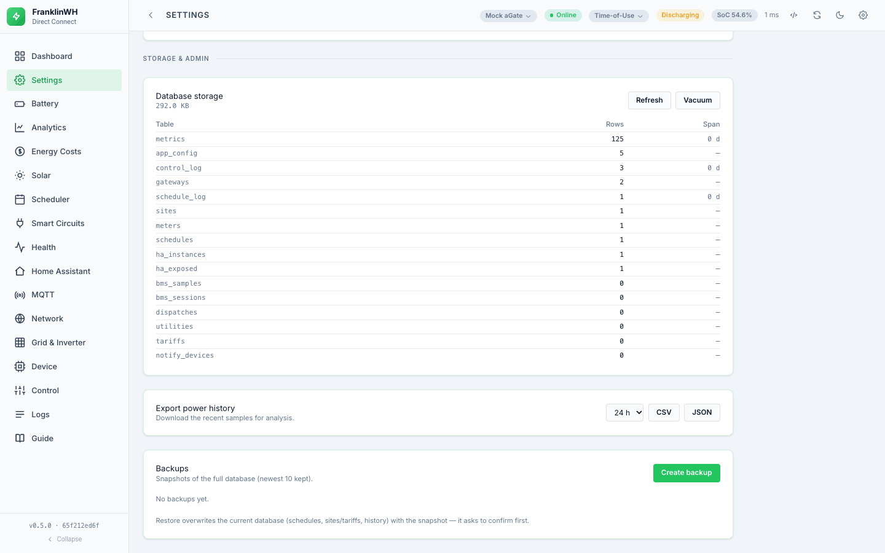
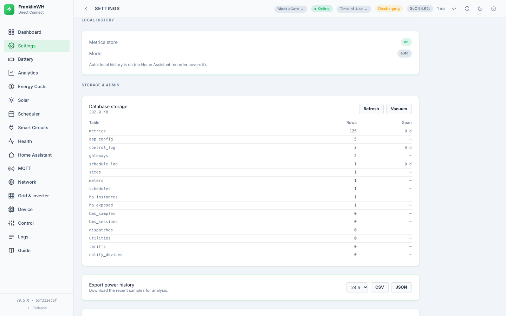
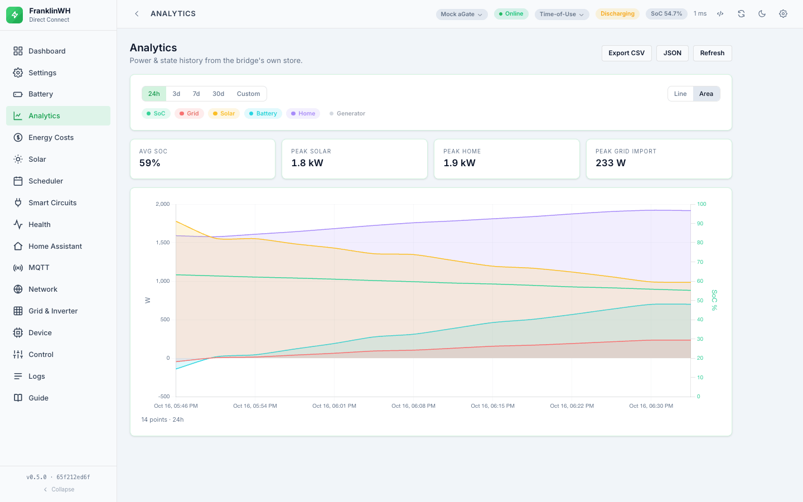
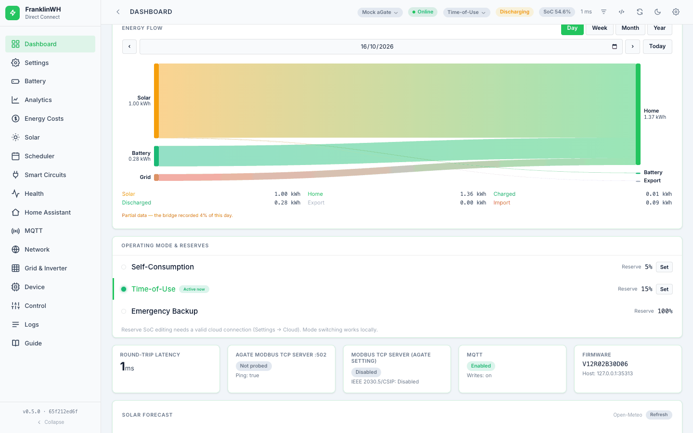
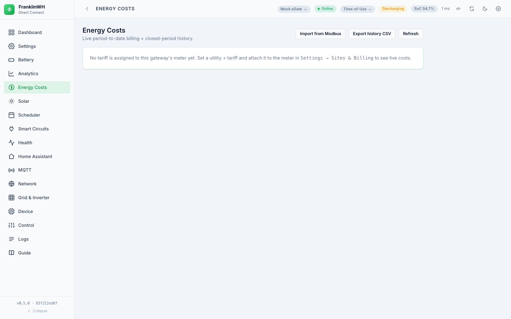
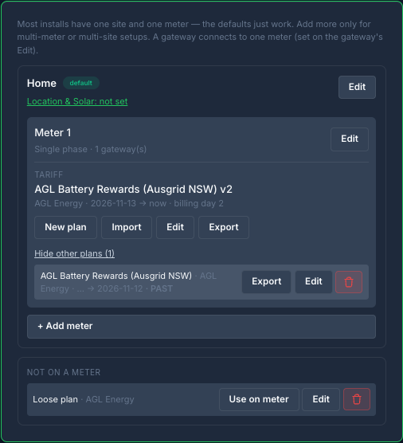
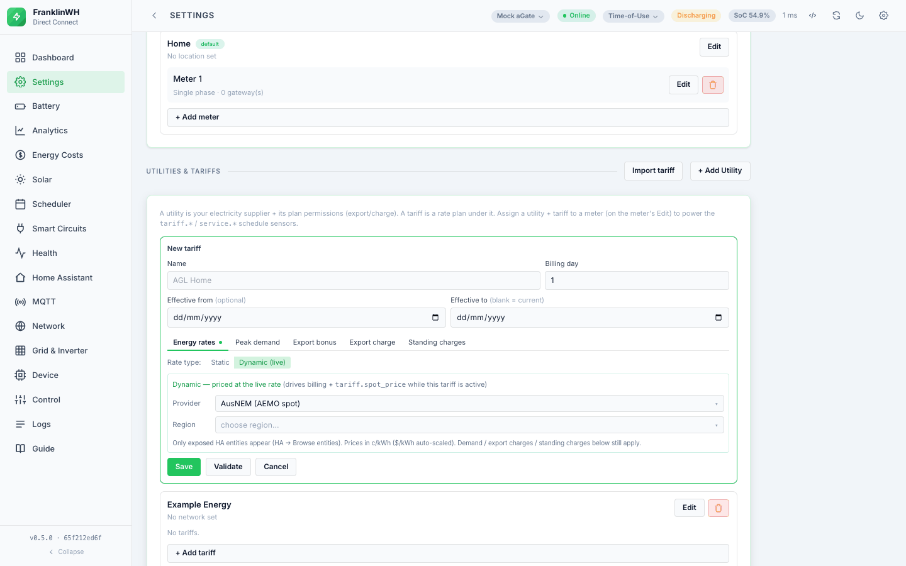
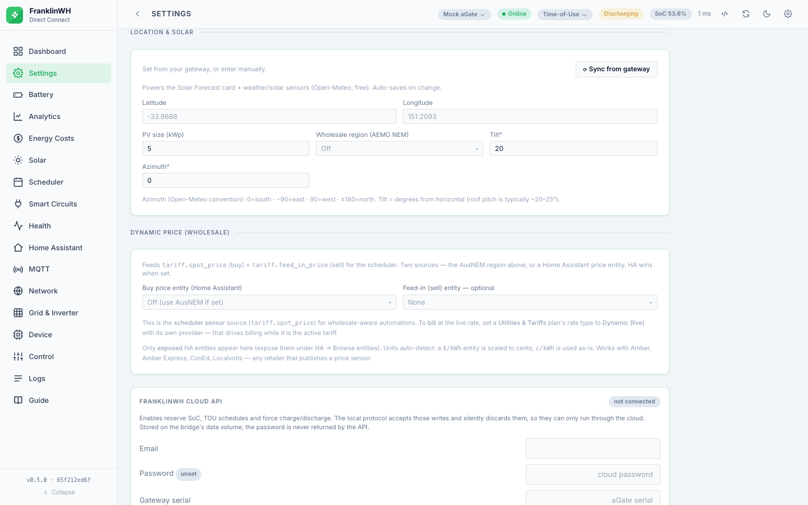

# History, costs and tariffs

[Back to the guide index](index.md)

The bridge keeps its own history in a local SQLite database, and prices it against a
tariff you describe. This page covers what is stored, what the numbers mean, and how much
to trust them.

---

## What is stored, and for how long

| Store | Retention |
|---|---|
| Power / metrics samples | **1 year** by default; Settings → Admin → Local history → **Keep for** (90 days, 1 year, 2 years or Forever) |
| Battery tab recordings | **90 days** and **200 MB** by default; Settings → Admin → Local history → **Battery recordings: keep … days, up to … MB**. Past either, the oldest finished recordings are deleted first; one still recording is kept |
| Application log | the newest **50,000** rows |
| Hourly link-health buckets | 90 days |

**Full resolution for the last 10 days, then 5-minute rows.** Every poll is kept as it was
read for 10 days (Home Assistant's recorder keeps 10 by default too). After that, each
gateway's samples become one row per 5 minutes: each value's average, with its min and max
and the sample count, the last mode and the last tariff-tier counters. Energy over those 5
minutes is unchanged, so the charts and Energy Costs read the same totals. Once an hour the
bridge deletes what is past **Keep for**, then makes the 5-minute rows, and logs both, for
example: `Local history: 2880 samples older than 10 days kept as 288 five-minute rows (full
resolution for the last 10 days)`.

**How much disk it takes is measured, not assumed.** The Local history card shows, per
gateway, what the last 10 days take a day and what older days take a day, from this
database. On a test install polling every 30 seconds that was about 8 MB a day for the
last 10 days (each poll keeps every number it read) and about 0.4 MB a day older, so two
years come to roughly 350 MB per gateway. Keeping a year or more locally is deliberate: it
removes the only reason the gateway's own history (about 105 days) looked like the longer
record.

Settings → Admin → **Database storage** shows the space on disk with the WAL and SHM files
counted, and each table's rows, size and time span.

### Choosing how long it is kept, or turning it off

Settings → Admin → **Local history** has the switch and **Keep for**: 90 days, 1 year
(the default), 2 years or **Forever**. The card shows the database size now and how fast
it grows (about 0.35–0.7 MB a day per gateway); with Forever it keeps growing. A change
applies at once and is kept across restarts.

Local history is **on by default everywhere**, the Home Assistant add-on included: the
Dashboard's power history, Analytics and Energy Costs read only this store. On the add-on
with MQTT on, Home Assistant's recorder also keeps the values the bridge publishes, so this
is a second copy of them; the card says so. Turning it off asks first, because those
charts stop getting new data; what is already stored is kept.

`METRICS_ENABLED` and `METRICS_RETENTION_DAYS` (environment variables, or the add-on's
options) still decide when they are set: the card then shows them as set for this install,
and they are changed there.

If the store is disabled, the features built on it degrade honestly rather than
pretending: the Logs tab falls back to an in-memory ring, and the endpoints that need the
store answer **503 "metrics store is disabled"**.

---

## Analytics

Longer-horizon charts over the stored samples — power, battery, energy — with a
selectable range. This is the bridge's own record, so it survives a gateway reboot and
goes back further than the aGate's.

Local and Cloud share one layout. The top row has the time span (Day (5-min), Day (hourly),
Week, Month, Year or Lifetime; one choice for both sources, remembered in this browser) and
**Chart ▾**, one choice for both: Line, Area, Bars, **Bars stacked** (each slot's sources
piled above zero and its uses below) or Flow; Analytics opens on the last one picked, then **Local | Cloud**, **Export ▾** and
**Refresh**. **Chart ▾ → Colours…** (or **Colours** at the end of the legend) sets a colour for each series: tap one for a palette (or type a hex colour), then **Done** (Local's Battery and Grid
take Battery discharged's and Grid exported's), for Local and Cloud alike and remembered in
this browser; **Dark background** and **Light background** are ready-made sets, and
**Reset to defaults** brings back the original colours (SoC in magenta, apart from the
battery's greens). **Detailed metrics** in the same dialog lists Cloud's Details ▾
fields (solar to home, grid to battery, …): each takes its source's colour (Solar's, Grid
imported's, …) until you pick one, and **Use its source's** goes back. Under it, one date picker serves Local, Cloud and Flow: **‹ ›** move by the
period (a day, a Monday-to-Sunday week, a month or a year on the site's calendar), the
period button (9 Nov 2026, Week of 2 Nov 2026, October 2026, 2026) opens a calendar of days,
months or years to pick from, and **Today** comes back to the current one. On Day (5-min) and Day (hourly),
**From** and **To** beside the date set the stretch shown, each from a time grid (an hour,
and on Day (5-min) a minute in 5-minute steps), then **Apply**: Local, Cloud and Flow show
just that stretch, in the view's own slots. A To at or before From is the next day's (22:00
to 02:00 runs past midnight, marked "+1 day"); **Whole day** goes back to the full day, and
**‹ ›** keep the times as they move the day. **‹** stops at the oldest stored sample;
the caption under the chart says where the history starts ("history from …").

**Custom** (last in the time span list) shows any range: **From** and **To** each open the
calendar with the time grid (5-minute steps); pick a day and a time, then **Apply**. To is
where the range stops and isn't included, so 00:00 the next day takes in the whole of a day;
To must be after From. The range is remembered in this browser, and Local, Cloud and Flow
all show it. The longer the range, the coarser the slots, the same on both sources: 5-minute
power up to 2 days, kWh per hour up to 31 days, per day up to a year, per month beyond. On
Cloud a long hourly range reads the cloud once per day the first time, then from the cache.

Local shows the same quantity as Cloud: Day (5-min) is power in **kW** (5-minute averages), and Day (hourly), Week, Month, Year and Lifetime are **kWh** per hour, day,
month or year with Cloud's series (home, solar, battery discharged and charged, grid
imported and exported; charge and export below zero) plus the average SoC. Local's kWh are
summed from the bridge's power samples, as Energy Flow does, so they are an estimate, not a
meter; the caption says what share of the period has samples, and a slot with none is
left empty. The strip under the chart shows the period's totals. A period older than the
stored history is shown empty. The chips
under the chart (SoC, Grid, Solar, Battery, Home, Generator for a day; Cloud's series for
the kWh periods) show or hide each series;
**Line | Area | Bars** at the top picks the style (SoC, on its own % axis, stays a line);
until one is picked, a day draws lines and the kWh periods bars, as Cloud does. Dates are in
your browser's own format. Local and Cloud charts are the same height, and Local's kW or kWh axis
is scaled as Cloud's (zero always shown, four even steps), so the same data looks the same in
both.

### Local or Cloud

The **Local | Cloud** switch in the top row picks the source, and the page says which one
it is showing. **Export ▾** (CSV or JSON) and **Refresh** beside it work on whichever source
is shown. For Cloud, the export is the shown period (`fwh-cloud-<period>-<date>.csv`) with
every series the cloud returned, including any hidden with its chip.

Cloud needs the FranklinWH cloud account: while it is missing or
refused, a **Cloud account** link at the top of the Cloud view opens Settings → Integrations →
**FranklinWH Cloud API**. **Local** is the bridge's own record, above. **Cloud** shows the
FranklinWH cloud's energy history for the gateway picked in the top bar:

| Period | Chart |
|---|---|
| Day (5-min) | home, solar, battery and grid power in kW, as lines, and SoC on a % axis |
| Day (hourly) | each hour's kWh, as bars, and the hour's average SoC |
| Week, Month | each day's kWh, as bars |
| Year | each month's kWh |
| Lifetime | each year's kWh |

The cloud's other fields with data for the period are listed under **Details ▾**, after the
chips; tick one to give it a chip (remembered):
home from solar, grid and battery; battery charged from solar and grid; export from solar and
battery; and on a day, each 5-minute flow (solar → home, grid → battery, …). They take their
source's colour, dashed or lighter. Fields with no data (V2L, solar sub-meters) get no chip,
but **Export ▾ → JSON** includes every array the cloud returned.

Pick the period from the time span in the top row, then step with **‹ ›**, choose a date, or press
**Today** to come back to the current period; Week starts on
its Monday, and Month and Year on the 1st. Battery discharge and grid import are drawn
above zero, battery charge and grid export below. A period with no data is left empty,
never drawn as 0. Values marked **≈** are added up from the cloud's 5-minute flows rather
than read as a total. **(inferred)** marks a value the cloud's field is only named for,
never checked. A generator that never ran is left out.

Under the chart, a chip per series shows or hides it, and the chart rescales to what is
shown. **Line | Area | Bars** at the top picks the style for any period (a day starts as lines, the
longer periods as bars). Hover, or tap on a phone, anywhere on the chart for every shown
value at that time. Dates are shown in your browser's own format (5 Nov in
Australia, Nov 5 in the US); times are 24-hour, on the site's clock. With Bars, the
**stacked** button (at the end of the chips) draws one column per bar instead of one per
value: where the energy came from (solar, battery, grid import) above zero, and where it
went (home, battery charge, grid export) below. Refresh **↻** is at
the end of the line that says what is shown.

Cloud needs your FranklinWH cloud account in **Settings**; without one, or for a mock
gateway, the panel says why it's empty. The bridge asks the cloud as little as it can: the
current period is kept for 5 minutes and a finished one for 6 hours (**↻** asks again).
The choice of Local or Cloud and the period are remembered in this browser.

## The energy-flow Sankey

On the Dashboard. It shows directional flows for a local day: solar to home, solar to
battery, solar to grid, battery to home, battery to grid, grid to home, grid to battery.

The card says where its numbers come from, and **Local | Cloud** switches between them:
**Cloud** is the FranklinWH cloud's own metered breakdown, with a cloud icon (it needs the
sign-in in Settings → Integrations → **FranklinWH Cloud API**, and is greyed out until
then); **Local** is this bridge's estimate (below), with a slashed cloud and how many days of
samples the bridge holds ("Local · 12 days of data"). The choice is the same one as
Analytics' Local | Cloud, so changing either changes both; until one is picked it's Cloud
when signed in. If the cloud can't answer, the card says why and shows Local. **‹ ›** move
by the period, the date button opens the same calendar as Analytics (days, or months for
Month, or years for Year) and shows the period ("Week of 2 Nov 2026", "November 2026"), and
**Today** comes back. **In Analytics** opens the same period in Analytics → Flow. The line under the heading says which one is shown ("Cloud · metered by the FranklinWH
cloud" or "Local · 402 days of data").

Hover over a flow, or tap it on a touch screen, to see what it carried, e.g.
"Solar → Battery 321.7 kWh"; the other flows dim while it shows. Tapping outside the flows
puts the label away.

**Be clear about what this is.** The gateway reports *node* totals — how much solar, how
much import — and never the arcs between them. The bridge reconstructs the arcs from its
own power samples by a merit-order split. It is a well-founded estimate, not a meter
reading. The response carries a `quality.coverage` figure saying how much of the span
actually had samples, and the UI surfaces it; a low coverage means a gap in polling, and
the numbers should be read accordingly.

### In Analytics: Flow

**Flow** in Analytics' **Chart ▾** menu draws the same diagram
for the time span and day picked there (a day, a week, a month, a year or lifetime), from
either source:

- **Local**: the estimate above, from this bridge's samples, with its coverage.
- **Cloud**: the FranklinWH cloud's own breakdown of where the energy went (home from solar,
  battery charged from solar, export from the battery, …), metered rather than estimated;
  for a day, its 5-minute flows added up.

The totals under the diagram are the period's, and **Export ▾** downloads them (each arc
and node in kWh) as CSV or JSON.

---

## Energy Costs

The **Energy Costs** tab shows live period-to-date billing and closed-period history:
net cost this period, peak kW, retailer and plan, and a table of closed periods. You can
export the history as CSV, import history, or **import from a Modbus Bridge** if you have
one with a longer record.

The cost is computed by integrating your grid import and export against the rate in force
at the time, plus demand charges, export charges, battery-export bonuses and standing
charges where your tariff defines them. It is an estimate for your own use — not a
revenue-grade meter, and not a substitute for your bill.

---

## Tariffs

Set up under **Settings → Sites & Billing → Utilities & Tariffs**. A tariff belongs to a
utility and is assigned to a meter; the meter is what a gateway connects to. (See
[Multi-gateway and sites](multi-gateway.md) for why the tariff hangs off the meter rather
than the gateway.)

### Static or dynamic

The editor's **Rate type** toggle offers two, and only two, options:

- **Static** — your plan as written. A default buy and sell rate, which may itself be a
  **tier ladder** rather than a single number, plus optional **seasons** and **time
  periods**. Time periods are defined as periods rather than as prices, so import and
  export boundaries can differ, and a tiered price *inside* a time-of-use band needs no
  extra concept — a time period with a tiered price *is* the hybrid plan. A plain flat or
  tiered tariff is complete with no seasons and no periods at all.
- **Dynamic (live)** — priced at the live wholesale rate while this tariff is active. Two
  providers:
  - **AusNEM (AEMO spot)** — set your NEM region (`NEM_REGION`: NSW1, QLD1, SA1, TAS1,
    VIC1).
  - **Home Assistant price entity** — point at an HA entity for the buy price and
    optionally another for the feed-in price. Values in dollars are auto-detected and
    scaled to c/kWh.

  When both are configured, **the HA price entity wins over NEM.**

A dynamic tariff drives two things at once: the billing figures on the Energy Costs tab,
and the `tariff.spot_price` / `tariff.feed_in_price` sensors available to the
[Scheduler](scheduler/conditions.md) — so a rule can charge when the price is negative without you
wiring the price in twice. `GET /api/tariff/spot` shows both providers side by side.

Tariffs can be **exported, imported and validated** one at a time, so a plan can be moved
between installs or shared.

---

## Solar forecast

Optional, and off until the bridge has a location. The forecast comes from Open-Meteo.

Under **Settings → Integrations → Location & Solar**, press **Sync from gateway**. The
bridge reads the location your installer configured on the aGate, over the local API
(`cmdType 1201`), and saves it as the latitude and longitude. No cloud account is needed,
and nothing needs typing. If the aGate has no location configured, the sync says so and
leaves the fields as they were. Only then type the coordinates in yourself.

Then set the array: size in kWp, tilt, and azimuth.

**Azimuth uses Open-Meteo's convention**, which is not the one most people assume:
`0` is south, `-90` is east, `90` is west.

With a location set you get the **Solar Forecast card on the Dashboard** (not on the
Solar tab): hourly forecast bars for today and tomorrow, the current weather, actual PV
generated today against the forecast, and an ahead/behind figure versus the forecast to
now. Hours are shown in the PV location's local time, aligned to now by the forecast's own
offset, so it reads correctly from any timezone. The server caches the forecast for about
15 minutes.

The same data becomes scheduler sensors: today's forecast kWh, today's peak kW, remaining
kWh today, tomorrow's kWh, and two solar-*tracker* sensors comparing actual generation
against the forecast (percentage of today's forecast reached, and percentage versus
forecast-to-now, where above 100 means ahead of schedule).

---

## Storage and backups

**Settings → Admin.**

- **Storage** — how much the database is using.
- **Vacuum** — reclaim space after a retention prune.
- **Back up** — write a backup, list them, download one, delete one.
- **Restore** — replace the live database from a backup. It needs an explicit
  confirmation, because it is destructive. (`allow_writes` no longer blocks it; see
  [Control](control.md#1-allow_writes-no-longer-blocks-writes).)
- **Export metrics** — a windowed export of raw samples.

One caution from this project's own history: in a container deployment the data directory
is a mount, and the database in it is the real one. Treat a restore as the destructive
operation it is.
