# Home Assistant setup and notifications

[Back to the guide index](index.md) · [Home Assistant and MQTT](home-assistant.md)

This page covers the bridge's link **into** Home Assistant: how to connect it, how to
add your phone as a notification device, what the bridge notifies you about, and the
notifications with buttons that let you answer from your phone. Publishing the aGate's
entities **to** Home Assistant over MQTT is a separate thing, covered in
[Home Assistant and MQTT](home-assistant.md).

---

## Before you start: what you need

Home Assistant calls notifications with buttons
**[actionable notifications](https://companion.home-assistant.io/docs/notifications/actionable-notifications/)**.
They are a feature of the **Home Assistant Companion app**. Only a phone or tablet with
the Companion app, whose service is `notify.mobile_app_<device>` (for example
`notify.mobile_app_my_phone`), shows the buttons. Every other `notify.*` service, such as
an email or a TV, gets the same title and message as plain text, without buttons.

To get notifications on your phone, with or without buttons, you need two things:

1. **A Home Assistant instance in the bridge's list**: its URL and a token. See
   [step 1](#1-link-the-bridge-to-home-assistant).
2. **The Companion app on your phone**, signed in to that Home Assistant, with
   notifications allowed. See [Your phone, notifications and access from
   away](phone-and-remote-access.md#1-alerts-on-your-phone-the-home-assistant-companion-app).

You do **not** need to run the bridge as a Home Assistant add-on. The add-on only saves
you step 1: it adds **Home Assistant (this add-on)** to the list by itself. In Docker or
a pip install you add your Home Assistant yourself, with a long-lived access token. After
that, notifications and buttons work the same way.

### Does Home Assistant need to reach the bridge?

No. Every connection goes **from the bridge to Home Assistant**:

- A notification is a call from the bridge to Home Assistant's REST API.
- A tap on a button comes back over Home Assistant's **WebSocket API**. The bridge opens
  the WebSocket itself, signs in with the instance's token, and listens for the Companion
  app's button taps.

Home Assistant never calls the bridge. You don't need a webhook, YAML in Home Assistant,
an open port, or a URL for the bridge that Home Assistant can reach. The bridge must
reach Home Assistant at the instance's URL; your phone reaches Home Assistant the usual
way, at home or from away.

So buttons add no setup over plain notifications. An instance you add, edit or remove
takes effect at once, for sending and for taps; no restart is needed.

| Install | Steps |
|---|---|
| Home Assistant add-on | Install the Companion app on your phone. In the bridge: **Settings → Integrations → Companion Devices → + Add device**, pick your phone, **Save**, then **Test with buttons**. |
| Docker or pip | Create a long-lived access token in Home Assistant. In the bridge: **Settings → Integrations → HA Instances → + Add instance** (name, URL, token), tick **Default instance**, **Save**. Then add your phone as for the add-on. |

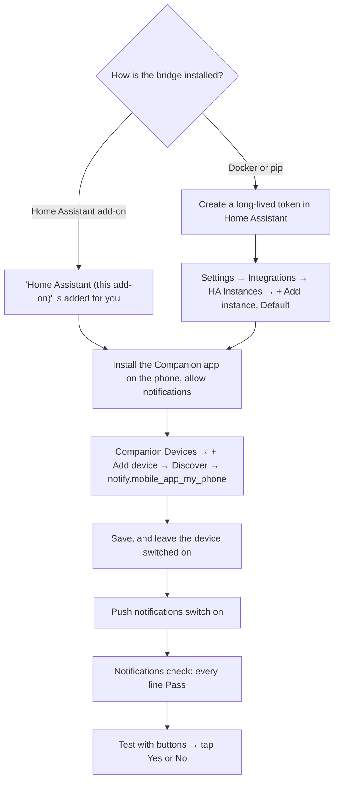

---

## 1. Link the bridge to Home Assistant

The bridge keeps a list of **Home Assistant instances**. Each one is a base URL and a
token. The bridge uses an instance to read entity states for the Scheduler, to find
notification services, to send notifications, to receive button taps, and to call
services from schedules. The **default** instance also receives Home Assistant's own
persistent notifications, including critical alerts.

### As a Home Assistant add-on: automatic

When the add-on starts with an empty instance list, it adds one for you:

- named **Home Assistant (this add-on)**;
- at `http://supervisor/core`, the Supervisor's proxy to Home Assistant;
- with the token the Supervisor gives the add-on;
- marked as the default.

You do not need a long-lived token. After an add-on update the Supervisor issues a new
token, and the bridge copies it into that instance on start-up. It never changes
instances you added yourself. Settings shows it as **auto-detected**, at "This Home
Assistant (Supervisor)".

You can still add other Home Assistant instances, to reach phones that are signed in to
another Home Assistant.

### Docker or standalone: URL and token

1. In Home Assistant, open your profile, then **Security → Long-lived access tokens →
   Create token**. Copy it.
2. In the bridge, open **Settings → Integrations → HA Instances → + Add instance** (the
   **Home Assistant** tab → **Instances** has the same list).
3. Fill in **Name**, **Base URL** (for example `http://192.0.2.20:8123`) and
   **Long-lived token**. Tick **Default instance** if this is your main Home Assistant,
   and leave it enabled.
4. Press **Test**. It reports "token rejected" when Home Assistant refuses the token.
5. Press **Save**. The bridge starts listening for button taps on it straight away.

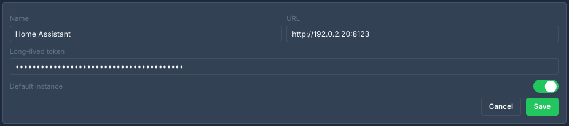

**Disable** on an instance keeps it, and its devices, but sends nothing through it and
stops listening on it.

The token is **write-only**. The bridge never sends it back to the browser: the list
shows **Token set** or **No token — reads will fail**, and an edit form shows the token
field as unchanged. It is stored in the bridge's database in plain text.

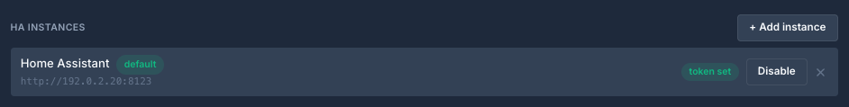

---

## 2. Check the connection

### The four setup checks

The **setup wizard**, at its **Home Assistant** step, checks the four things that decide
whether the bridge works with Home Assistant. They fail independently, and each has a
different fix. Each check is **pass**, **fail**, or **could not be determined**; the last
is not shown as a failure. **Check again** runs them again.

| Check | What it tests | Fix when it fails |
|---|---|---|
| MQTT broker connected | Publishing is on, and at least one gateway that publishes is connected to the broker. With no publishing gateway yet: "No gateway publishing yet", undetermined. | Turn publishing on from the **MQTT** tab, or install the Mosquitto broker add-on. |
| Home Assistant connected to the bridge | The first enabled instance answers with its token. Shows "This Home Assistant" for the add-on's own instance. | Add one under **Home Assistant → Instances**. |
| Home Assistant's MQTT integration set up | Home Assistant has the MQTT integration loaded. | In Home Assistant: **Settings → Devices & services → Add integration → MQTT**. |
| Bridge entities in Home Assistant | How many of this bridge's entities Home Assistant has, plus any left over from removed gateways. | Remove leftover devices in Home Assistant. |

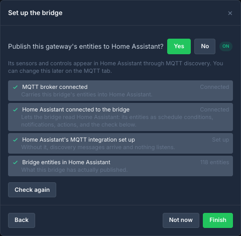

### The Notifications check

For notifications, use the **Notifications check** under **Settings → Integrations →
Notifications**. It answers "would a critical alert reach me?" See
[Troubleshooting notifications](#troubleshooting-notifications).

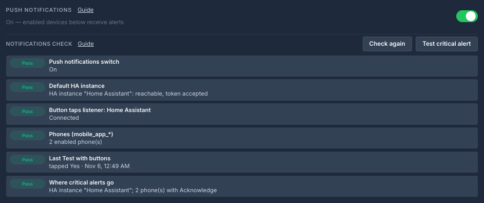

---

## 3. Add a notification device

A **notification device** is a name for one of Home Assistant's `notify` services on
one instance. A phone with the
[Home Assistant Companion app](https://companion.home-assistant.io/) has a service
called `notify.mobile_app_<device>`. That is the usual choice, and the only one that
shows buttons. Step by step, and how to reach it away from home: [Your phone,
notifications and access from away](phone-and-remote-access.md).

1. Open **Settings → Integrations**, and scroll to **Notifications → Companion Devices**.
2. Press **+ Add device**. It is disabled until you have an instance ("Add an HA
   instance first").
3. Fill in an **Alias**, such as "Phone".
4. Pick the **HA instance**.
5. Press **Discover** next to **Notify service**. The bridge lists every `notify.*`
   service on that Home Assistant, with its friendly name and when Home Assistant last
   saw it. A `_2` service that duplicates another is marked "duplicate of …"; pick the
   one without the suffix unless you know you need it. Use **filter services…** to find
   yours.
6. Press **Send test** to check that the phone receives it.
7. Press **Save**.

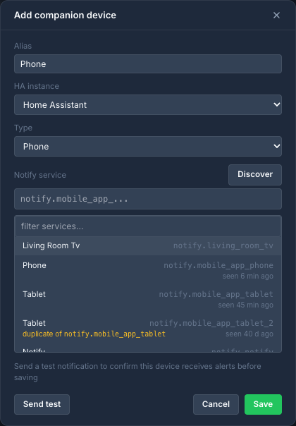

Each saved device has an on/off switch, an icon for its kind (phone, tablet, TV, speaker
or other, guessed from the service name), **Edit**, **Test**, and remove. A device on an
instance that is switched off is marked **instance disabled**, and receives nothing.

- **Test** sends one plain message straight to that service. It goes out even while the
  **Push notifications** switch is off.
- **Test with buttons** appears only on a `mobile_app_*` device. It sends "FranklinWH
  test" with **Yes** and **No**, then waits up to 2 minutes for your tap. The row then
  shows "Round trip works: you tapped Yes", or "No reply within 120 s". It goes the same
  way as every other notification, so it needs the **Push notifications** switch on. A
  pass proves the whole round trip: the bridge reaches Home Assistant, the phone shows
  the buttons, and the tap comes back. The last result is kept, and shown in the
  Notifications check.

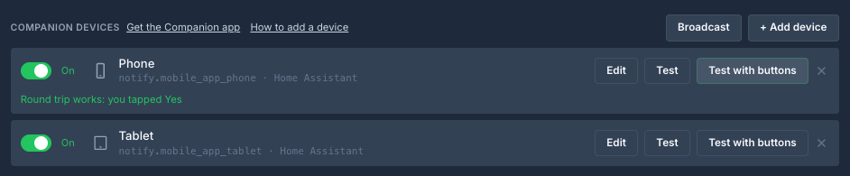

**Broadcast** sends one message to every enabled device.

---

## 4. What the bridge notifies you about

There are **two channels**: pushes to your notification devices, and Home Assistant's
own persistent notifications. One switch, **Push notifications** at the top of
**Settings → Integrations → Notifications**, covers both.

### The Push notifications switch

**Off — no notifications are sent** means:

- nothing goes to your notification devices: the triggers, schedules, broadcasts, the
  scheduled-dispatch report, and every notification with buttons;
- no Home Assistant persistent notifications;
- critical alerts reach only the bridge's own window. Settings then shows **Critical
  alerts reach only the bridge UI**.

The per-device **Test** button is the one exception: it sends directly, to check a
device before or after saving it.

### Send to

Every notification that goes to your devices has a **Send to** choice:

- **All devices**, the default: every enabled device on an enabled instance.
- **Chosen devices**: tick one or more. A chosen device that is switched off, or on a
  switched-off instance, gets nothing.

You set it on each Auto-notify trigger, on **Critical alerts** and **Release / Keep a
running force** (the two rows under the triggers), and on a schedule's **Ask before
continuing** step. Devices that show buttons are marked **buttons**. Targeting by user
or role is not available yet.

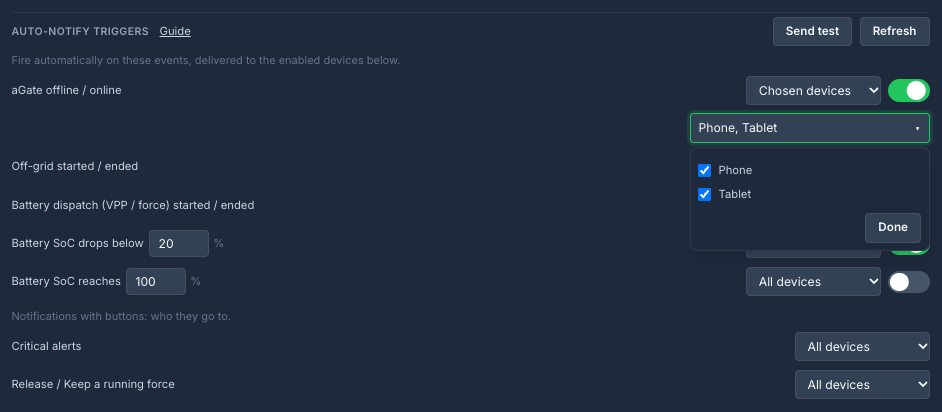

### Push to your notification devices

Set these under **Settings → Integrations → Notifications → Auto-notify triggers**. Each
has a switch and a **Send to**; the two SoC triggers also have a threshold.

| Trigger | Default | Sent when | Message |
|---|---|---|---|
| aGate offline / online | on | The gateway stops or starts answering polls. | "aGate is UNREACHABLE [gateway] — check network / WiFi / power." / "aGate is reachable again [gateway]." |
| Off-grid started / ended | on | The off-grid flag changes. The message says why, in the top bar's words: **user requested** (someone asked for off-grid) or **grid outage** (no request was made); **reason unknown** when that wasn't read. | "Gateway went OFF-GRID [gateway] (user requested) — running on battery." / "Gateway is back ON-GRID [gateway]." |
| Battery dispatch (VPP / force) started / ended | on | A dispatch is found active at start-up, or one starts that **this bridge did not start**. | "FranklinWH — VPP dispatch active at startup" / "FranklinWH — battery dispatch started (VPP)" |
| Battery SoC drops below | off, 20 % | SoC crosses the threshold downward. | "Battery SoC dropped below 20% [gateway] (now N%)." |
| Battery SoC reaches | off, 100 % | SoC crosses the threshold upward. | "Battery SoC reached 100% [gateway] (now N%)." |
| Bridge started / restarted / stopped | on | The bridge starts or stops. A start after a clean stop is a **restart**: it says how long the bridge was down and, after an update, the version it came from. A start with no clean stop before it (first run, or a crash or power cut) is **started**. | "Bridge started (v0.5.36)." / "Bridge restarted (v0.5.36, updated from 0.5.35) after 1 min 35 s down." / "Bridge stopping (v0.5.36) — no polling or notifications until it starts again." |

A trigger fires on a **change** between one poll and the next, not on every poll. There
is no other rate limit.

#### Scheduler

Under the same triggers, the **Scheduler** group tells you about runs that didn't go as
planned (#581). Each has its own switch and **Send to**, and every message names the
gateway. Each also writes a warning to the bridge log (Logs) in the same words, whether or
not the push is on, and the schedule's activity has its own row.

| Trigger | Default | Sent when | Message |
|---|---|---|---|
| Run failed | on | A scheduled action fails. It is the `SCHEDULE_FAILED` critical alert's push, with **Acknowledge**: this switch and Send to steer that push; the alert window and the Home Assistant notification stay. | "Schedule 'Evening peak' failed on House (attempt 1): …" |
| Run missed | on | A schedule's window closes with no successful run. Also a `SCHEDULE_MISSED` warning in the alert list. | "Schedule 'Evening peak' missed its window [House]: 3 attempt(s), none succeeded." |
| Run aborted (stopped, deferred or ended early) | off | **Stop** on a schedule with a running dispatch; a run deferred to a higher-priority rule or a busy battery; a window ended early by its exit condition. | "Schedule 'Evening peak' did not finish [House]: stopped by hand." |
| No reply to an actionable notification | on | An [actionable notification](#actionable-notifications) got no reply in time, couldn't be delivered, or was lost in a restart. It goes to the devices the question went to (its Send to), else to this trigger's Send to. | "Schedule 'Evening peak' got no reply [House]: no reply in 10 min: skipped this run (if no reply: skip)." |

**Send test** at the top of the triggers sends a test to all enabled devices or to the
ones you choose. It says how many devices it reached, and when none, why: "No devices
are on", "No device chosen" or "Push notifications are off".

Also sent to every enabled device: after a restart that interrupted a **scheduled
dispatch**, when the restart policy is **notify** (the default is **release**), a message
titled "FranklinWH — scheduled dispatch …". See
[Control → After a bridge restart mid-dispatch](control.md#after-a-bridge-restart-mid-dispatch).

**Recent notifications**, on the same page, lists each delivery; deliveries are kept for
30 days.

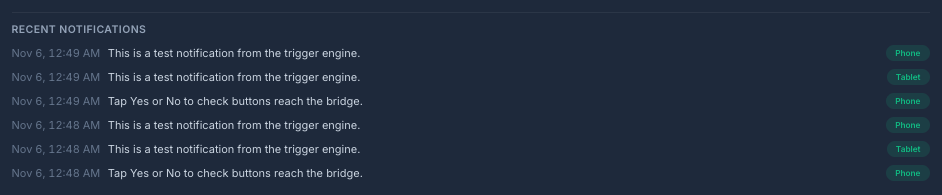

### Home Assistant persistent notifications

These appear in Home Assistant's own notification panel, not on your phone. They go to
the **default** enabled instance (else the first enabled one); on the add-on that is
"Home Assistant (this add-on)". Only when no instance is set up do they fall back to the
add-on's Supervisor or, outside the add-on, to the `HA_URL` and `HA_TOKEN` settings.

| Event | Title | Message |
|---|---|---|
| The aGate stops or starts answering | FranklinWH aGate | "aGate is UNREACHABLE (check network / WiFi / power)." / "aGate is reachable again." |
| The Modbus TCP Server (aGate :502) stops or starts answering this bridge's probe | FranklinWH Modbus | "Modbus :502 is DOWN." / "Modbus :502 is back up." |
| Cloud credentials become invalid or locked | FranklinWH cloud credentials rejected | — |
| The firmware version changes | FranklinWH firmware updated | old → new |
| The aGate is found again at a new address | FranklinWH aGate moved | "<gateway name> re-discovered on the LAN at <address>." Only an aGate with this gateway's own serial is adopted, never one another gateway uses. |

There is no per-event switch for these.

### Alerts

Alerts are the bridge's record of faults. They follow one spec shared with the Modbus
Bridge, so an automation that reads one bridge's codes works on the other. Each alert is
stored in the bridge's database and survives a restart. Every alert is also a line in
**Logs** (WARNING when raised, INFO when it clears or is acknowledged), whether or not it
reached anyone.

There are two kinds:

- an **event**, such as a command that was refused, stays open until it is acknowledged;
- a **condition**, such as the aGate being unreachable, is active while the fault lasts and
  is marked resolved when it clears. Acknowledging a condition stops the alert window,
  not the red bar.

What raises one today:

| Code | Kind | Severity | Raised when | Clears when |
|---|---|---|---|---|
| `GATEWAY_UNREACHABLE` | condition | critical | Polls of the aGate have failed for 5 minutes | Polls have succeeded for 2 minutes |
| `LIVE_DATA_MISSING` | condition | critical | No live power reading for 2 minutes | Readings for 1 minute |
| `MQTT_DOWN` | condition | warning | The MQTT broker has been disconnected for 5 minutes, on a gateway that publishes | Connected for 2 minutes |
| `HA_UNREACHABLE` | condition | warning | Home Assistant has failed to take an alert notification for 5 minutes | One goes through and 2 minutes pass |
| `WORKER_STALLED` | condition | critical | A background worker stops responding or crashes (Health → Workers) | Every worker for that gateway is beating again |
| `COMMAND_REFUSED` | event | critical | The Audit Trail records a control as failed or refused. Cloud sign-ins are not counted. | Acknowledged |
| `SCHEDULE_FAILED` | event | critical | A scheduled action fails | Acknowledged |
| `SCHEDULE_MISSED` | event | warning | A schedule's window closes without a successful run (#581) | Acknowledged |

The same event again within 10 minutes is added to the open alert (its count goes up)
rather than raising a new one. The other codes in the shared list (`COMMAND_UNCONFIRMED`,
`WRITE_IGNORED`, `RESTART_DURING_COMMAND`, `EXTERNAL_SETPOINT`, `DATA_MISSING_PARTIAL`,
`INTERNAL_ERROR`) are defined, but nothing in this bridge raises them yet.

**In the bridge.** A critical alert opens a window that stays until it is acknowledged.
It shows what happened, when (in the site's time), what it means and what to do. Tick
**I understand** for each alert, then **OK**. Escape and clicking outside do not close it.
An alert raised while no browser was open, by a schedule for example, is shown on the next
visit, and a condition that came and went shows as "09:54–13:27, resolved". While an
acknowledged condition is still active, a red bar stays under the top bar. A badge in the
top bar counts open alerts and opens the list, where warnings are acknowledged. The
acknowledgement applies for everyone.

**In Home Assistant.** Each critical alert creates a persistent notification with the id
`fwh_dc_alert_<id>`, whether or not a notification device is set up. It needs a Home
Assistant instance (step 1) and the **Push notifications** switch on. If Home Assistant
does not answer, the bridge keeps retrying, waiting longer each time up to 10 minutes.
Acknowledging the alert in the bridge dismisses the notification. **Dismissing it in Home
Assistant does not acknowledge the alert**: the bridge stays the record.

**On your devices.** The alert is also sent, with **Acknowledge**, to the devices chosen
under **Critical alerts → Send to**. On `GATEWAY_UNREACHABLE` there is also
**Re-discover**, which asks that gateway to search the LAN for the aGate again. It is
sent once, even when the Home Assistant notification fails or has nowhere to go; retries
of that notification do not send it again. The buttons work for an hour. When none of the
chosen devices can show buttons, the alert reaches Home Assistant only. It is an ordinary
push notification, not a critical one: it does not get past silent mode or Do Not
Disturb. Warnings are not
sent to devices.

With the switch **off**, no Home Assistant notification is made, and each one skipped is
recorded as "skipped: HA channel off". The bridge's alert window still opens; it never
depends on the switch.

Each gateway's device in Home Assistant also gets **Bridge problem**, a diagnostic
`problem` binary sensor that is on while any alert for that gateway, or for the bridge
itself, is open. Its attributes list the open alerts. It stays readable while the aGate
is offline.

A separate device, **FranklinWH Direct Connect Bridge**, has one **Bridge heartbeat**
timestamp, sent every minute while MQTT publishing is on and connected. If the bridge
itself stops, the heartbeat stops moving, which an automation can watch for (for
example, "heartbeat older than 5 minutes → notify").

Closed alerts are kept 90 days; open ones are never removed.

### Release or Keep a running force

When the bridge finds a battery force running that it did not start, it asks whether to
release it:

- a VPP or force dispatch **active at start-up**, while the **Battery dispatch** trigger
  is on;
- a **scheduled dispatch** interrupted by a restart and left running, with the restart
  policy set to **notify**.

**Release** releases the force on that aGate, as the top-bar Release does. **Keep** leaves
it running. The buttons work for 15 minutes. The question goes to the devices chosen
under **Release / Keep a running force → Send to**. When none of them can show buttons,
the bridge sends the plain message instead.

**Release** acts only on what was asked about. If this bridge has started a force on that
aGate since the question was sent (a schedule, say), the tap leaves it running and the
answer is "not released: a different force is running". A VPP found at start-up is checked
on the local channel, as it was found: if it has ended, the answer is "already released";
if it is still running but is not a Modbus force (the aGate's WSet is off), the bridge
writes nothing and answers "not released: the VPP is not a Modbus force this bridge can
release". The answer is in **Recent notifications** and the bridge log.

---

## 5. Notifications from a schedule

A schedule can send to a notification device, either as its main action or as one of its
**Home Assistant actions**. Home Assistant actions run on entry, on exit, or both, and
each can have its own condition (**guard**). See
[Scheduler → Home Assistant actions](scheduler/actions.md#home-assistant-actions).

In the schedule editor: **Home Assistant actions (optional) → + notify**, then pick the
device, and set a title and a message. `%sensor.id%` in the text is replaced with the
live value, or `?` when there is none. Write `%%` for a literal `%`.

You don't need to remember the codes. The **{x}** button beside every such field (the
notify title and message (an **Actionable notification**'s question too), and a raw service's
entity and data) opens a searchable list of the same sensors as the condition picker,
with each one's value now. Tap a row to put its code where the cursor was. Some useful
ones: `%battery.soc_pct%`, `%grid.power_w%`, `%schedule.name%`, `%run.phase%` (`fire` or
`exit`) and `%run.at%`.

### Worked example: tell me about the evening peak

The built-in template **Peak window — notify start & end** sends a message at 16:00 and
another at 21:00: "fire: SoC 74.2%, grid -350W", then "exit: …". It has no battery
action, so it never competes with another schedule for the gateway. To be told only
when the battery is low at the start of the peak, add a guard to the notify action:
**Battery SoC < 50**.

A notify step that cannot be sent is skipped, and the schedule's log says why: "device
no longer exists", "'Phone' is switched off", or "has no HA instance".

### Actionable notifications

A schedule can ask you on your phone before its action runs. In the schedule editor, add
a notification under **Home Assistant actions** (**+ notify**) and tick **Actionable
notification**. It goes **On entry**, and the action waits for your answer. A schedule
has one; its other notifications stay plain messages.

| Field | What it does |
|---|---|
| **Message** | The question, with **{x}** values filled in when it is sent, for example `SoC is %battery.soc_pct%%. Charge now?`. The title is the schedule's name and the gateway. " (reply within N min)" is added at the end. |
| **Buttons** | **Yes** (runs the action) and **No** (skips this run), unless you press **Use my own buttons**. Then give 2 to 4 buttons, each with its own label, and set each to **Runs the action** or **Skips this run**. |
| **Text reply** | At most one of your buttons can take a text reply: the phone asks for text when it is tapped. What you type becomes the answer. |
| **Wait for a reply (minutes)** | 5 in a new schedule. It must fit the schedule's window: a reply after the window closes could not run the action. A schedule with no duration has a 1-minute window; **Always** has no window and takes any wait. |
| **If no reply** | **Skip this run** (the default) or **Continue**. |
| **Send to** | **All enabled phones**, or **Chosen phones**. Only Companion apps (`mobile_app`) show the buttons, so only they are asked and listed; a switched-off one shows "(off)", and one removed since it was chosen shows "(removed)" so you can untick it. A removed device never stops the schedule from saving; it is just not asked. |

Under Send to, **Asks:** names the phones the question goes to, and the schedule's other
notifications are named below it. The
schedule list and **Explain** name the asked devices too, and the schedule's log says
`asked "…" on Phone, Tablet`. Home Assistant doesn't say which phone a tap came from, so
the log records the answer, not who gave it.

With the schedule's notify actions (section 5), there are no double messages:

- the **On entry** messages go once the answer runs the action, once per run, even when
  a failed action is retried;
- a run the answer (or **If no reply: Skip**) skipped sends neither its On entry nor its
  On exit messages; the log says `On exit actions not sent: Ask skipped this run`.

Schedules saved with the old **Ask before continuing** step, or with **Notify (Home
Assistant)** as their battery action, are moved over when the bridge starts: the Ask
becomes the Actionable notification and the Notify action an **On entry** notification.
An import or an API call in the old shape is moved over the same way.

Here it is filled in by the **Off-grid (user requested) for 30 min — ask** template, sent to the Phone only:

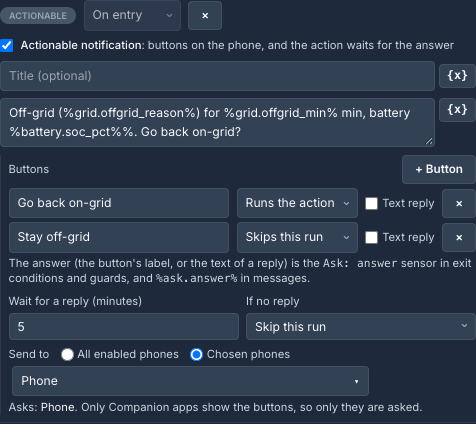

The question is sent once per run, when the schedule's window opens. While it waits, the
schedule shows **holding**, and other schedules carry on. Then:

- a tap on a button that **runs the action**: the action runs, and the log says
  `answered Yes`;
- a tap on a button that **skips this run**: the run is recorded as skipped;
- no tap in time: **If no reply** decides.

A tap made while the bridge is restarting, or while its connection to Home Assistant is
dropped, never reaches it (see [How buttons work](#6-how-buttons-work)), and counts as no
reply. With **Continue**, a **No** tapped then lets the action run. For a question
before an action that changes the battery or the operating mode, choose **If no reply:
Skip this run**.

**If no reply** also decides, at once, when nobody could be asked: no device in **Send
to** shows buttons, the send failed, or the **Push notifications** switch is off. The
schedule's log says which.

**The answer.** The label of the button tapped, or the text typed for a text reply, is
the **Ask: answer** sensor (`%ask.answer%`) for the rest of that run. Use it in exit
conditions and Home Assistant action guards, and in notify messages. See
[Scheduler → Conditions](scheduler/conditions.md).

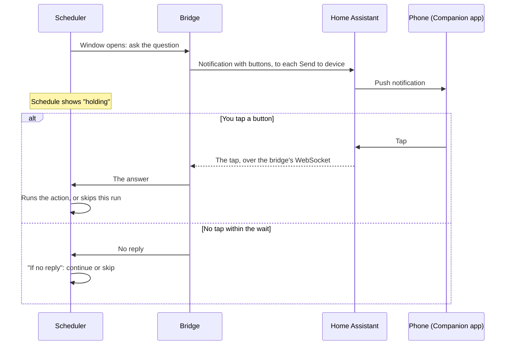

### Ask templates

**Templates** on the Scheduler tab has eight that ask before acting. Each watches its
conditions all the time and asks once when they become true, waits 5 minutes, and skips
when there is no reply. Change the thresholds, buttons and Send to as you like.

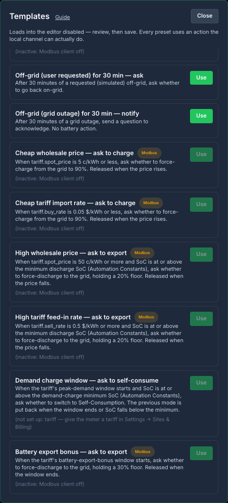

| Template | Asks when | Buttons | Action |
|---|---|---|---|
| Off-grid (user requested) for 30 min — ask | You put the system off-grid 30 minutes ago | Go back on-grid / Stay off-grid | Back on-grid |
| Off-grid (grid outage) for 30 min — notify | The grid has been out for 30 minutes | Acknowledge / Dismiss | None |
| Cheap wholesale price — ask to charge | Wholesale price ≤ 5 c/kWh | Charge / Not now | Charge from the grid to 90 % |
| Cheap tariff import rate — ask to charge | Import rate ≤ $0.05/kWh | Charge / Not now | Charge from the grid to 90 % |
| Price spike — ask to export | A price spike (Sites & Billing → Prices), battery at or above the min discharge SoC | Export / Hold | Discharge, down to 20 % |
| High tariff feed-in rate — ask to export | Feed-in rate ≥ $0.50/kWh, battery at or above the min discharge SoC | Export / Hold | Discharge, down to 20 % |
| Demand charge window — ask to self-consume | The demand window opens, battery at or above the demand-charge min SoC | Self-consume / Leave it | Self-Consumption for the window, then the previous mode back |
| Battery export bonus — ask to export | The bonus window opens | Export / Hold | Discharge, down to 30 % |

The off-grid templates use two sensors: **Off-grid reason** (`%grid.offgrid_reason%`:
"user requested", "grid outage" or "unknown") and **Off-grid for**
(`%grid.offgrid_min%`). The templates that charge or discharge need Modbus.

---

## 6. How buttons work

Every notification with buttons works the same way:

- Each send is one question with its own id. The buttons carry that id, so the tap is
  matched to the question on iOS and on Android.
- A question has a time limit: 2 minutes for **Test with buttons**, 5 minutes for **Test
  critical alert**, 15 minutes for **Release / Keep**, 1 hour for an alert, and the wait
  you set for an **Actionable notification**. A tap after that is recorded as expired and does
  nothing.
- A question takes one answer. A second tap, on the same phone or another, does nothing.
- **Open questions survive a bridge restart.** A tap within the time limit after a
  restart works as it would have before. A schedule waiting for a reply waits only for
  the time left, uses a reply given before the restart, and never asks twice.
  Releasing a force that has already ended, or acknowledging an alert someone already
  acknowledged, does nothing and is logged.
- **A tap made while the bridge is down, or while its connection to Home Assistant is
  dropped, is lost.** Home Assistant does not resend it. The question stays open, so tap
  again once the bridge is back; if nobody does, it is treated as no reply.
- Each send and each tap is recorded in the bridge's database, whether or not it went
  through.
- If the connection to Home Assistant drops, the bridge reconnects, waiting 2, 5, 10, 30,
  then 60 seconds between tries.

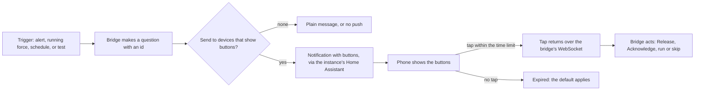

---

## Troubleshooting notifications

**Settings → Integrations → Notifications check** answers "would a critical alert reach
me?" Each line shows **Pass**, **Fail** or **Not set up**, and its fix. **Check again**
runs it again.

| Line | Passes when |
|---|---|
| Push notifications switch | The switch is on. |
| Default HA instance | The instance persistent notifications go to answers and accepts its token. It names where they go: the default instance, the add-on's Supervisor, or `HA_URL` / `HA_TOKEN` when no instance is set up. |
| Button taps listener: *name* | That enabled instance's WebSocket is connected, so taps reach the bridge. One line per instance. |
| Phones (mobile_app_*) | At least one enabled `notify.mobile_app_*` device is on an enabled instance. Only these show buttons. |
| Last Test with buttons | The last **Test with buttons** was tapped. It shows the result and when. |
| Where critical alerts go | Push notifications is on and at least one phone among **Critical alerts → Send to** can show Acknowledge. It names the Home Assistant target too. |

**Test critical alert** runs a critical alert's path and shows each step in its window:
the Home Assistant notification created (`fwh_dc_alert_test`), sent to the devices
(Critical alerts' Send to, with **Acknowledge**), and Acknowledge tapped (it waits 5
minutes). Tapping Acknowledge dismisses the test notification in Home Assistant. No alert
is recorded in the bridge, so no alert window opens.

| Symptom | Check line | Fix |
|---|---|---|
| Nothing anywhere | Push notifications switch: Fail | Switch on Push notifications. |
| No notification in Home Assistant | Default HA instance: Not set up | Add an instance (step 1) and make it the default. |
| No notification in Home Assistant | Default HA instance: Fail, "token rejected" | Create a new long-lived token and Edit the instance. |
| No notification in Home Assistant | Default HA instance: Fail, a connection error | Check the Base URL from the bridge's network, and that Home Assistant runs. |
| The phone gets nothing | Phones: Not set up or Fail | Install the Companion app, then **+ Add device** and pick its `notify.mobile_app_*` service. |
| The phone gets nothing | Where critical alerts go: Fail, "no phone" | Under **Critical alerts → Send to**, choose a phone that is on, or All devices. |
| The phone gets plain text, no buttons | — | The device is not a `notify.mobile_app_*` service. Pick the Companion app's service. |
| Tapping a button does nothing | Button taps listener: Fail | Check that instance's URL and token (**Edit → Test**); the error shown is the WebSocket's. |
| Tapping a button does nothing, listener Pass | — | The question expired. See the time limits in [How buttons work](#6-how-buttons-work). |
| A schedule never asks | — | Its log says why: no device in Send to shows buttons, the switch is off, or the send failed. |
| Unsure whether buttons work | Last Test with buttons: Not set up or Fail | Press **Test with buttons** on a phone's row and tap Yes or No. |

**Support info** (Settings → Admin) includes these lines, redacted: each line's status
and, where it helps, its detail, with no instance or device names, URLs, addresses or
tokens.

---

## Not yet available

- **No "dispatch ended" notification**, although the trigger is labelled "started /
  ended". A dispatch that this bridge started itself is not notified at its start
  either.
- **No push for** the Modbus TCP Server (aGate :502) going down, a firmware change, the
  aGate moving, or rejected cloud credentials. These are persistent notifications only,
  with no switch.
- **No targeting by user or role** (#470). **Send to** is all devices or chosen devices.
- **No quiet hours, cooldown or rate limit.**
- **No filter for phones.** The service list shows every `notify.*` service, not only
  `mobile_app_*`.
- **Buttons on these only:** Release / Keep, alerts (Acknowledge, Re-discover), **Ask
  before continuing**, **Test with buttons** and **Test critical alert**. Auto-notify
  triggers and schedule notify steps are plain.

---

## For developers: code and API

| Topic | Code | API |
|---|---|---|
| HA instances | `ha_instances.py`; `_seed_self_ha_instance()` in `app.py` | `POST /api/ha/instances`, `PATCH`/`DELETE /api/ha/instances/{id}`, `POST /api/ha/test` |
| Setup checks | `api_setup_ha_checks()` in `app.py`; `setup_wizard.js` | `GET /api/setup/ha-checks` |
| Notification devices | `ha_instances.notify_targets()`, `send_notification()` | `GET`/`POST /api/ha/notify-devices`, `PATCH`/`DELETE /api/ha/notify-devices/{id}`, `POST …/test`, `POST …/test-buttons`, `GET …/test-buttons/{request_id}`, `POST …/broadcast`, `GET /api/ha/notify-targets` |
| Push notifications switch | `ha_notify` setting; `actionable.build()` | — |
| Triggers and Send to | `notify_engine.py`; `actionable.targets()` | `PUT /api/notify/triggers` (`target`, and `asks` for alerts and Release / Keep), `POST /api/notify/triggers/test`, `GET /api/notify/log` |
| Persistent notifications | `Notifier` in `notify.py`; `poller.py` | `POST /api/notify/test` |
| Alerts | `alerts.py` (`alerts` table) | `GET /api/alerts` (`open=1`, `kind=event\|condition`, `since=<epoch>`), `POST /api/alerts/{id}/ack` (`source`: `ui`, `api`, `ha`), `GET /api/status` (`alerts`) |
| Buttons | `notify_buttons.py` (`ask_alert()`, `ask_release()`), `actionable.py`; `franklinwh-ha-notify` (`send.py`, `listener.py`, `notify_requests` and `notify_ledger` tables) | — |
| Running force at start-up | `vpp_monitor.py`; `reconcile_interrupted()` in `battery_control.py` (`dispatch_interrupt_policy`) | — |
| Schedules | `_ask_step()` and the templates in `scheduler.py` | `ask` on the schedule: `question`, `timeout_min`, `if_no_reply` (`skip`/`continue`), `choices` (`label`, `then`: `run`/`skip`, `reply`), `send_to` |
| Notifications check | `notify_checks` in `app.py` | `GET /api/notify/checks`, `POST /api/notify/test-alert`, `GET /api/notify/test-alert/{id}` |

The Companion app's tap event is `mobile_app_notification_action`. Notifications are sent
with `POST /api/services/notify/<service>`. See also
[Reading Home Assistant](../developers/reading-home-assistant.md).

An `ask` example:

```json
"ask": {
  "question": "SoC is %battery.soc_pct%%. Charge from the grid now?",
  "timeout_min": 5,
  "if_no_reply": "skip",
  "choices": [
    {"label": "Charge", "then": "run"},
    {"label": "Not today", "then": "skip"},
    {"label": "Other", "then": "skip", "reply": true}
  ],
  "send_to": {"type": "device", "ids": ["<notify-device-id>"]}
}
```

Leave out `choices` for Yes and No, and `send_to` for all enabled devices.
