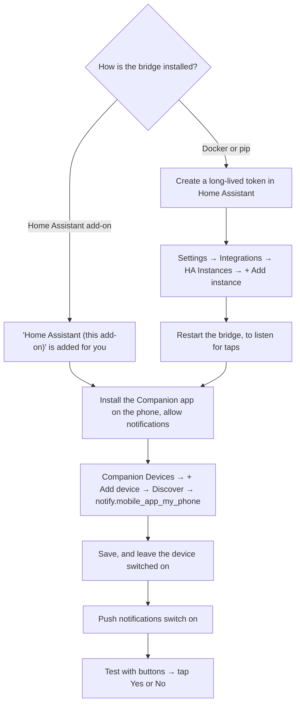
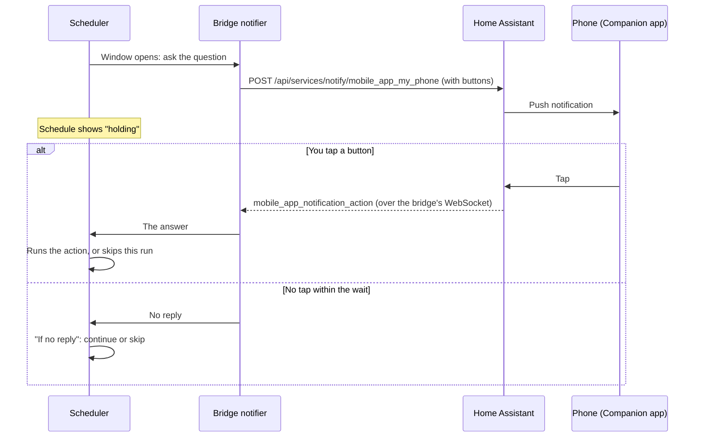

# Home Assistant setup and notifications

[Back to the guide index](index.md) · [Home Assistant and MQTT](home-assistant.md)

This page covers the bridge's link **into** Home Assistant: how to connect it, how to
check the connection, how to add your phone as a notification device, what the bridge
will notify you about, and the notifications with buttons that let you answer from your
phone. Publishing the aGate's entities **to** Home Assistant over MQTT is a separate
thing, covered in [Home Assistant and MQTT](home-assistant.md).

Everything here was read from the bridge's code on `main` (release 0.5.28) and from
`franklinwh-ha-notify` 0.1.1, the package the bridge sends notifications with, on
2026-11-04. It was not exercised against a running Home Assistant for this page. File
and function names are given so you can check them.

---

## Before you start: what you need

Home Assistant calls notifications with buttons
**[actionable notifications](https://companion.home-assistant.io/docs/notifications/actionable-notifications/)**.
They are a feature of the **Home Assistant Companion app**. Only a phone or tablet with
the Companion app, whose service is `notify.mobile_app_<device>` (for example
`notify.mobile_app_my_phone`), shows the buttons. Every other `notify.*` service, such as
an email or a TV, gets the same title and message as plain text, without buttons
(`Target.buttons` in `franklinwh-ha-notify`).

To get notifications on your phone, with or without buttons, you need two things:

1. **A Home Assistant instance in the bridge's list**: its URL and a token. See
   [step 1](#1-link-the-bridge-to-home-assistant).
2. **The Companion app on your phone**, signed in to that Home Assistant, with
   notifications allowed. See [Your phone, notifications and access from
   away](phone-and-remote-access.md#1-alerts-on-your-phone-the-home-assistant-companion-app).

You do **not** need to run the bridge as a Home Assistant add-on. The add-on only saves
you step 1: it adds **Home Assistant (this add-on)** to the list by itself, with the
token the Supervisor gives it. In Docker or a pip install you add your Home Assistant
yourself, with a long-lived access token. After that, notifications and buttons work the
same way.

### Does Home Assistant need to reach the bridge?

No. Every connection goes **from the bridge to Home Assistant**:

- A notification is a call from the bridge to Home Assistant's REST API,
  `POST /api/services/notify/<service>` (`send.py` in `franklinwh-ha-notify`).
- A tap on a button comes back over Home Assistant's **WebSocket API**. The bridge opens
  the WebSocket itself, signs in with the instance's token, and subscribes to the
  Companion app's `mobile_app_notification_action` event (`listener.py` in
  `franklinwh-ha-notify`; `actionable.start()` opens one listener per instance).

Home Assistant never calls the bridge. You don't need a webhook, YAML in Home Assistant,
an open port, or a URL for the bridge that Home Assistant can reach. The only
requirement is the one you already have: the bridge must reach Home Assistant at the
instance's URL. Your phone reaches Home Assistant the usual way, at home or from away.

So buttons add no setup over plain notifications. The minimal steps:

| Install | Steps |
|---|---|
| Home Assistant add-on | Install the Companion app on your phone. In the bridge: **Settings → Integrations → Companion Devices → + Add device**, pick your phone, **Save**, then **Test with buttons**. |
| Docker or pip | Create a long-lived access token in Home Assistant. In the bridge: **Settings → Integrations → HA Instances → + Add instance** (name, URL, token), **Save**, then **restart the bridge** so it starts listening for taps on the new instance (see below). Then add your phone as for the add-on. |

The bridge opens its tap listeners once, at start-up, for the instances in the list then
(`actionable.start()`, `Notifier.listen()`). An instance added later sends notifications
straight away (`actionable.send()` re-reads the list), but taps on it are only received
after a restart.



---

## 1. Link the bridge to Home Assistant

The bridge keeps a list of **Home Assistant instances**. Each one is a base URL and a
token. The bridge uses an instance to read entity states for the Scheduler, to find
notification services, to send notifications, to receive button taps, and to call
services from schedules. It talks to Home Assistant's REST API, and to its WebSocket API
for taps; see [Reading Home Assistant](../developers/reading-home-assistant.md) for the
details.

### As a Home Assistant add-on: automatic

The add-on asks Home Assistant for API access (`homeassistant_api: true` in
`config.yaml`). When it starts with an empty instance list, it adds one for you
(`_seed_self_ha_instance()` in `app.py`):

- named **Home Assistant (this add-on)**;
- at `http://supervisor/core`, the Supervisor's proxy to Home Assistant;
- with the token the Supervisor gives the add-on;
- marked as the default.

You do not need a long-lived token. After an add-on update the Supervisor issues a new
token, and the bridge copies it into that instance on start-up (fixed in #99). It never
changes instances you added yourself. Settings shows it as **auto-detected**, at "This
Home Assistant (Supervisor)".

You can still add other Home Assistant instances, to reach phones that are signed in to
another Home Assistant.

### Docker or standalone: URL and token

1. In Home Assistant, open your profile, then **Security → Long-lived access tokens →
   Create token**. Copy it.
2. In the bridge, open the **Home Assistant** tab → **Instances** → **Add instance**.
3. Fill in **Name**, **Base URL** (for example `http://192.0.2.20:8123`) and
   **Long-lived token**. Tick **Default** if this is your main Home Assistant, and leave
   **Enabled** on.
4. Press **Test**. It calls Home Assistant's `/api/` with the token, and reports "token
   rejected" for a 401 or 403 (`ha_instances.probe()`).
5. Press **Save**.
6. Restart the bridge, so it listens for button taps on the new instance.

The same list is also under **Settings → Integrations → HA Instances → + Add instance**
(Name, URL, Long-lived token, Default instance). **Disable** on an instance keeps it, and
its devices, but sends nothing through it.

The token is **write-only**. The bridge never sends it back to the browser: the list
shows **Token set** or **No token — reads will fail**, and an edit form shows the token
field as unchanged. It is stored in the bridge's database in plain text.

From the API: `POST /api/ha/instances`, `PATCH /api/ha/instances/{id}`,
`DELETE /api/ha/instances/{id}`, and `POST /api/ha/test`.

---

## 2. Check the connection: the four setup checks

`GET /api/setup/ha-checks` (`api_setup_ha_checks()` in `app.py`) measures the four
things that decide whether the bridge works with Home Assistant. They fail
independently, and each has a different fix. Each check is **pass**, **fail**, or
**could not be determined**. The last is not shown as a failure.

| Check | Title shown | What it tests | Fix when it fails |
|---|---|---|---|
| `mqtt_broker` | MQTT broker connected | Publishing is on, and at least one gateway that publishes is connected to the broker. With publishing on but no publishing gateway yet, the result is "No gateway publishing yet", undetermined. | Turn publishing on from the **MQTT** tab, or install the Mosquitto broker add-on. |
| `ha_linked` | Home Assistant connected to the bridge | The **first enabled** instance answers `/api/` with its token. Shows "This Home Assistant" for the add-on's own instance. | "Add one under Home Assistant → Instances." |
| `ha_mqtt` | Home Assistant's MQTT integration set up | `mqtt` is among Home Assistant's loaded components (`/api/config`). | In Home Assistant: **Settings → Devices & services → Add integration → MQTT**. |
| `entities` | Bridge entities in Home Assistant | How many of this bridge's entities Home Assistant has, matched by device identity, plus any left over from removed gateways. | Remove leftover devices in Home Assistant. |

The checks appear in the **setup wizard**, at the **Home Assistant** step. That step
also asks "Publish this gateway's entities to Home Assistant?", and has a **Check again**
button (`templates/partials/setup_wizard.html`, `loadHaChecks()` in
`static/js/setup_wizard.js`).

There is no check for notifications. Use **Test with buttons** (step 3) instead.

---

## 3. Add a notification device

A **notification device** is a name for one of Home Assistant's `notify` services on
one instance. A phone with the
[Home Assistant Companion app](https://companion.home-assistant.io/) has a service
called `notify.mobile_app_<device>`. That is the usual choice, and the only one that
shows buttons.
Step by step, and how to reach it away from home: [Your phone, notifications and access
from away](phone-and-remote-access.md).

1. Open **Settings → Integrations**, and scroll to **Notifications → Companion Devices**.
2. Press **+ Add device**. It is disabled until you have an instance ("Add an HA
   instance first").
3. Fill in an **Alias**, such as "Phone".
4. Pick the **HA instance**.
5. Press **Discover** next to **Notify service**. The bridge asks that Home Assistant for
   its services (`GET /api/services`) and lists every `notify.*` one
   (`ha_instances.notify_targets()`; `GET /api/ha/notify-targets`). Each row shows the
   friendly name, the service, and when Home Assistant last saw it. A `_2` service that
   duplicates another is marked "duplicate of …"; pick the one without the suffix
   unless you know you need it. Use **filter services…** to find yours.
6. Press **Send test** to check that the phone receives it.
7. Press **Save**.

Each saved device has an on/off switch, an icon for its kind (phone, tablet, TV, speaker
or other, guessed from the service name), **Edit**, **Test**, and remove. A device on an
instance that is switched off is marked **instance disabled**, and receives nothing.

- **Test** sends one plain message straight to that service
  (`POST /api/ha/notify-devices/test`, `ha_instances.send_notification()`). It goes out
  even while the **Push notifications** switch is off.
- **Test with buttons** appears only on a `mobile_app_*` device. It sends "FranklinWH
  test" with **Yes** and **No**, then waits up to 2 minutes for your tap. The row then
  shows "Round trip works: you tapped Yes", or "No reply within 120 s"
  (`POST /api/ha/notify-devices/test-buttons`, then
  `GET /api/ha/notify-devices/test-buttons/{request_id}`). It goes through the same path
  as every other notification, so it needs the **Push notifications** switch on. A pass
  proves the whole round trip: the bridge reaches Home Assistant, the phone shows the
  buttons, and the tap comes back over the WebSocket.

**Broadcast** sends one message to every enabled device.

The list shows all `notify.*` services, not only phones. Any of them works as a device;
only `mobile_app_*` ones show buttons.

From the API: `GET`/`POST /api/ha/notify-devices`,
`PATCH`/`DELETE /api/ha/notify-devices/{id}`, `POST /api/ha/notify-devices/test`,
`POST /api/ha/notify-devices/test-buttons` and `POST /api/ha/notify-devices/broadcast`.
A new device needs `alias`, `instance_id` and `service`.

---

## 4. What the bridge notifies you about

There are **two separate channels**, and they behave differently. One switch, **Push
notifications** at the top of **Settings → Integrations → Notifications**, covers both.

### The Push notifications switch

The switch is the `ha_notify` setting. **Off — no notifications are sent** means:

- nothing goes to your notification devices: the triggers, schedules, broadcasts, the
  scheduled-dispatch report, and every notification with buttons. The bridge's one
  sender checks it before each send and records "notifications are off"
  (`Notifier._send()` in `franklinwh-ha-notify`, built with
  `enabled=lambda: bool(settings.ha_notify)` in `actionable.build()`);
- no Home Assistant persistent notifications (`notify.py`);
- critical alerts reach only the bridge's own window. Settings then shows **Critical
  alerts reach only the bridge UI**.

The per-device **Test** button is the one exception: it sends directly, to check a
device before or after saving it.

### Push to your notification devices

These go to your notification devices. Set them under **Settings → Integrations →
Notifications → Auto-notify triggers** (`notify_engine.py`). Each has a switch; the two
SoC triggers also have a threshold.

| Trigger | Default | Sent when | Message |
|---|---|---|---|
| aGate offline / online | on | The gateway stops or starts answering polls. | "aGate is UNREACHABLE [gateway] — check network / WiFi / power." / "aGate is reachable again [gateway]." |
| Off-grid started / ended | on | The off-grid flag changes. | "Gateway went OFF-GRID [gateway] — running on battery." / "Gateway is back ON-GRID [gateway]." |
| Battery dispatch (VPP / force) started / ended | on | A dispatch is found active at start-up, or one starts that **this bridge did not start** (`vpp_monitor.py`). | "FranklinWH — VPP dispatch active at startup" / "FranklinWH — battery dispatch started (VPP)" |
| Battery SoC drops below | off, 20 % | SoC crosses the threshold downward. | "Battery SoC dropped below 20% [gateway] (now N%)." |
| Battery SoC reaches | off, 100 % | SoC crosses the threshold upward. | "Battery SoC reached 100% [gateway] (now N%)." |

A trigger fires on a **change** between one poll and the next, not on every poll. There
is no other rate limit.

**Send to.** Each trigger has a **Send to** list (#281):

- **All devices**, the default: every enabled device.
- **Chosen devices**: tick one or more. The last ticked device can't be unticked. A
  chosen device that is switched off gets nothing; it stays off for its triggers too
  (`notify_engine.fire()`).

From the API, a trigger's `target` is `{"type": "all"}` or
`{"type": "device", "ids": [...]}` (`PUT /api/notify/triggers`). Targeting by user or
role is not available in this bridge.

**Send test** at the top of the triggers opens a test that goes to all enabled devices
or to the ones you choose (`POST /api/notify/triggers/test`). It says how many devices
it reached, and when none, why: "No devices are on", "No device chosen" or "Push
notifications are off".

Also sent to every enabled device: after a restart that interrupted a **scheduled
dispatch**, if `dispatch_interrupt_policy` is `notify` (the default is `release`), a message titled
"FranklinWH — scheduled dispatch …" (`reconcile_interrupted()` in `battery_control.py`).
See [Control → After a bridge restart mid-dispatch](control.md#after-a-bridge-restart-mid-dispatch).

**Recent notifications**, on the same page, lists each delivery (`GET /api/notify/log`;
the last 2,000 are kept).

### Home Assistant persistent notifications

These appear in Home Assistant's own notification panel, not on your phone
(`Notifier` in `notify.py`, posting to `persistent_notification.create`). They go to the
add-on's own Home Assistant, or, outside the add-on, to the `HA_URL` and `HA_TOKEN`
settings. They do **not** use the HA instances list. They are sent only while the
**Push notifications** switch (`ha_notify`) is on. From `poller.py`:

| Event | Title | Message |
|---|---|---|
| The aGate stops or starts answering | FranklinWH aGate | "aGate is UNREACHABLE (check network / WiFi / power)." / "aGate is reachable again." |
| The Modbus TCP Server (aGate :502) stops or starts answering this bridge's probe | FranklinWH Modbus | "Modbus :502 is DOWN." / "Modbus :502 is back up." |
| Cloud credentials become invalid or locked | FranklinWH cloud credentials rejected | — |
| The firmware version changes | FranklinWH firmware updated | old → new |
| The aGate is found again at a new address | FranklinWH aGate moved | "<gateway name> re-discovered on the LAN at <address>." Only an aGate with this gateway's own serial is adopted, never one another gateway uses. |

There is no per-event switch for these.

### Alerts

Alerts are the bridge's record of faults (#271). They follow one spec shared with the
Modbus Bridge, so an automation that reads one bridge's codes works on the other. Each alert
is stored in the bridge's database (`alerts.py`, the `alerts` table) and survives a
restart. Every alert is also a line in **Logs** (WARNING when raised, INFO when it clears
or is acknowledged), whether or not it reached anyone.

There are two kinds:

- an **event**, such as a command that was refused, stays open until it is acknowledged;
- a **condition**, such as the aGate being unreachable, is active while the fault lasts and
  is marked resolved when it clears. Acknowledging a condition stops the alert window,
  not the red bar.

What raises one today:

| Code | Kind | Severity | Raised when | Clears when |
|---|---|---|---|---|
| `GATEWAY_UNREACHABLE` | condition | critical | Polls of the aGate have failed for 5 minutes | Polls have succeeded for 2 minutes |
| `LIVE_DATA_MISSING` | condition | critical | No live power reading for 2 minutes | Readings for 1 minute |
| `MQTT_DOWN` | condition | warning | The MQTT broker has been disconnected for 5 minutes, on a gateway that publishes | Connected for 2 minutes |
| `HA_UNREACHABLE` | condition | warning | Home Assistant has failed to take an alert notification for 5 minutes | One goes through and 2 minutes pass |
| `WORKER_STALLED` | condition | critical | A background worker stops responding or crashes (Health → Workers) | Every worker for that gateway is beating again |
| `COMMAND_REFUSED` | event | critical | The Audit Trail records a control as failed or refused. Cloud sign-ins are not counted. | Acknowledged |
| `SCHEDULE_FAILED` | event | critical | A scheduled action fails, or its window closes without success | Acknowledged |

The same event again within 10 minutes is added to the open alert (its count goes up)
rather than raising a new one. The other codes in the shared list (`COMMAND_UNCONFIRMED`,
`WRITE_IGNORED`, `RESTART_DURING_COMMAND`, `EXTERNAL_SETPOINT`, `DATA_MISSING_PARTIAL`,
`INTERNAL_ERROR`) are defined, but nothing in this bridge raises them yet.

**In the bridge.** A critical alert opens a window that stays until it is acknowledged.
It shows what happened, when (in the site's time), what it means and what to do. Tick
**I understand** for each alert, then **OK**. Escape and clicking outside do not close it.
An alert raised while no browser was open, by a schedule for example, is shown on the next
visit, and a condition that came and went shows as "09:54–13:27, resolved". While an
acknowledged condition is still active, a red bar stays under the top bar. A badge in the
top bar counts open alerts and opens the list, where warnings are acknowledged. The
acknowledgement applies for everyone and is recorded as `source:ui`.

**In Home Assistant.** Each critical alert creates a persistent notification with the id
`fwh_dc_alert_<id>`, whether or not a notification device is set up. It goes to the same
Home Assistant as the persistent notifications above (the add-on's own, or `HA_URL` and
`HA_TOKEN`), and needs the **Push notifications** switch on. If Home Assistant does not
answer, the bridge keeps retrying, waiting longer each time up to 10 minutes.
Acknowledging the alert in the bridge dismisses the notification. **Dismissing it in Home
Assistant does not acknowledge the alert**: the bridge stays the record.

**On your phone.** Once that persistent notification is created, the same alert goes to
every enabled notification device, with buttons (#374; `notify_buttons.ask_alert()`,
called from `alerts.py`):

- **Acknowledge** acknowledges the alert, as **OK** in the bridge does, recorded as
  `source:ha`.
- **Re-discover**, only on `GATEWAY_UNREACHABLE`, asks that gateway's poller to search the
  LAN for the aGate again.

The buttons work for an hour. Devices that can't show buttons get the text. If none of
the enabled devices is a `mobile_app_*` one, the alert is not sent to devices. Warnings
are not sent to devices.

With the switch **off**, no Home Assistant notification is made, and each one skipped is
recorded as "skipped: HA channel off". The bridge's alert window still opens; it never
depends on the switch.

Each gateway's device in Home Assistant also gets **Bridge problem**, a diagnostic `problem`
binary sensor that is on while any alert for that gateway, or for the bridge itself, is
open. Its attributes list the open alerts. It does not use the gateway's availability
topic, so it stays readable while the aGate is offline.

A separate device, **FranklinWH Direct Connect Bridge**, has one **Bridge heartbeat**
timestamp. The alert monitor sends it every minute while MQTT publishing is on and
connected, independently of every gateway. If the bridge itself stops, the heartbeat stops
moving, which an automation can watch for (for example, "heartbeat older than 5 minutes →
notify").

The API is `GET /api/alerts` (filters `open=1`, `kind=event|condition`, `since=<epoch>`),
`POST /api/alerts/{id}/ack` with `{"source": "ui"|"api"|"ha"}` (default `api`), and
`GET /api/status`, whose `alerts` is `{level, open, latest_id, changed_ts}`. `changed_ts`
moves whenever an alert opens, resolves or is acknowledged. Closed alerts are kept 90
days; open ones are never removed.

### Release or Keep a running force

When the bridge finds a battery force running that it did not start, it asks whether to
release it (`notify_buttons.ask_release()`):

- a VPP or force dispatch **active at start-up** (`vpp_monitor.py`), while the **Battery
  dispatch** trigger is on;
- a **scheduled dispatch** interrupted by a restart and left running, with
  `dispatch_interrupt_policy` set to `notify` (`battery_control.py`).

**Release** releases the force on that aGate, as the top-bar Release does. **Keep** leaves
it running. The buttons work for 15 minutes. The question goes to every enabled device,
not only the trigger's **Send to** devices. When no device can show buttons, the bridge
sends the plain message instead.

---

## 5. Notifications from a schedule

A schedule can send to a notification device, either as its main action or as one of its
**Home Assistant actions**. Home Assistant actions run on entry, on exit, or both, and
each can have its own condition (**guard**). See
[Scheduler → Home Assistant actions](scheduler/actions.md#home-assistant-actions).

In the schedule editor: **Home Assistant actions (optional) → + notify**, then pick the
device, and set a title and a message. `%sensor.id%` in the text is replaced with the
live value, or `?` when there is none. Some useful ones: `%battery.soc_pct%`,
`%grid.power_w%`, `%schedule.name%`, `%run.phase%` (`fire` or `exit`) and `%run.at%`.
Write `%%` for a literal `%`.

### Worked example: tell me about the evening peak

The built-in template **Peak window — notify start & end** does this
(`peak_window_notify` in `scheduler.py`). As a request body:

```json
{
  "name": "Peak window",
  "trigger_type": "daily",
  "fire_at": "16:00",
  "duration_min": 300,
  "action": {"kind": ""},
  "ha_actions": [
    {"ha_kind": "notify", "device_id": "<notify-device-id>", "when": "both",
     "title": "Peak window",
     "message": "%run.phase%: SoC %battery.soc_pct%%, grid %grid.power_w%W"}
  ]
}
```

At 16:00 your phone gets "fire: SoC 74.2%, grid -350W", and at 21:00 "exit: …". The
schedule has no battery action, so it never competes with another schedule for the
gateway.

To be told only when the battery is low at the start of the peak, add a guard to the
action:

```json
"guard": {"sensor": "battery.soc_pct", "op": "<", "value": 50}
```

A notify step that cannot be sent is skipped, and the schedule's log says why: "device
no longer exists", "'Phone' is switched off", or "has no HA instance".

### Ask before continuing

A schedule can ask you on your phone before its action runs (#374). In the schedule
editor, tick **Ask before continuing** (`_ask_step()` in `scheduler.py`):

| Field | What it does |
|---|---|
| **Question** | The message. `%sensor.id%` values are filled in when it is sent, as in notify messages, for example `SoC is %battery.soc_pct%%. Charge now?`. The title is the schedule's name and the gateway. |
| **Buttons** | **Yes** (runs the action) and **No** (skips this run), unless you press **Use my own buttons**. Then give 2 to 4 buttons, each with its own label, and set each to **Runs the action** or **Skips this run**. |
| **Text reply** | At most one of your buttons can take a text reply: the phone asks for text when it is tapped. What you type becomes the answer. |
| **Wait for a reply (minutes)** | 1 or more; 10 in a new schedule. |
| **If no reply** | **Skip this run** (the default) or **Continue**. |
| **Send to** | **All enabled devices**, or **Chosen devices** (#281). Devices that show buttons are marked **buttons**. |

The question is sent once per run, when the schedule's window opens. While it waits, the
schedule shows **holding**, and other schedules carry on. Then:

- a tap on a button that **runs the action**: the action runs, and the log says
  `answered Yes`;
- a tap on a button that **skips this run**: the run is recorded as skipped;
- no tap in time: **If no reply** decides.

**If no reply** also decides, at once, when nobody could be asked: no enabled device in
**Send to** is a `mobile_app_*` one, the send failed, notifications are not running, or
the **Push notifications** switch is off. The schedule's log says which.

**The answer.** The label of the button tapped, or the text typed for a text reply, is
the **Ask: answer** sensor (`ask.answer`) for the rest of that run. Use it in exit
conditions and Home Assistant action guards, and as `%ask.answer%` in notify messages.
See [Scheduler → Conditions](scheduler/conditions.md).

The API field is `ask` on the schedule:

```json
"ask": {
  "question": "SoC is %battery.soc_pct%%. Charge from the grid now?",
  "timeout_min": 10,
  "if_no_reply": "skip",
  "choices": [
    {"label": "Charge", "then": "run"},
    {"label": "Not today", "then": "skip"},
    {"label": "Other", "then": "skip", "reply": true}
  ],
  "send_to": {"type": "device", "ids": ["<notify-device-id>"]}
}
```

Leave out `choices` for Yes and No, and `send_to` for all enabled devices.



---

## 6. How buttons work

Every notification with buttons follows the same path (`actionable.py`, and
`franklinwh-ha-notify`):

- Each send is one question with its own id. The buttons carry that id, so the tap is
  matched to the question on iOS and on Android.
- A question has a time limit: 2 minutes for **Test with buttons**, 15 minutes for
  **Release / Keep**, 1 hour for an alert, and the wait you set for **Ask before
  continuing**. A tap after that is recorded as expired and does nothing.
- A question takes one answer. A second tap, on the same phone or another, does nothing.
- Open questions are kept in memory. **A tap on a question asked before a bridge restart
  is ignored**, and is recorded as unknown.
- Each send and each tap is recorded in the bridge's database (the `notify_ledger`
  table), whether or not it went through.
- If the WebSocket to Home Assistant drops, the bridge reconnects, waiting 2, 5, 10, 30,
  then 60 seconds between tries.

---

## Not yet available

Checked against the code on `main` (0.5.28). These do not exist today:

- **No "dispatch ended" notification**, although the trigger is labelled "started /
  ended". `vpp_monitor.py` logs the end and sends nothing. A dispatch that this bridge
  started itself is not notified at its start either.
- **No push for** the Modbus TCP Server (aGate :502) going down, a firmware change, the
  aGate moving, or rejected cloud credentials. These are persistent notifications only,
  with no switch.
- **No Send to for alerts or Release / Keep.** They go to every enabled device.
- **No targeting by user or role.** **Send to** is all devices or chosen devices.
- **No quiet hours, cooldown or rate limit.**
- **No filter for phones.** The service list shows every `notify.*` service, not only
  `mobile_app_*`.
- **No setup check for notifications.** **Test with buttons** is the check.
- **No tap listener for an instance added after start-up** until the bridge restarts.
- **No UI** for the persistent-notification target outside the add-on (`HA_URL`,
  `HA_TOKEN`; set them in the environment), and no button for the persistent-notification
  test (`POST /api/notify/test`). Outside the add-on, without them, critical alerts
  reach neither Home Assistant nor your phone.
