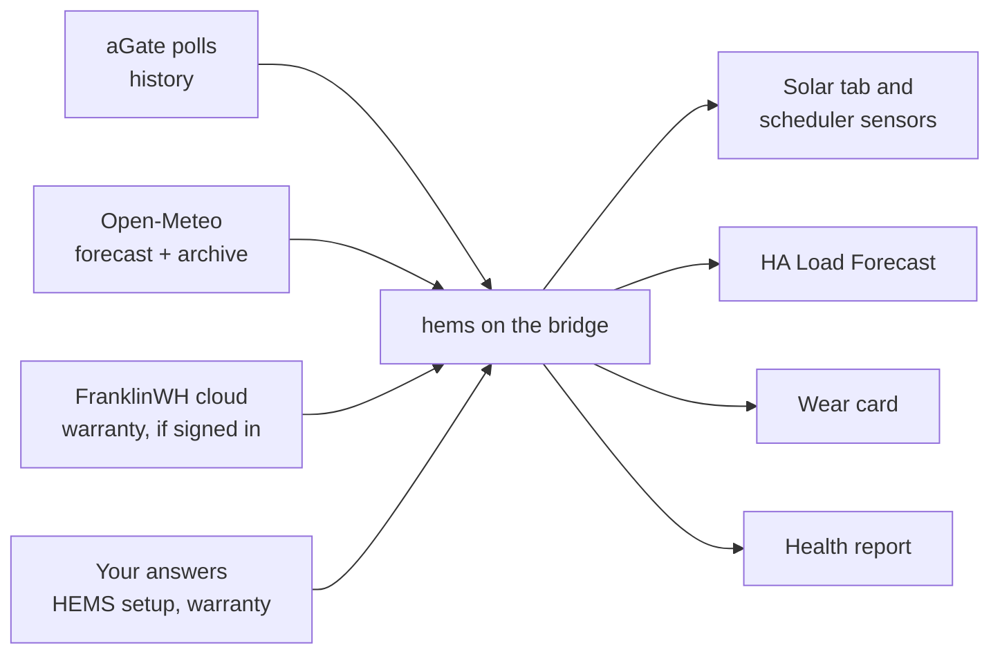

# HEMS (energy planning)

[Back to the guide index](../index.md) · [Getting started](getting-started.md)

To set it up, run **Energy planning (HEMS)** from the setup list (see
[Getting started](getting-started.md#the-set-up-hems-wizard)).

HEMS is the part of the bridge that looks ahead: what the sun and your home will do over the
next two days, what each kWh through the battery costs in wear, and a description of your home
that planning can work from. It is built on **hems**, the shared energy engine the bridges use
(the [hems library](https://github.com/david2069/hems), an implementation of
[OUTUS](https://github.com/david2069/outus), the Open Utility Tariff & Usage Specification).

## What it does today

| Part | What you get | Where |
|---|---|---|
| [Solar forecast](solar-forecast.md) | Today's and tomorrow's solar, hour by hour, calibrated against what your system actually made | Solar tab; scheduler sensors |
| [Load forecast](load-forecast.md) | Your home's load for the next 48 hours, learnt from its own history, with an accuracy check | Home Assistant **Load Forecast**; Health → weekly report |
| [Battery warranty and wear](battery-wear.md) | Wear cost per kWh, warranted throughput used and left, the pace that lasts the warranty, state of health, round-trip efficiency | Settings → Gateways → *Battery warranty & wear* |
| [Loads and controllability](loads.md) | Your always-on load, usage periods and heavy loads, each checked against what this bridge can control | Settings → Gateways → *HEMS setup* |
| [Smart Dispatch](smart-dispatch.md) | A 24-hour battery plan for your target (backup, TOU, lowest cost, self-consumption, export earnings) within your utility's limits, with the action now and why, and the plan as Scheduler tasks on request | Smart Dispatch tab |
| [Scheduler](scheduler.md) | Forecast sensors to use in schedule conditions | Scheduler |
| [Home Assistant](home-assistant.md) | The HEMS entities | MQTT discovery |

## What it does not do (yet)

- **No automatic control.** The planner, [Smart Dispatch](smart-dispatch.md), shows a plan
  and adds it to the Scheduler only when you click **Create schedules**; acting on it by
  itself, and switching loads, are later phases of #612. The forecasts
  also feed sensors and schedules you write yourself.
- **It never writes to the aGate or to the FranklinWH cloud.** Everything here reads.

## Local, cloud and outside services

- **Runs on the bridge.** The forecasts, the wear figures and the checks are worked out
  locally, from the history the bridge already keeps.
- **Open-Meteo** is the one outside service: the weather and sunlight forecast, and past
  temperatures for the load model. It is free and needs no key; it is sent the site's
  location and the panels' tilt and direction only.
- **The FranklinWH cloud** is used for one thing, and only while you are signed in: the
  warranty end date and warranted throughput, read at most once a day to pre-fill the
  wear card (marked *Please confirm*).

## Opt-in

The forecasts and wear figures appear as soon as there is data for them. The **HEMS setup**
(your home's description) is optional and off until you switch it on, with the notice
*"Planning is only as accurate as your answers."* Anything the bridge can measure is
pre-filled and marked **Please confirm**; nothing it guesses is used until you confirm it.

