# Home Assistant and MQTT

[Back to the guide index](index.md)

The bridge publishes your aGate to Home Assistant over **MQTT discovery**, so the gateway
arrives as a native HA device with sensors and a few controls. There is no custom
integration to install.

Two tabs are involved, and they point in opposite directions:

- **MQTT** — what *this bridge publishes outward*: the broker connection, the entity list
  with live values and topics, which groups are enabled, and a scan for other FranklinWH
  publishers on the same broker.
- **Home Assistant** — what the bridge *reads inward from HA*: your HA instances, which
  HA entities to expose to the Scheduler, your notification devices, and a dashboard-card
  YAML generator.

---

## Setting up the broker

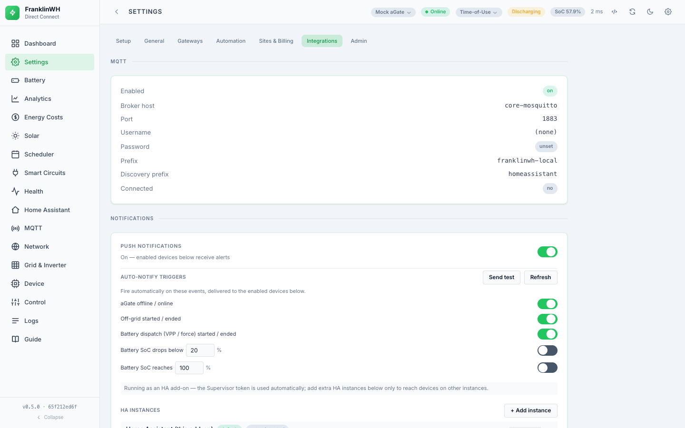

The broker settings are **not live-editable**. They come from the environment (or the
add-on's options) and need a restart to change, unlike `allow_writes` and the log level.
Settings → Integrations → MQTT shows them read-only, with a Connected chip.

| Setting | Default |
|---|---|
| `MQTT_ENABLED` | `false` |
| `MQTT_HOST` | `core-mosquitto` |
| `MQTT_PORT` | `1883` |
| `MQTT_USERNAME` / `MQTT_PASSWORD` | empty |
| `MQTT_PREFIX` | `franklinwh-local` |
| `HA_DISCOVERY_PREFIX` | `homeassistant` |

As a Home Assistant add-on, set these in the add-on's configuration; the default host
assumes the official Mosquitto add-on.

### One side effect worth knowing

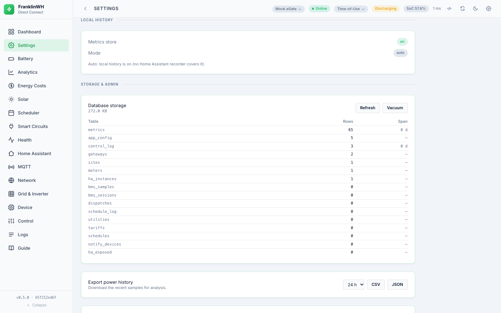

The bridge's own SQLite history is **on** unless you turn it off, add-on or not, MQTT
or not. It used to switch itself off for an add-on with MQTT enabled, on the reasoning
that Home Assistant's recorder keeps the published entities. But the bridge's own
charts read only the local store, so they went empty; since #136 an unset value means on
(`metrics_active()` in `config.py`). Set `METRICS_ENABLED=false` to opt out.

---

## Topics

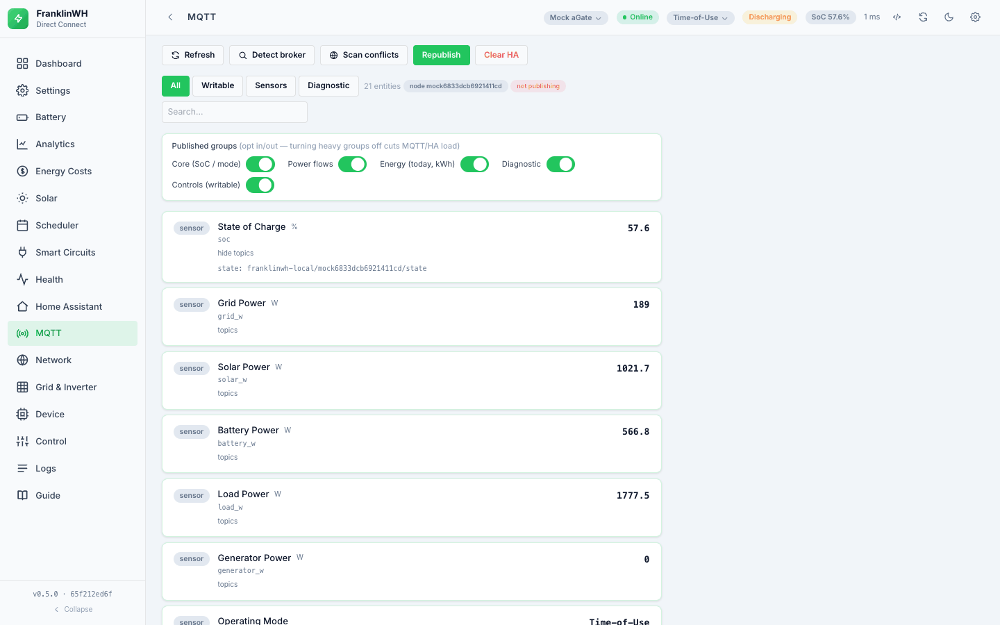

The bridge uses one JSON state topic per device. With the defaults, and writing `<node>`
for the node id:

| Purpose | Topic |
|---|---|
| State (all values, one JSON object) | `franklinwh-local/<node>/state` |
| Availability | `franklinwh-local/<node>/availability` |
| TOU entities (#421) | `franklinwh-local/<node>/tou` |
| Commands in | `franklinwh-local/<node>/control/<key>/set` |
| Discovery configs | `homeassistant/<sensor\|binary_sensor\|select\|switch>/<node>/<key>/config` |

**The node id is your gateway's serial number, lower-cased.** Each discovery config pulls
its own field out of the shared state JSON with a `value_template`, and availability is a
separate topic driven by the health round-trip and the MQTT last-will, so an offline
gateway shows as unavailable in HA rather than as stale numbers. A failed poll publishes
only *offline*, never a state: the last good values stay retained until a poll
succeeds (#176).

In Home Assistant the device appears as **"FranklinWH Direct &lt;last 8 characters of the
serial&gt;"**, so several gateways are told apart (`device_name()` in
`publish/entities.py`). The name is only a label. The device's identity is its
`identifiers`, `franklinwh_<node>`; changing those would create a second device and
orphan every entity already discovered. `sw_version` reads "Direct Connect Bridge v" and
this bridge's version, and that prefix is how the bridge recognises its *own* entities
on a broker shared with other FranklinWH publishers. The aGate's firmware is shown as
the hardware version when known. Developer detail:
[Sending data to Home Assistant over MQTT](../developers/mqtt.md#identity).

---

## The entities

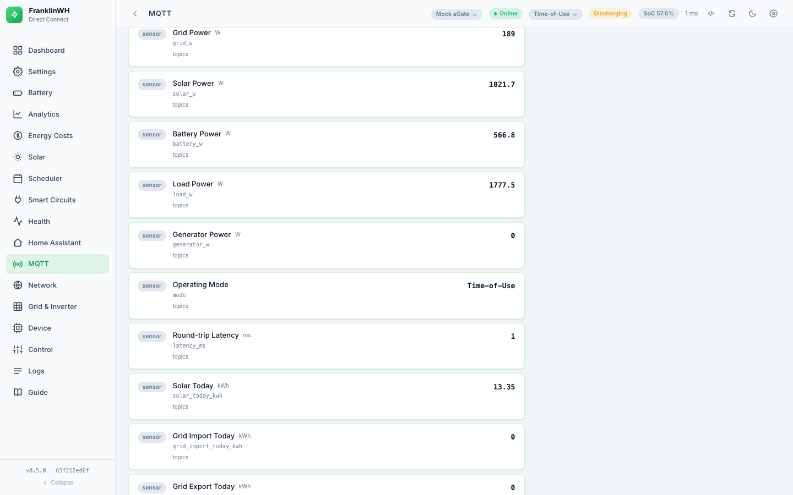

Measured live on 2026-10-15: **21 entities — 17 sensors and 4 controls.**

### Sensors

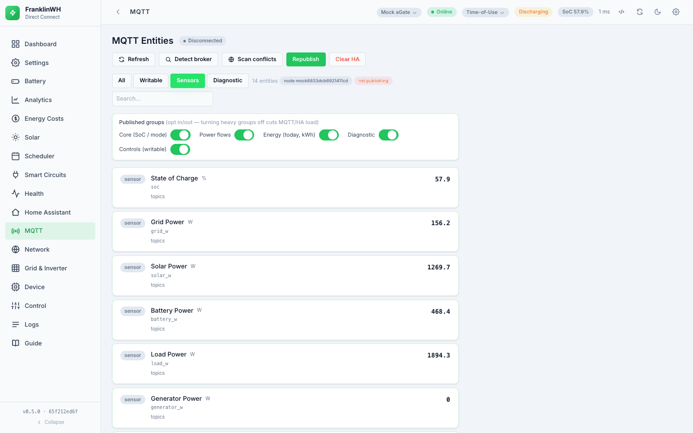

| Key | Name | Unit | Group | Source |
|---|---|---|---|---|
| `soc` | State of Charge | % | core | local |
| `mode` | Operating Mode | — | core | local |
| `grid_w` | Grid Power | W | power | local |
| `solar_w` | Solar Power | W | power | local |
| `battery_w` | Battery Power | W | power | local |
| `load_w` | Load Power | W | power | local |
| `load_forecast` | Load Forecast (this hour; the next 48 hours as a `forecast` attribute) | kW | power | local |
| `tou_schedule` | TOU Schedule: the FranklinWH TOU schedule's name. Attributes: utility, last changed in the app, last checked, rate unit, and today's blocks with their buy and sell rates | — | core | cloud |
| `tou_dispatch_now`, `tou_dispatch_next` | TOU Dispatch Now / Next: what the TOU block has the battery do, and the next change. Attributes: start, end | — | core | cloud |
| `tou_tariff_now`, `tou_tariff_next` | TOU Tariff Now / Next: the price band (Off-peak, Mid-peak, On-peak, Super off-peak), and the next change. Attributes: buy, sell, start (and end for now), rate unit | — | core | cloud |
| `generator_w` | Generator Power | W | power | local |
| `battery_status` | Battery State (charging / discharging / standby) | — | power | local |
| `grid_voltage_v` | Grid Voltage | V | power | local |
| `grid_frequency_hz` | Grid Frequency | Hz | power | local |
| `solar_today_kwh` | Solar Today | kWh | energy | local |
| `grid_import_today_kwh` | Grid Import Today | kWh | energy | local |
| `grid_export_today_kwh` | Grid Export Today | kWh | energy | local |
| `battery_charge_today_kwh` | Battery Charged Today | kWh | energy | local |
| `battery_discharge_today_kwh` | Battery Discharged Today | kWh | energy | local |
| `load_today_kwh` | Home Load Today | kWh | energy | local |
| `ambient_temp_c` | Ambient Temperature | °C | diagnostic | local |
| `run_status` | Run Status | — | diagnostic | local |
| `run_status_desc` | Run Status Description | — | diagnostic | local |
| `latency_ms` | Round-trip Latency | ms | diagnostic | local |
| `net_in_use`, `net_available`, `net_write_safety`, `net_fallback` | Network In Use, Networks Available, Network Write Safety, Network Fallback (the aGate's network, read every few minutes) | — | diagnostic | local |
| `net_wifi_signal`, `net_4g_signal` | WiFi Signal, 4G Signal | %, — | diagnostic | local |
| `net_if_eth0`, `net_if_eth1`, `net_if_wifi`, `net_if_4g` | Ethernet 0, Ethernet 1, WiFi Link, 4G Link | — | diagnostic | local |
| `net_cloud`, `net_cloud_endpoint`, `net_cloud_via` | Cloud Connection, Cloud Endpoint, Cloud Connection Via (the aGate's own link to the FranklinWH cloud) | — | diagnostic | local |
| `status_grid_status` | Grid Status (Connected / SimulatedOffGrid / Outage / OffGrid) | — | core | local |
| `active_reserve_pct` | Active Reserve SOC | % | core | local |
| `device_firmware` | Firmware Version | — | diagnostic | local |
| `relay_main1`, `relay_main2`, `relay_grid2`, `relay_black_start` | Main Relay 1, Main Relay 2, Grid Relay 2, Black Start Relay (binary sensors) | — | diagnostic | local |
| `status_vpp` | VPP Active (binary sensor) | — | core | local |
| `offgrid_reason` | Off-Grid Reason (user requested / grid outage / unknown) | — | core | local |
| `offgrid_min` | Off-Grid Duration | min | core | local |
| `circuit_1_power_w` … `circuit_3_power_w` | Smart Circuit 1–3 Power | W | power | local |
| `circuit_1_today_kwh` … `circuit_3_today_kwh` | Smart Circuit 1–3 Energy Today | kWh | energy | local |
| `v2l_power_w` | V2L Power | W | power | local |
| `v2l_export_kwh`, `v2l_import_kwh` | V2L Export Energy, V2L Import Energy (lifetime) | kWh | energy | local |
| `generator_state` | Generator State (Standby / OFF, Running / ON, Cooldown, Fault) | — | power | local |
| `generator_enabled` | Generator Enabled (binary sensor) | — | diagnostic | local |
| `generator_today_kwh` | Generator Today | kWh | energy | local |
| `active_alarms` | Active Alarms | — | diagnostic | local |

**Load Forecast** (#713) is the home load the bridge expects this hour, in kW, with the next
48 hours in its `forecast` attribute for HAEO and similar optimisers. How it is learnt, its
attributes and how to keep it out of the recorder are in
[HEMS → Load forecast](hems/load-forecast.md).

The six daily `kWh` counters are published as `total_increasing` with the `energy` device
class, which is what the **Home Assistant Energy dashboard** needs. They come out of the
same payload the bridge already polls, so they cost nothing extra.

`battery_status` is derived from the sign of battery power: negative is charging,
positive is discharging, zero is standby.

**Grid Status** is *SimulatedOffGrid* when the aGate is off grid because someone asked it
to be, and *Outage* when it is off grid with no request the bridge knows about. A real
outage has not been measured yet, so *Outage* means "not requested", not a confirmed
outage. *OffGrid* means off grid with the cause unknown. **Active Reserve SOC** is the
reserve of the operating mode in use. **Grid Voltage** is the aGate's service voltage (1707 `gridLineVol`), and **Grid
Frequency** the grid frequency (1707 `gridFreq`). A relay is on when it conducts. Mock gateways don't
publish the relays, because the emulator doesn't model them.

**VPP Active** is on while a VPP programme (1707 programme 9) controls the aGate.
**Off-Grid Reason** and **Off-Grid Duration** have a value only while the aGate is off
grid, and are unknown on the grid; the duration counts from the first poll that saw it off
grid, so after a bridge restart it starts again. **Smart Circuit 1–3 Power and Energy
Today**, **V2L Power and Energy**, and **Generator State and Enabled** come from the
smart-circuit meter and generator read every 60 seconds (the same read as the scheduler's
sensors); a circuit or V2L port that isn't read stays unknown, and mock gateways don't
publish the meter ones, because the emulator reports no meter. A circuit's energy today
counts from its first reading of the day. **Active Alarms** counts the alarms System view
lists for the gateway: the devices' own and the bridge's open alerts for it.

### Controls (writable)

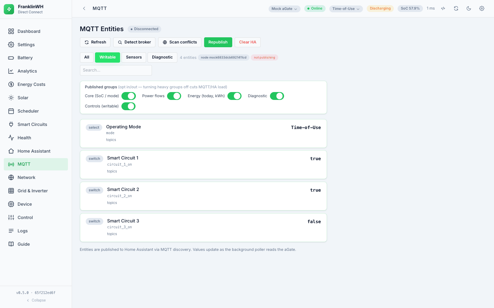

| Key | HA type | Options | Source |
|---|---|---|---|
| `operating_mode` | `select` | Time-of-Use · Self-Consumption · Emergency Backup | local |
| `smart_circuit_1` | `switch` | ON / OFF | local |
| `smart_circuit_2` | `switch` | ON / OFF | local |
| `smart_circuit_3` | `switch` | ON / OFF | local |
| `off_grid` | `switch` | ON / OFF, Go Off-Grid | local |
| `reserve_soc_tou` | `number` | 0–100 %, TOU Reserve SOC | cloud |
| `reserve_soc_self` | `number` | 0–100 %, Self-Consumption Reserve SOC | cloud |
| `battery_command` | `select` | Not Active · Force Charge · Force Discharge · Force Standby · Release | modbus |
| `battery_command_power` | `number` | 0–5000 W in steps of 100, Command Power | modbus |
| `battery_command_power_pct` | `number` | 0–100 % in steps of 5, Command Power % | modbus |
| `battery_command_duration` | `number` | 0–7200 s in steps of 60, Command Duration | modbus |
| `battery_command_target_soc` | `number` | 0–100 % in steps of 5, Target SoC | modbus |

The publisher subscribes to `…/control/+/set` and routes by the key in the topic.

**Reserve SoC goes through the FranklinWH cloud.** The aGate discards a reserve written
over the local API, so the two reserve numbers write through the cloud, as the bridge's
own Control page does. Emergency Backup has no number: its reserve is fixed at 100 %. They appear only when your FranklinWH cloud credentials are set in
Settings and they are for this gateway's aGate, and leave Home Assistant when they no
longer are (see *Source* below). Mock gateways never have them. Each number
shows the reserve the aGate reports locally every poll, so a change made in the app shows
up too. The result of each change is in the bridge's log.

**Battery Command** is the Battery tab's Battery Command, with the Modbus Bridge's entity
names and ranges. Set **Command Power** (watts) or **Command Power %** (of the aGate's
rating; the last one set wins), and optionally **Command Duration** and **Target SoC**,
then choose *Force Charge*, *Force Discharge* or *Force Standby* in **Battery Command**;
*Release* (or *Not Active*) ends the force. The numbers are the same staged values the
Battery tab shows, and the force runs the same way: over the Modbus TCP Server (aGate
:502), with the bridge's watchdog ending it at the duration or target, recorded like a
Battery tab force. It needs **Allow writes**, and the controls are published only while the Modbus client is
switched on in Control → Modbus client (see *Source* below); a refusal is in the bridge's log. **Battery Command** shows the
force this bridge holds on the gateway. Mock gateways don't have these controls: they
have no Modbus TCP Server.

**Smart-circuit schedules are not published**: the gateway discards that write, and an
HA control that silently does nothing is worse than no control.

### Source

The **Source** column says where each entity's value comes from, or where a control
writes (#711):

| Source | What it is | Published |
|---|---|---|
| `local` | The aGate's Direct Connect API, which the bridge polls | Always |
| `cloud` | The FranklinWH cloud | Only while your FranklinWH cloud credentials are set and are for this gateway's aGate |
| `modbus` | This bridge's Modbus client, to the aGate's Modbus TCP Server (:502) | Only while the Modbus client is on (Control → Modbus client) |

The TOU entities are worked out once a minute from the bridge's latest copy of the
TOU schedule (Scheduler → FranklinWH TOU), so they cost no cloud read. The copy is read
at start-up, when TOU mode is set, once a day and on **Sync now**. The cloud gives the
rates without a unit; they're taken as your currency per kWh, so please check them
against the FranklinWH app.

The bridge checks every poll. When a source turns on, its entities appear in Home
Assistant; when it turns off, they are removed (not left *unavailable*). Mock gateways are
never published to Home Assistant; the setup wizard's **Yes** to publishing turns it on for
real gateways only.

### Entity groups

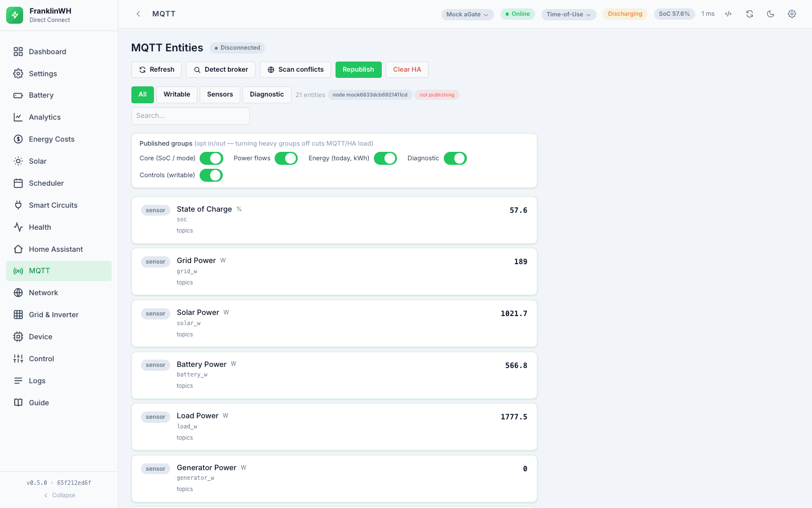

Publishing is opt-in per group, from the MQTT tab. All five were enabled on the bridge
read live, and all five are on by default:

| Group | Label |
|---|---|
| `core` | Core (SoC / mode) |
| `power` | Power flows |
| `energy` | Energy (today, kWh) |
| `diagnostic` | Diagnostic |
| `controls` | Controls (writable) |

Turning a group off reduces both MQTT traffic and the number of HA entities.

### The bridge's own device

A separate device, **FranklinWH Direct Connect Bridge**, holds what belongs to the bridge
rather than to a gateway. Its entities are diagnostic and don't depend on the groups
above:

| Key | Name | HA type | State |
|---|---|---|---|
| `heartbeat` | Bridge heartbeat | `sensor` (timestamp) | Sent every minute while MQTT is connected |
| `bridge_problem` | Bridge problem | `binary_sensor` (problem) | On while any alert is open |
| `bridge_version` | Bridge Version | `sensor` | This bridge's version, e.g. `0.5.50` (#706) |

**Bridge Version**'s attributes say how this bridge runs:

| Attribute | What it holds |
|---|---|
| `install_type` | `ha_addon_haos`, `ha_addon_supervised`, `docker`, `podman`, `pip` or `dev` |
| `home_assistant` | The Home Assistant version, for the add-on; else empty |
| `platform` | `os`, `arch` (CPU) and `python` |
| `integrations` | `local` (on, number of gateways), `cloud` (signed in, sign-in state), `modbus` (this bridge's Modbus client on), `mqtt` (on), `ha_instances` (enabled Home Assistant instances) |
| `libraries` | The installed version of each FranklinWH and shared library the bridge depends on, e.g. `franklinwh-direct-connect-api`, `franklinwh-cloud`, `hems`; empty when one isn't installed |

It is sent when the bridge connects, with every heartbeat, and as soon as an integration
changes (a gateway added, the cloud signed in, the Modbus client switched on). It holds
counts and versions only: no serial, address, account or install id.

### Republish and Unpublish

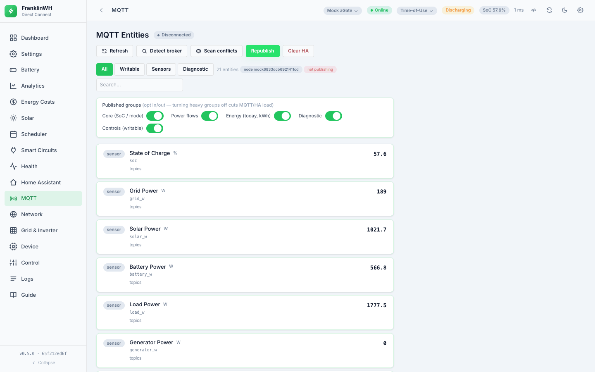

Both buttons are on the **MQTT** tab and act on the **gateway selected at the top**, not on
every gateway.

| Button | What it does |
|---|---|
| **Republish** | Sends this gateway's discovery configs again, using the groups that are switched on. If the gateway was unpublished, it turns publishing **back on** (saved) and its entities return within a poll. |
| **Unpublish** | Removes this gateway from Home Assistant **and keeps it removed**. It turns the gateway's publishing off (saved, so it survives restarts) and waits for its poller to stop. It then removes every retained topic this bridge can publish for it: discovery configs of all groups, state and availability. Finally it reads the broker back and reports how many topics were removed, and any it could not remove. Before you confirm, it shows how many topics it will remove. History already in Home Assistant stays. The gateway keeps polling, and recording if history is on. |

Nothing outside this bridge is touched. The topic list comes from the bridge's own entities
for that gateway, never from a wildcard, so other gateways and other FranklinWH software
(Modbus Bridge, FWHAI) are left alone. Every Unpublish is recorded in Control → Audit trail.

Disabling or removing a gateway in Settings → Gateways removes its entities the same way
([Multiple gateways](multi-gateway.md)).

### Why Operating Mode appears twice

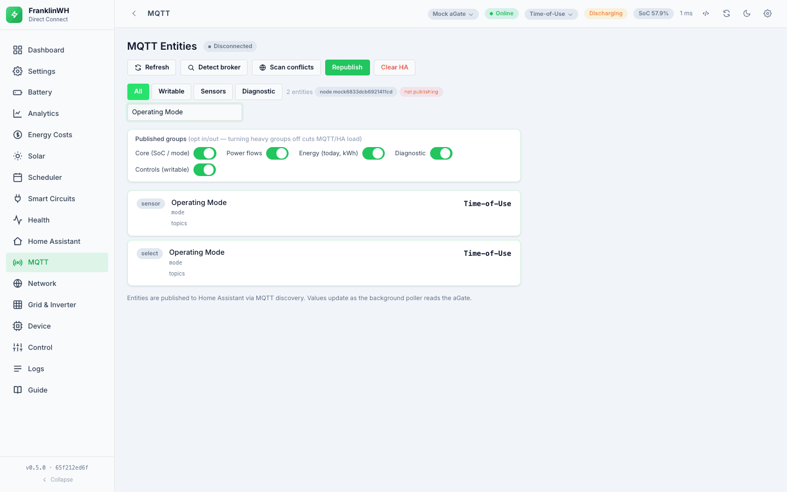

There is an **Operating Mode** sensor (read-only) and an **Operating Mode** select (the control).
Both show the same value. The sensor is redundant. Removing it removes a Home Assistant entity,
so it will go with the planned clean-up work, not in a quick fix.

---

## Sharing a broker with other FranklinWH software

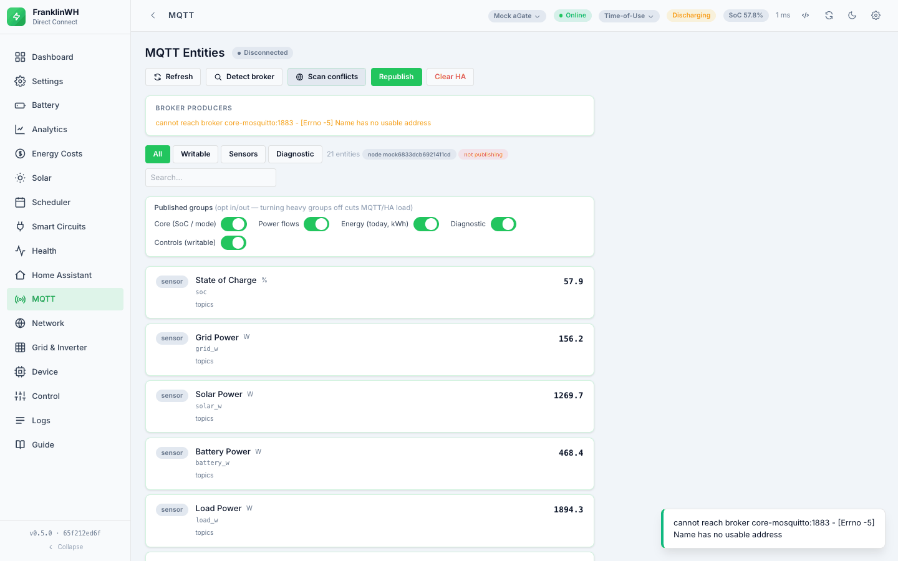

If you also run the FranklinWH Modbus Bridge or FWHAI against the same aGate and the same
broker, each publishes the gateway under **its own node id** — so the same physical device
shows up in Home Assistant as *duplicate devices*. That is the real failure mode, and it
is not a topic collision.

The MQTT tab's **Broker producers** panel scans the broker (a read-only sniff of a couple
of seconds) and lists any other FranklinWH publishers it finds, saying plainly "No other
FranklinWH producers on this broker — clean" when there are none. There is also an
**orphans** purge for discovery configs left behind by a node this bridge no longer
publishes; it is computed against *every* registered gateway, so on a multi-gateway
install one gateway's purge cannot delete another's entities.

---

## Shorter names in Home Assistant

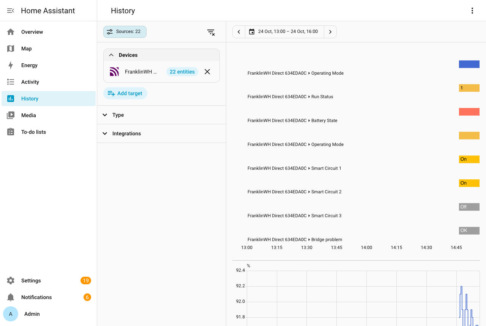

Home Assistant builds each entity's friendly name from **the device name + the entity
name**: *FranklinWH Direct 634EDA0C* + *Battery State*. On a phone, or in a history graph
with many rows, the device part fills the space. Every row is cut to the same
"FranklinWH Dir…", and you can't tell the rows apart.

You can shorten the device name in Home Assistant yourself. It takes a minute, and
nothing else changes.

**Steps**

1. In Home Assistant, open **Settings → Devices & services → Devices** and select the
   bridge's device (*FranklinWH Direct …*).
2. Select the **pencil** (Edit settings) at the top right.

   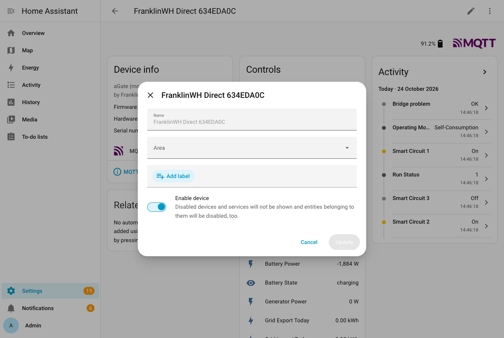

3. Type a short **Name**. Keep part of the serial (for example the last 4 characters,
   `aGate DA0C`) so that two aGates never share a name.
4. Select **Update**.

   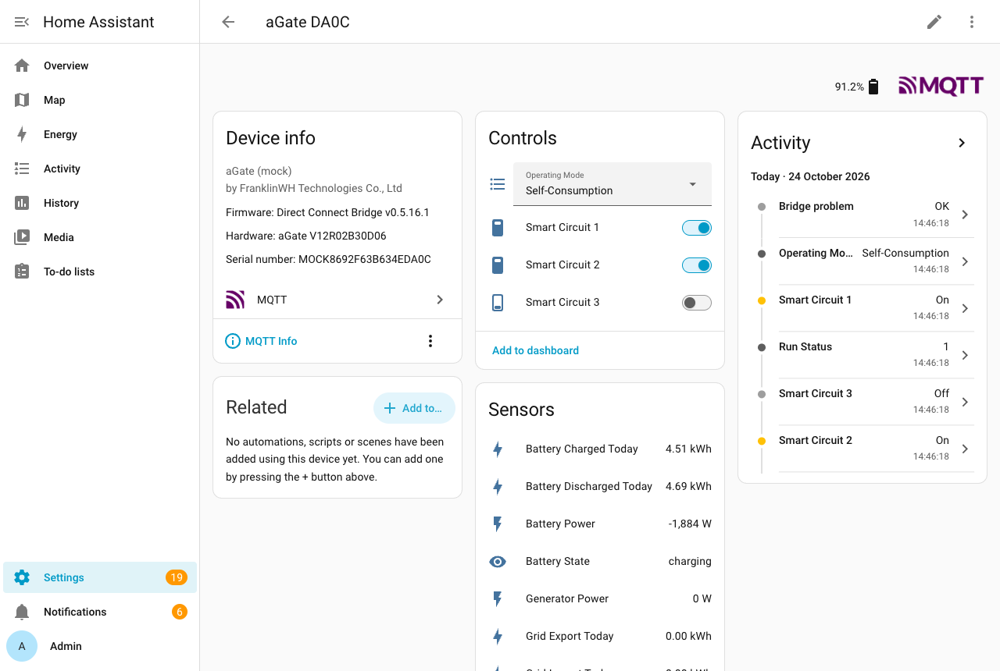

Every entity's friendly name now starts with the new name:

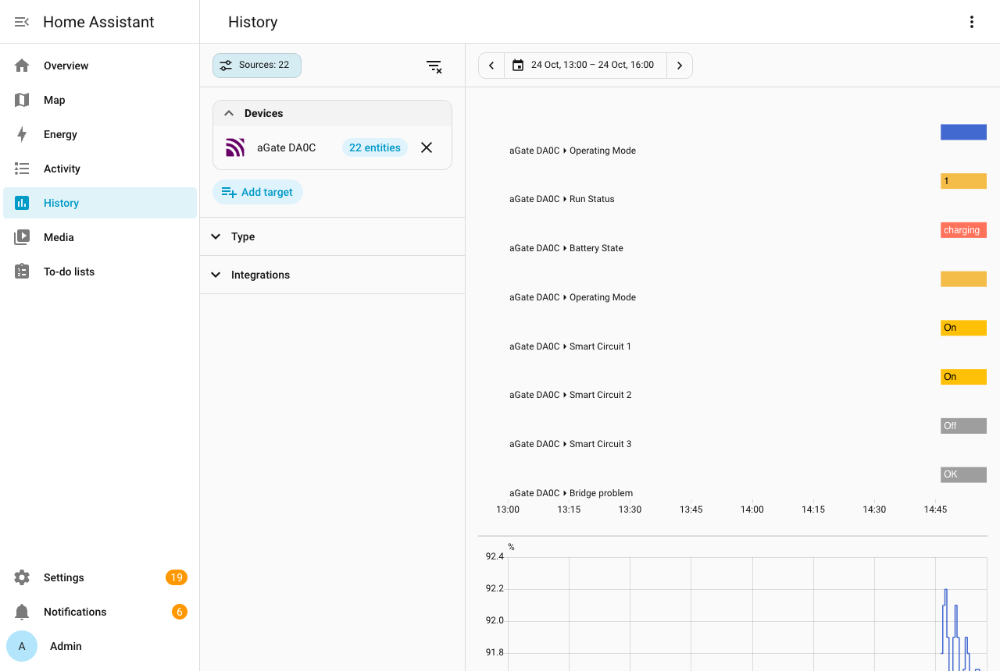

**What stays the same**

- **Entity IDs** (`sensor.franklinwh_direct_…`), so automations, dashboards and scripts
  keep working.
- **History and long-term statistics**, which follow the entity ID.
- **Your name survives republishing.** When the bridge republishes its devices (for
  example **Republish** on the MQTT tab), Home Assistant keeps a name you set yourself.
  The bridge's own name doesn't override it. To go back, open the dialog again and clear
  the name.

If Home Assistant offers to rename the **entity IDs** as well, choose **no**, unless you're
ready to update every automation and dashboard that uses them.

A setting in the bridge to choose this name before publishing, with a preview, is planned
([#320](https://github.com/david2069/franklinwh-direct-connect-bridge/issues/320)).

---

## Reinstalling, and keeping your history

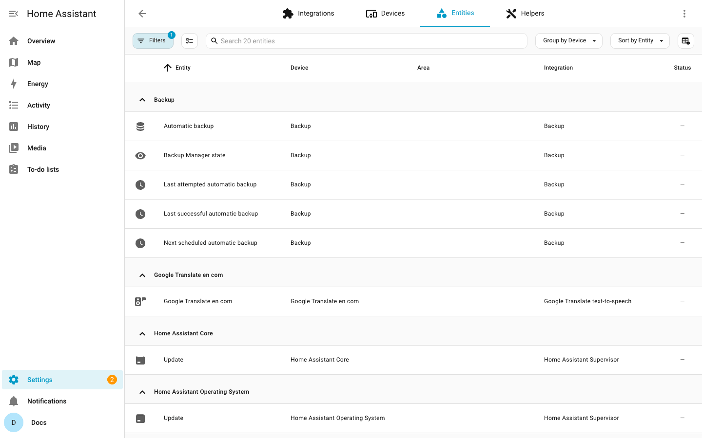

An **upgrade** keeps your entities. A **remove-and-reinstall** is the case that costs
people history: Home Assistant still holds the old entity under its id, the newly
discovered one lands as `_2`, and its history starts at zero — usually noticed weeks later
in the Energy dashboard.

The fix is Home Assistant's own and copies no data: free the old entity id, then rename the
new entity to it. History and long-term statistics follow the id.

- [INSTALL.md → Reinstalling](https://github.com/david2069/franklinwh-direct-connect-bridge/blob/main/INSTALL.md#reinstalling-read-this-before-you-remove-anything)
  — the steps.
- [HA_HISTORY.md](../HA_HISTORY.md) — the whole question, including why merging an old
  series into a new one by hand is **discouraged**, and what has to match before two series
  may be joined at all. The trap: this bridge's energy sensors are **daily** counters, so
  matching units do not make them the same series as a lifetime counter.

---

## The Home Assistant tab

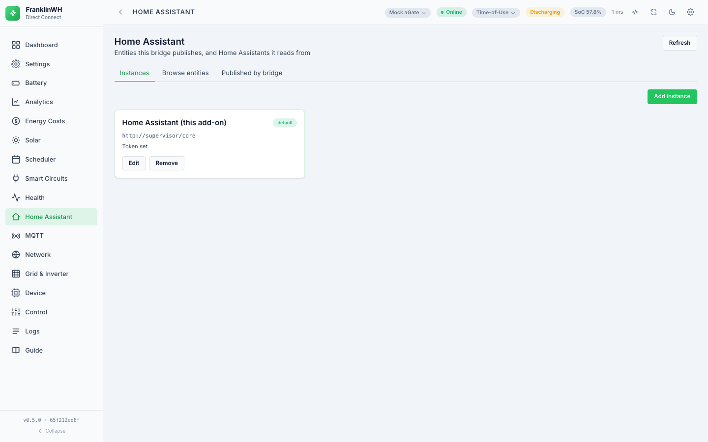

### Instances

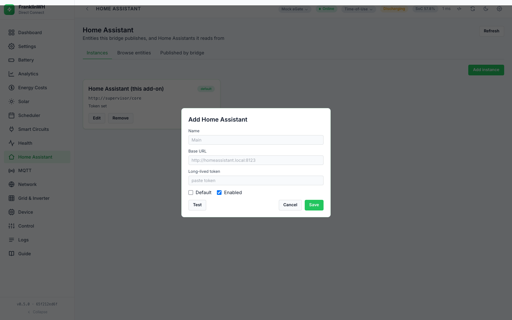

Add one or more HA instances with a base URL and a long-lived token; one can be marked
default, and each can be enabled or disabled. **Test** checks the connection. In the HA
add-on the supervisor provides the token and URL automatically, so notifications work
without configuring anything.

### Exposing entities

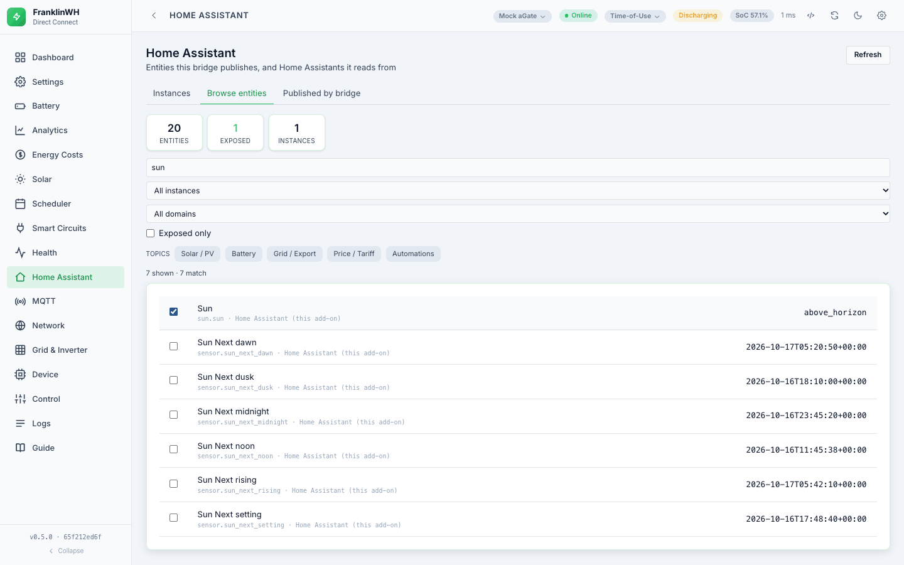

Browse an instance's entities (filterable by instance and domain) and **expose** the ones
you want. Exposing is what makes an entity available to the Scheduler as
`ha:<instance>:<entity_id>` — see
[Scheduler → Conditions](scheduler/conditions.md#home-assistant-entities). Only exposed
entities are offered and evaluated. (Each scheduler tick still fetches the instance's state
list and keeps the exposed ones.)

### Notification devices

Register notification targets, test one, or broadcast to all of them. These are what the
Scheduler's **Notify** action and the bridge's own alerts (an interrupted dispatch, for
instance) send to.

A separate set of **notification triggers** — the bridge's own standing alerts, as
opposed to a schedule's notify action — lives under
**Settings → Integrations → Notifications**, with a test button and its own log.

Step by step, with what each event sends and what is not yet available:
[Home Assistant setup and notifications](ha-setup-and-notifications.md).

### Dashboard card

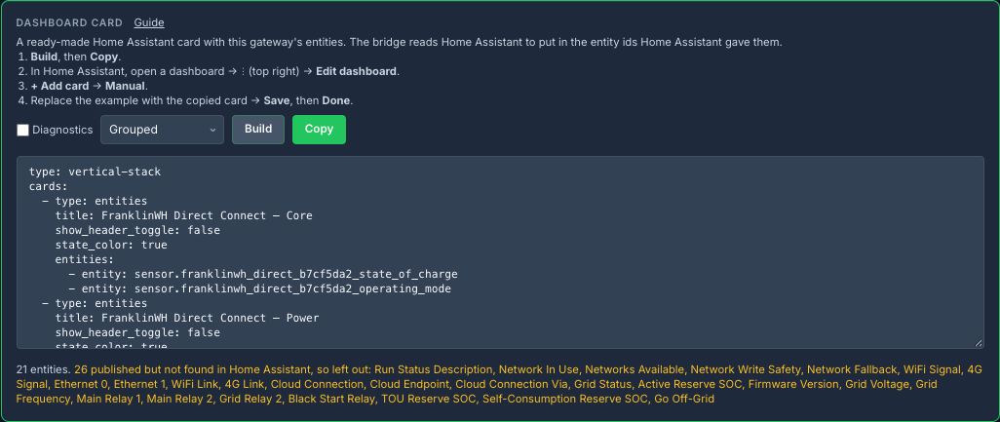

A ready-made Home Assistant card with this gateway's entities. The bridge reads Home
Assistant to put in the entity ids Home Assistant gave them, so the card works whatever
Home Assistant named them. Choose **Grouped** or **Single card**, and whether to include
the **Diagnostics**.

1. **Build**, then **Copy**.
2. In Home Assistant, open a dashboard → **⋮** (top right) → **Edit dashboard**.
3. **+ Add card** → **Manual**.
4. Replace the example with the copied card → **Save**, then **Done**.

Entities this gateway publishes that Home Assistant doesn't have are listed by name under
the card and left out of it. If none are found, the card says so: check that publishing is
on (**MQTT** tab) and that the Home Assistant under **Home Assistant → Instances** is the
one that uses this bridge's MQTT broker.
