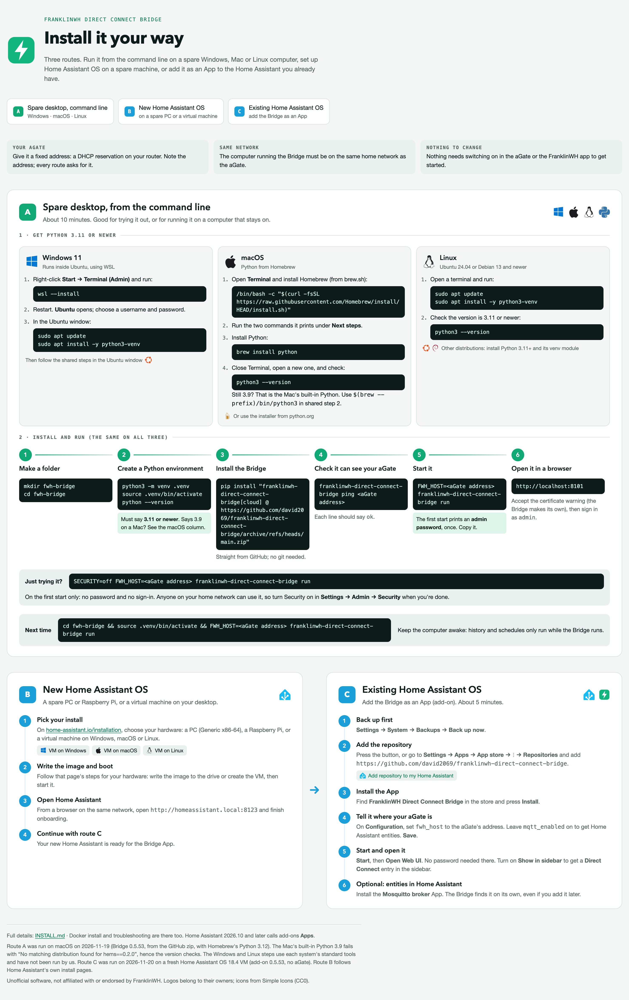

# Quick install: pick your route

[Back to the guide index](index.md)

Three ways to get the Bridge running, on one page:

- **A. A spare Windows, Mac or Linux computer**, from the command line.
- **B. A new Home Assistant OS**, on a spare PC, a Raspberry Pi or a virtual machine. Then C.
- **C. The Home Assistant OS you already have**, with the Bridge added as an App.

[Open the interactive page](../overview/quick-install.html){ .md-button } ·
[Light image (PNG)](../overview/quick-install.png) · [Dark image (PNG)](../overview/quick-install-dark.png)



For screenshots of each step see [Installing, in pictures](installing.md). The full text,
including Docker, upgrading and troubleshooting, is
[INSTALL.md](https://github.com/david2069/franklinwh-direct-connect-bridge/blob/main/INSTALL.md).
Where this page and INSTALL.md disagree, INSTALL.md is the reference.

## Before you start

- **Give the aGate a fixed address**: a DHCP reservation on your router. Every route asks
  for it.
- **Same network**: the computer running the Bridge must be on the same home network as the
  aGate.

## A. Spare desktop, from the command line

### 1. Get Python 3.11 or newer

=== "Windows 11"

    The Bridge runs inside Ubuntu on Windows (WSL).

    1. Right-click **Start → Terminal (Admin)** and run:

        ```bash
        wsl --install
        ```

    2. Restart. **Ubuntu** opens; choose a username and password.
    3. In the Ubuntu window:

        ```bash
        sudo apt update
        sudo apt install -y python3-venv
        ```

    Then do step 2 below in the Ubuntu window. Running the Bridge directly on Windows,
    without WSL, has not been tried.

=== "macOS"

    1. Open **Terminal** and install [Homebrew](https://brew.sh):

        ```bash
        /bin/bash -c "$(curl -fsSL https://raw.githubusercontent.com/Homebrew/install/HEAD/install.sh)"
        ```

    2. Run the two commands it prints under **Next steps**.
    3. Install Python:

        ```bash
        brew install python
        ```

    4. Close Terminal, open a new one, and check the version:

        ```bash
        python3 --version
        ```

        It must say 3.11 or newer. If it still says **3.9**, `python3` is the Mac's own
        Python, not Homebrew's. In step 2 below, use `$(brew --prefix)/bin/python3 -m venv .venv`
        instead of `python3 -m venv .venv`.

    Or use the installer from [python.org](https://www.python.org/downloads/).

=== "Linux"

    Ubuntu 24.04 or Debian 13 and newer:

    ```bash
    sudo apt update
    sudo apt install -y python3-venv
    python3 --version
    ```

    The version must be 3.11 or newer. On other distributions, install Python 3.11+ and its
    `venv` module with the system's package manager.

### 2. Install and run

The same on all three:

```bash
mkdir fwh-bridge
cd fwh-bridge
python3 -m venv .venv
source .venv/bin/activate
python --version
pip install "franklinwh-direct-connect-bridge[cloud]"
```

`python --version` must say 3.11 or newer before you run `pip install`. On an older Python,
pip stops with *No matching distribution found for hems==0.2.0*, because the Bridge's
dependencies need 3.11+. Delete the folder's `.venv` and create it again with a newer
Python (see your OS tab above).

That installs straight from GitHub; git is not needed. Check it can see your aGate (each line
should say `ok`):

```bash
franklinwh-direct-connect-bridge ping <aGate address>
```

Start it:

```bash
FWH_HOST=<aGate address> franklinwh-direct-connect-bridge run
```

!!! warning "Copy the admin password"
    The first start prints an **admin password**, once. Copy it before the window scrolls.

Open `http://localhost:8101` in a browser. Accept the certificate warning (the Bridge makes
its own certificate), then sign in as `admin`. See
[Security](security.md#the-first-admin) for what the first admin is and how to add other users.

- **Choose your own login instead:** set `ADMIN_USERNAME` and `ADMIN_PASSWORD` before the
  first start.
- **Lost the password:** run `franklinwh-direct-connect-bridge reset-password admin` in the
  same folder.

!!! tip "Just trying it? Start without a sign-in"
    On the **first** start, add `SECURITY=off`:

    ```bash
    SECURITY=off FWH_HOST=<aGate address> franklinwh-direct-connect-bridge run
    ```

    `http://localhost:8101` then opens straight away: no password, no certificate warning,
    and no admin is created. Anyone on your home network can use it, battery control
    included, so turn Security on under **Settings → Admin → Security** when you're done
    trying it. `SECURITY` is read only on the first start: it never turns Security off on
    an install that already has it on.

**Next time**, from the same folder:

```bash
cd fwh-bridge && source .venv/bin/activate && FWH_HOST=<aGate address> franklinwh-direct-connect-bridge run
```

History and schedules only run while the Bridge runs, so keep the computer awake.

## B. New Home Assistant OS

1. On [home-assistant.io/installation](https://www.home-assistant.io/installation/), choose
   your hardware: a PC (Generic x86-64), a Raspberry Pi, or a virtual machine on Windows,
   macOS or Linux.
2. Follow that page's steps: write the image to the drive or create the virtual machine,
   then start it.
3. From a browser on the same network, open `http://homeassistant.local:8123` and finish
   onboarding.
4. Continue with route C.

## C. Existing Home Assistant OS

1. **Back up first**: **Settings → System → Backups → Back up now**.
2. **Add the repository.** Press the button, or go to **Settings → Apps → App store → ⋮ →
   Repositories** and add `https://github.com/david2069/franklinwh-direct-connect-bridge`.

    [](https://my.home-assistant.io/redirect/supervisor_add_addon_repository/?repository_url=https%3A%2F%2Fgithub.com%2Fdavid2069%2Ffranklinwh-direct-connect-bridge)

3. **Install**: find **FranklinWH Direct Connect Bridge** in the store and press **Install**.
4. **Configure**: on **Configuration**, set `fwh_host` to the aGate's address. Leave
   `mqtt_enabled` on to get Home Assistant entities. **Save**.
5. **Start**, then **Open Web UI**. No password is needed there. To open it from the sidebar
   too, turn on **Show in sidebar** on the same page: a **Direct Connect** entry appears. It was
   off after a fresh install on Home Assistant OS 18.4 ([#784](https://github.com/david2069/franklinwh-direct-connect-bridge/issues/784)).
6. **Optional**: install the **Mosquitto broker** App for Home Assistant entities. The
   Bridge picks it up on its own, even if you add it later.

Home Assistant 2026.10 and later calls add-ons **Apps**; earlier versions say *Add-ons* and
*Add-on Store*.

## How this page was checked

- **Route A on macOS** was run on 2026-11-19 with Bridge 0.5.53, installed from the GitHub
  zip as above, using Homebrew's Python 3.12 by its full path: `ping`, the first start (the
  admin password was printed), and `http://localhost:8101` redirecting to the HTTPS sign-in
  page.
- **Plain `python3` on macOS** was also tried on 2026-11-19. On that Mac it was Apple's
  Python 3.9.6 (from Xcode), and the install failed with *No matching distribution found
  for hems==0.2.0* (PyPI lists `hems` 0.2.0 as `requires_python >=3.11`). That is why the
  version checks are there.
- **The `SECURITY=off` quick start** (added in [#786](https://github.com/david2069/franklinwh-direct-connect-bridge/pull/786))
  was run on 2026-11-20 on macOS with Bridge 0.5.54, installed from this branch, on an empty
  data folder and with no aGate. Port 8101 answered `200` with no redirect to the sign-in
  page, no password was printed, and the log warned that Security is off.
- **Route A on Windows and Linux** uses each system's standard tools and has **not been run**
  for this page.
- **Routes B and C** follow Home Assistant's own installation pages and this project's
  [Installing, in pictures](installing.md#home-assistant-add-on), whose screenshots were taken
  on 2026-10-16 with release 0.5.0. The sidebar title (`panel_title: "Direct Connect"`) and
  option names (`fwh_host`, `mqtt_enabled`) are from the add-on's `config.yaml`.
- **Route C** was run on 2026-11-20 on a fresh Home Assistant OS 18.4 virtual machine with
  add-on 0.5.53 and no aGate: repository added, App installed and started. **Show in sidebar**
  was off after installing; **Open Web UI** worked, and with the toggle on, **Direct Connect**
  appeared in the sidebar. The add-on log reported Security on for a new install and printed
  no password; the sidebar panel opened without a sign-in.
- **On that virtual machine, Home Assistant answered on port 80**, and every request to 8123
  was redirected to the same path on port 80. On a home network, `homeassistant.local:8123`
  therefore still lands on Home Assistant. Seen on one install only.
