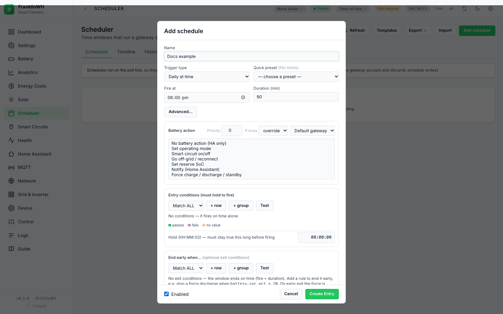
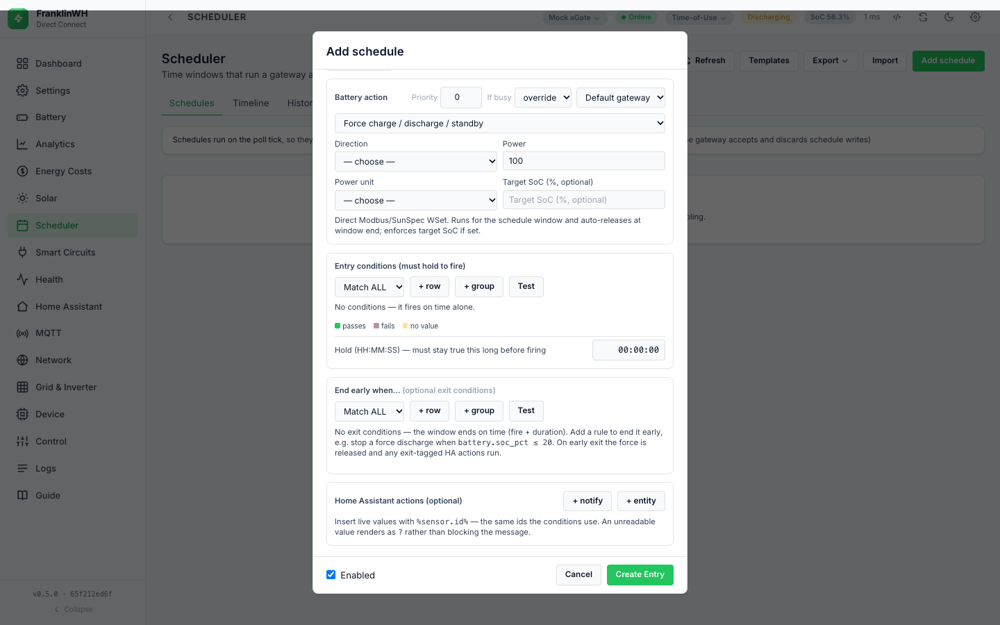
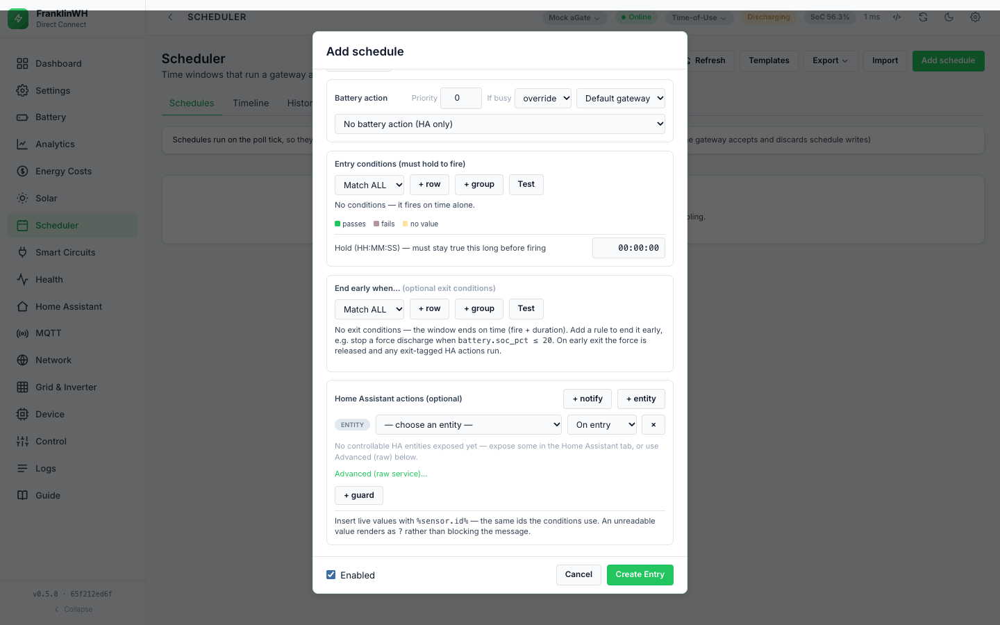

# Actions

Direct Connect Bridge. Mirrors the Modbus Bridge page
[Actions](https://david2069.github.io/franklinwh-modbus-bridge/user/scheduler/actions/)
section for section.

The action is what a schedule does when it fires. Each schedule has one **Battery action**
(or *No battery action (HA only)*) plus any number of **Home Assistant actions**.



## Summary

The **Battery action** list comes from the bridge (`GET /api/schedules` → `actions`). Each
action shows a note from the code under the list.

| Battery action (UI) | API `action.kind` | Parameters | What the bridge sends |
|---|---|---|---|
| Set operating mode | `set_mode` | `mode`: `tou`, `self` or `backup` | an operating-mode change (Direct Connect 1727) |
| Smart circuit on/off | `smart_circuit` | `circuit` (1–3), `on` | a smart-circuit write (1409, read back) — **Direct Connect only** |
| Go off-grid / reconnect | `offgrid` | `on`, `soc` | an off-grid switch (1723) — **Direct Connect only** |
| Set reserve SoC | `reserve_soc` | `mode`, `soc` | nothing: always skipped (see below, #129) |
| Force charge / discharge / standby | `force` | `direction`, `power`, `unit`, `target_soc` | a WSet power setpoint through the Modbus client (this bridge) to the Modbus TCP Server (aGate :502) |
| No battery action (HA only) | `""` (empty) | — | nothing; only the Home Assistant actions run |

Every action except a force is a **one-shot**: it is sent once per occurrence (one opening of
the window) and is not sent again until the next occurrence. Nothing a one-shot changed is
undone when the window closes, unless **restore on exit** is set (see
[Exit and release](exit-and-conflicts.md#release-policy)). A force is held for the run and
released at the end of the window. <!-- @b ACT-01 ;; src: scheduler.py:538-541, scheduler.py:2453-2458 ;; tested: tests/test_scheduler.py::test_fires_once_per_day ;; write: yes ;; b: An action is sent once per occurrence; due() refuses the same occurrence key once it is marked fired -->

**The API does not check the action when you save.** `action` is stored as sent: an unknown
kind, a `set_mode` with no `mode` or a force with no direction is accepted. It fails or is
skipped only when it runs. <!-- @b ACT-02 ;; src: app.py:629-688, app.py:3088-3103 ;; untested ;; write: yes ;; b: POST and PUT /api/schedules accept any action dict with no validation ;; test: unit (API): POST an unknown action kind and a set_mode without mode; assert 201 today, decide whether to refuse -->
An unknown kind sends nothing and is logged *fired* with the text "unknown action '…'".
<!-- @b ACT-29 ;; src: scheduler.py:1853, scheduler.py:1642-1643 ;; tested: tests/test_scheduler.py::test_unavailable_action_reports_the_reason_when_run ;; write: no ;; b: An unknown action kind returns "unknown action '<kind>'", which the classifier reads as skipped -->

**Not available here.** One action is listed as unavailable, with its reason, rather than
hidden: `smart_circuit_schedule` — *"the gateway accepts and discards schedule writes"*. The
Scheduler tab names it in its note at the top, and import refuses an entry that uses it.
<!-- @b ACT-37 ;; src: scheduler.py:73-77, scheduler.py:1851-1852, scheduler.py:846-850, templates/tabs/scheduler.html:64-71 ;; tested: tests/test_scheduler.py::test_unavailable_action_reports_the_reason_when_run ;; write: no ;; b: smart_circuit_schedule is listed as unavailable with its reason, is skipped if run and is an import error -->

## Battery actions: Force Charge and Force Discharge



One action, **Force charge / discharge / standby**, with a **Direction**: *Force charge*,
*Force discharge* or *Force standby (hold)*. It goes through the Modbus client (this
bridge) — the same path as the Battery Control widget on the Control tab — to the Modbus
TCP Server (aGate :502). It is independent of the FranklinWH Modbus Bridge.

**Direct Connect only: the action needs a ready Modbus client.** In the form the action is
listed as *"— unavailable"* and cannot be picked while `force_available` is false; the form
then shows *"Modbus unavailable: <reason>"*. <!-- @b ACT-38 ;; src: app.py:3031-3046, templates/tabs/scheduler.html:552-564 ;; untested ;; write: no ;; b: The force option is disabled in the form with the reason when battery_control.available() is false ;; test: browser: with the Modbus client off, the force option is disabled and the reason shown -->
At send time the bridge checks again: a force is sent only when a SunSpec read through the
Modbus client (this bridge) succeeds (state *ready*). Otherwise nothing is written and the
result says why: *not_configured* (no host, or the Modbus client (this bridge) is off),
*unreachable* (nothing answered on TCP 502) or *no_sunspec* (the port answered, SunSpec did
not). <!-- @b ACT-30 ;; src: battery_control.py:377-402, battery_control.py:492-504 ;; untested ;; write: yes ;; b: execute() refuses every force unless capability() confirms a SunSpec read (state ready) ;; test: unit: capability not ready returns ok False with the state and never calls send_command -->
With no gateway host at all the action is skipped: *"force skipped: no gateway host to
reach over Modbus"*. <!-- @b ACT-31 ;; src: scheduler.py:1542-1543 ;; tested: tests/test_scheduler.py::test_force_without_dispatch_path_skips_safely ;; write: yes ;; b: A force with no host returns "force skipped" and sends nothing -->

### Power and sizing

| Power unit | Where | Result |
|---|---|---|
| **% of inverter power** (`pct`) | form (default) and API | that share of the gateway's rated power for the direction |
| **kW** (`kw`) | form and API | that power, converted to watts |
| **W** (`w`) | API only | that power in watts |

<!-- @b ACT-05 ;; src: static/js/scheduler_tab.js:474-476, scheduler.py:1551-1558 ;; untested ;; write: yes ;; b: The form offers pct and kW; the engine also accepts w; any other unit is read as pct ;; test: unit: _force_dispatch with unit kw, w and pct passes the right power_w/power_pct/power_mode to execute -->

- **Percent** is sized against the gateway's SunSpec model 702 ratings (max charge and max
  discharge), read through the Modbus client (this bridge) at send time. If the ratings
  cannot be read, **5000 W** is assumed for each direction. <!-- @b ACT-03 ;; src: battery_control.py:437-443, battery_control.py:519-528 ;; untested ;; write: yes ;; b: pct power = rating for the direction x pct/100; the rating falls back to 5000 W when discovery fails ;; test: unit: fake controller with RATED_MAX_CHARGE_W 8000 and a failing discover; assert 50 % -> 4000 W and 2500 W -->
- **kW and W are sent as given.** The bridge does not cap them at the rating. Whether the
  `franklinwh-modbus` library or the aGate limits them is **unverified**. <!-- @b ACT-10 ;; src: battery_control.py:524-528, scheduler.py:1553-1556 ;; unclear ;; write: yes ;; b: A power in W or kW is not capped by the bridge at the 702 rating ;; test: unit: power_w above max_ch is passed to BatteryCommand unchanged; decide whether to cap -->
- When you first pick the force action, the form fills in *Force discharge*, *% of inverter
  power* and `100`, so a new force is never 0 W by accident.
- **Empty power through the API is 0.** `power` missing or empty reads as 0, which is a
  0 W (standby) setpoint in the charge or discharge direction. <!-- @b ACT-04 ;; src: scheduler.py:1552-1558, static/js/scheduler_tab.js:490-497 ;; unclear ;; write: yes ;; b: An empty power is 0 (pct 0 or 0 W), not the full rating; only the form seeds 100 % ;; test: unit: force with no power sends 0 W; decide whether empty should mean full rating -->

**Not in this bridge: a trusted battery rating.** The Modbus Bridge refuses a force until the
rating is calibrated or confirmed by a measured peak. This bridge has no such check: it
trusts the 702 rating (or 5000 W). There is no overshoot guard either (see
[Outcomes and audit](outcomes.md#overshoot-guard)).

**A refused force is a failed run.** When the Modbus client (this bridge) is off,
unreachable or SunSpec does not answer, the run is logged *error* with the reason, such as
*"force charge failed: This bridge's Modbus client is off …"*, and retried while the window
is open (#191). <!-- @b ACT-13 ;; src: scheduler.py:1826-1830, battery_control.py:603-617 ;; tested: tests/test_force_ownership.py::test_a_refused_force_is_a_failed_run_not_fired ;; write: yes ;; b: A force refused for capability reasons returns 'force <dir> failed: <reason>', so the run is failed and retried, not fired -->

### What is written

1. The bridge connects to the Modbus TCP Server (aGate :502) through the Modbus client (this
   bridge), unit id 2, and reads the 702 ratings.
2. It sends one `BatteryCommand` with the signed power (charge positive, discharge negative,
   standby 0) through the `franklinwh-modbus` library, which writes the WSet setpoint
   (SunSpec model 704). Which registers the library writes is the library's; it is not
   re-checked here.
3. On success it starts its own **watchdog** (below), logs *dispatch-start* under the
   **battery** filter in History, and records the dispatch in the `dispatches` table so a
   restart can find it.

<!-- @b ACT-14 ;; src: battery_control.py:505-543, scheduler.py:1578-1597 ;; untested ;; write: yes ;; b: A force connects, reads ratings, sends one BatteryCommand, arms the watchdog, logs dispatch-start and records the dispatch row ;; test: unit: fake controller; assert send_command power, _arm_watchdog args and a dispatches row with signed watts -->

The bridge reads nothing back after the send: success is what `send_command` returns.

- **The bridge does the releasing.** It does not give the library a duration. Its watchdog
  thread checks every 5 seconds and releases at the time limit or the target SoC. The module
  notes that the aGate's hardware revert timer is cosmetic on this firmware, so a running
  bridge is the only thing that ends a force (a claim from the code's comment, **unverified**
  here). <!-- @b ACT-15 ;; src: battery_control.py:1-8, battery_control.py:92-110, battery_control.py:532-536 ;; untested ;; write: yes ;; b: The bridge's own watchdog (5 s loop) releases the force; no duration is handed to the library ;; test: unit: arm with duration 10 s and a fake clock; assert _release_now after 10 s -->

- **One force per gateway.** The Modbus client (this bridge) supervises each gateway's force
  on its own, with its own time limit, target SoC and SoC reader. A force on a second
  gateway (for example with gateway scope *all*) never ends or changes the first one's, and
  the watchdog releases only its own gateway (#194). A newer force on the **same** gateway
  replaces the older one. <!-- @b ACT-39 ;; src: battery_control.py:20-60, battery_control.py:74-170 ;; tested: tests/test_multigw_force.py::test_a_second_gateways_force_keeps_the_first_ones_limits ;; write: yes ;; b: battery_control holds one force per host part, each with its own stop event, SoC reader and event sink (see also test_each_force_keeps_its_own_soc_reader, test_the_watchdog_releases_only_its_own_gateway) -->

**One attempt per tick.** A force, mode, circuit or off-grid write is sent once per tick,
with no retry or wait inside the tick, so one failing gateway never holds up the others
(#197). <!-- @b ACT-40 ;; src: scheduler.py:1879-1884, resilience.py:107-110 ;; tested: tests/test_force_ownership.py::test_a_failing_scheduled_write_never_sleeps_inside_the_tick ;; write: yes ;; b: run_action_outcome uses resilience.SCHEDULED (one attempt) for device writes; nothing sleeps inside the tick -->
If it fails, the run is *failed* and the scheduler retries it on later ticks (see
[Outcomes and audit](outcomes.md#retries)).

!!! note "The window end is the deadline"
    The deadline bounds the one attempt a tick makes. It is the window's close. For an *Always* entry and a zero-duration window
    there is no close, so the fallback (fire time + duration on today's date) is now or in
    the past and the deadline becomes **1 second**: one attempt only. <!-- @b ACT-42 ;; src: scheduler.py:2411-2413, scheduler.py:273-279, scheduler.py:1652-1654 ;; unclear ;; write: yes ;; b: With no window end the deadline falls back to fire_at+duration today, which is often past, so resilience gets 1 s ;; test: unit: always entry with a failing force; assert number of attempts -->

!!! note "An *unknown* outcome cannot happen here today"
    The resilience layer can return *unknown* (the write may have landed) and the scheduler
    would settle such a run without retrying. But the action body never raises, and a failed
    result is turned into a `ConnectionError`, which counts as "never arrived". So scheduler
    actions end *ok*, *failed* or *skipped*, never *unknown*. The *unknown* path is only
    exercised by tests that mock it. <!-- @b ACT-41 ;; src: scheduler.py:1655-1667, scheduler.py:1854-1855, resilience.py:70-80 ;; unclear ;; write: yes ;; b: Verdict UNKNOWN is unreachable for scheduler actions because failures are raised as ConnectionError ;; test: unit: a run_action that times out after the request left should yield UNKNOWN through run_action_outcome -->

### Parameters you can set only through the API

| Param | In the form | Effect |
|---|---|---|
| `target_soc` | yes: **Target SoC (%, optional)** | Charge stops at SoC ≥ target, discharge at SoC ≤ target. Checked every 5 s against the gateway's last poll. Empty or 0 = no target. Ignored for standby. |
| time limit | no field | Always the schedule's **Duration (min)** × 60. 0 = no time limit. |
| `unit: "w"` | no | power in watts |

<!-- @b ACT-18 ;; src: battery_control.py:101-110, scheduler.py:1560-1565, scheduler.py:1577 ;; untested ;; write: yes ;; b: target_soc releases a charge at SoC>=target and a discharge at SoC<=target every 5 s from the poller cache; 0 = off ;; test: unit: arm with watts>0, target 80, soc_getter returning 81; assert release -->

The time limit comes from **Duration (min)**, not from the window.
<!-- @b ACT-17 ;; src: scheduler.py:2409-2413, scheduler.py:1578-1581, battery_control.py:99-100 ;; untested ;; write: yes ;; b: The force time limit is duration_min x 60 for every trigger type, enforced by the watchdog ;; test: unit: tick a window-trigger force entry; assert execute duration_s equals the window length (fails today, #160) -->

!!! warning "A force in a *Recurring windows* schedule stops after the hidden Duration (min)"
    *Recurring windows* hides **Duration (min)**, but the schedule still has one, and a new
    schedule starts with 90. A force in a 17:00 → 20:00 window therefore releases after
    90 minutes. Use **Daily at time** or **Weekly at time** for a force, with the duration
    you want (#160).

Saving from the form keeps whatever else the action object holds: the form edits a copy of
the stored action and sends it back whole. <!-- @b ACT-19 ;; src: static/js/scheduler_tab.js:273, static/js/scheduler_tab.js:556-561, app.py:3111-3127 ;; untested ;; write: yes ;; b: The form sends the whole action object, so API-only keys in it survive a form save ;; test: unit (API): PUT with the form's body keeps action keys the form does not show -->

## Battery actions: Force Standby

*Force standby (hold)* sends 0 W: the battery neither charges nor discharges. It needs the
same ready Modbus client (this bridge) as charge and discharge. <!-- @b ACT-20 ;; src: battery_control.py:519-522, scheduler.py:1522-1525 ;; untested ;; write: yes ;; b: Standby is BatteryCommand(0 W) after the same capability check ;; test: unit: execute Force Standby sends power_watts 0 -->

## Battery actions: Release

**Not in this bridge.** There is no schedule action that only releases (#162). A force is
released at the end of its window, by its exit conditions, by **Stop**, by its own time limit
or target SoC, or by the **Release** control on the Control tab.

## Non-battery actions: Reserve and Operating Mode

=== "Set operating mode"

    | Param | Values |
    |---|---|
    | Operating mode (`mode`) | a picker of the gateway's three modes, stored as `tou`, `self` or `backup` |

=== "Set reserve SoC"

    | Param | Values |
    |---|---|
    | `mode`, SoC (%) (`soc`) | shown in the form, but never written |

The mode picker lists the gateway's own mode names, stored by work mode (1 → `tou`,
2 → `self`, 3 → `backup`); with no gateway data it offers Time-of-Use, Self-Consumption and
Emergency Backup. <!-- @b ACT-22 ;; src: static/js/scheduler_tab.js:451-462, scheduler.py:1785-1787, client.py:371-380 ;; tested: tests/test_scheduler.py::test_operating_mode_is_a_picker_not_a_text_box ;; write: yes ;; b: Mode is a picker of tou/self/backup from the gateway's work modes; set_mode sends it over Direct Connect ;; test: — -->
A `set_mode` with no `mode` (API) fails when it runs and is retried. <!-- @b ACT-23 ;; src: scheduler.py:1785-1787, scheduler.py:1854-1855 ;; untested ;; write: yes ;; b: A set_mode without mode raises KeyError, returned as "set_mode failed" and retried ;; test: unit: run_action_outcome set_mode with no mode is FAILED -->

**A mode or off-grid write that the aGate rejects is a failed run.** `set_mode` returns ok
only when the aGate answers result 0. A rejection is logged *error* as *"mode -> tou:
failed: {'ok': False, 'result': 3}"* and retried while the window is open (#191). Off-grid
behaves the same. A smart-circuit write counts *NOT confirmed* as a failure. <!-- @b ACT-24 ;; src: scheduler.py:2020-2034 ;; tested: tests/test_force_ownership.py::test_a_rejected_mode_write_is_a_failed_run ;; write: yes ;; b: set_mode and offgrid results with ok False return text containing 'failed', so the run is failed and retried -->

**Set reserve SoC never writes.** It is always skipped with *"reserve_soc skipped: no local
write path exists … needs a cloud provider"*, even when cloud credentials are set up and
`POST /api/cloud/reserve` works. A skip counts as success, so it is logged *fired* (#129).
<!-- @b ACT-32 ;; src: scheduler.py:1847-1849, scheduler.py:2424-2429 ;; tested: tests/test_fire_entry_outcomes.py::test_a_skipped_action_is_not_a_failure ;; write: yes ;; b: reserve_soc is always skipped and a skipped verdict is recorded as a successful run ;; test: — -->

**Not in this bridge: mode-write-locked.** The Modbus Bridge marks a gateway whose mode
writes are ignored. This bridge does not.

**If busy** applies to force actions only: a mode change is sent even while another
schedule's force is running. In the same tick, though, a mode schedule and a force schedule
on one gateway compete for the same resource and only the higher priority runs (see
[Priorities and conflicts](priorities.md)). <!-- @b ACT-26 ;; src: scheduler.py:2126-2140, scheduler.py:2183-2190 ;; untested ;; write: yes ;; b: The If busy check runs only for force winners; set_mode and reserve_soc still contend as the battery resource in the same tick ;; test: unit: active dispatch owned by A, set_mode entry B with conflict defer; assert set_mode is sent -->

## No battery action (HA only)

Choose *No battery action (HA only)*. The schedule sends nothing to the gateway and only its
Home Assistant actions run. It claims no resource, so it never competes with other schedules.
With no HA actions either, it still fires and logs *fired — nothing to do*.
<!-- @b ACT-27 ;; src: scheduler.py:2183-2212, scheduler.py:2408-2417 ;; tested: tests/test_scheduler.py::test_a_notify_rule_claims_nothing ;; write: no ;; b: An empty action claims no resource and only runs the HA actions ;; test: — -->

Exit conditions still apply to such a schedule: they close its window early and run its
exit-time actions (see [Exit and release](exit-and-conflicts.md#exit-conditions)).

**Run now** on such a schedule runs its *On entry* and *Entry & exit* HA actions (guards
honoured) and logs *manual*. <!-- @b ACT-28 ;; src: app.py:3441-3455 ;; untested ;; write: no ;; b: Run now runs the fire-phase HA actions of any schedule, including HA-only ones ;; test: unit (API): Run now on an HA-only schedule calls the notify once and logs manual -->

## Home Assistant actions



Under **Home Assistant actions (optional)**:

- **+ notify** adds a message to a saved notification device. It is disabled until you add
  one. The message names the gateway the rule ran on, on entry, on exit
  and with **Run now**. <!-- @b HAA-19 ;; src: scheduler.py _fire_ha_phase, app.py api_schedule_run ;; tested: tests/test_notify_row_gateway.py ;; write: no ;; b: notify rows pass the schedule's gateway, so the message names it (#577) ;; test: — -->
- **+ entity** adds a service call. It is disabled until a Home Assistant instance exists.
  The guided picker lists the controllable entities you **exposed** on the Home Assistant
  tab (switch, input_boolean, light, select, input_select, number, input_number, button,
  scene, script) and offers the control for the domain: Turn On / Turn Off / Toggle, an
  option, a value, press, or run. **Advanced (raw service)…** takes any domain, service,
  entity and a JSON data payload.

| Field | Values | Notes |
|---|---|---|
| Kind | NOTIFY, ENTITY (guided), SERVICE (raw) | |
| Notify device | a saved device | **Settings** notification devices |
| Title, Message (notify) | text | no length limit, no required field |
| When | **On entry**, **On exit**, **Entry & exit** | |
| Guard (**+ guard**) | sensor, operator, Value or Lookup | runs the action only if it holds at that moment |

The API and the form do not check HA actions. An incomplete row is saved as it is. When it
runs it is skipped with the reason: *"service skipped: no HA instance selected"*, *"…domain
and service are required"*, *"notify skipped: device no longer exists"*, or *"…is switched
off"*. <!-- @b HAA-01 ;; src: scheduler.py:1801-1827, app.py:629-688 ;; tested: tests/test_scheduler.py::test_ha_service_requires_instance_and_fields ;; write: no ;; b: HA actions are not validated at save; at run time a missing instance or domain/service is skipped with the reason ;; test: — -->
<!-- @b HAA-02 ;; src: static/js/scheduler_tab.js:419-441 ;; untested ;; write: no ;; b: The form saves every HA action row, complete or not ;; test: browser: save a notify row with no message; assert it is stored -->

A raw service whose data is not valid JSON is skipped: *"service skipped: data is not valid
JSON"*. <!-- @b HAA-15 ;; src: scheduler.py:1828-1834 ;; tested: tests/test_scheduler.py::test_ha_service_bad_json_is_reported ;; write: no ;; b: Raw service data that is not JSON skips the call with the reason ;; test: — -->
A guided entity action calls `/api/services/<domain>/<service>` with the entity and its data.
<!-- @b HAA-16 ;; src: scheduler.py:1818-1845, static/js/scheduler_tab.js:383-399 ;; tested: tests/test_scheduler.py::test_ha_guided_entity_action_calls_domain_service ;; write: no ;; b: A guided entity action calls domain.service with {entity_id, **data} ;; test: — -->

**One notify path (#576).** Notifications are sent only from these rows. *Notify (Home
Assistant)* is no longer a battery action: a schedule saved with it, imported with it or
sent with it through the API gets an **On entry** notify row instead. A notify row can be
an **Actionable notification** (buttons, a wait, what no reply does); see
[Actionable notifications](../ha-setup-and-notifications.md#actionable-notifications). <!-- @b HAA-18 ;; src: scheduler.py normalize_spec, entry_ask, migrate_notify_paths ;; tested: tests/test_actionable_notify_576.py ;; write: no ;; b: one notify path: the notify action and ask move into notify rows -->

### When they run

| When | Runs |
|---|---|
| On entry | each time the schedule fires, **after** the battery action |
| On exit | at each closing edge of the window: the time ends, or the exit conditions become true |
| Entry & exit | both |

<!-- @b HAA-05 ;; src: scheduler.py:1918-1931 ;; untested ;; write: no ;; b: An HA action runs in a phase when its when is that phase or both (default fire) ;; test: unit: _fire_ha_phase with when both runs in fire and in exit; exit-only does not run in fire -->

- On-entry actions do not run while the entry conditions fail or the hold is counting.
  <!-- @b HAA-04 ;; src: scheduler.py:2045-2076, scheduler.py:2415-2416 ;; untested ;; write: no ;; b: Fire-phase HA actions run only from _fire_entry, after the gate and hold passed ;; test: unit: gated entry with a notify action; assert no send -->
- They run once per successful occurrence. <!-- @b HAA-03 ;; src: scheduler.py:2397-2458 ;; untested ;; write: no ;; b: Fire-phase HA actions run inside _fire_entry after the battery action ;; test: unit: two ticks inside one window; assert one notify -->
- **Stop** does not run the exit actions; **Run now** runs the on-entry actions.

!!! warning "On-entry actions run even when the battery action failed, and again on each retry"
    The bridge runs the on-entry HA actions right after the battery action, whatever its
    result. If the action failed, the run is retried later in the window (30 s, then
    doubling), and the HA actions run again each time. A "Discharge started" notification can
    therefore arrive several times for a discharge that never started. Issue #203.
    <!-- @b HAA-07 ;; src: scheduler.py:2408-2417, scheduler.py:2459-2466 ;; unclear ;; write: no ;; b: Fire-phase HA actions run after a failed battery action and on every retry ;; test: unit: failing force plus notify, two retries; assert one notify (fails today) -->

!!! note "On-exit actions run when the window closes, fired or not"
    This is by design: exit-time actions run at the closing edge of the window, not at the
    end of a run. A schedule whose entry conditions failed for the whole window still sends
    its *On exit* message. Exit conditions that turn true, false and true again run the exit
    actions each time. (Only the force **Release** at window close depends on whether this
    schedule holds the force; see [Exit and conflicts](exit-and-conflicts.md#how-a-run-ends).)
    <!-- @b HAA-06 ;; src: scheduler.py:2259-2302 ;; unclear ;; write: no ;; b: Exit-phase HA actions run at every closing edge of the effective window, fired or not (by design) ;; test: unit: gated window with an exit notify; assert it is sent -->

### Guards

**+ guard** adds one condition to an HA action, checked against the live values at the moment
the action is due. The API also takes a `{match, conditions}` tree. False, or no value: the
action is skipped silently, with no History row. <!-- @b HAA-08 ;; src: scheduler.py:1907-1915, scheduler.py:1926-1927, static/js/scheduler_tab.js:431-438 ;; untested ;; write: no ;; b: A guard is one leaf or a tree; false or missing data skips the action without a log line ;; test: unit: guard false skips the call; guard tree with match any works -->

### Placeholders in notifications

Title and message can quote live values with `%sensor.id%`, the same ids as the conditions:

```text
SoC %battery.soc_pct%%, mode %mode.name%, grid %grid.power_w%W
```

- A sensor with no value, or an unknown id, prints `?`. The message is still sent.
  <!-- @b HAA-09 ;; src: scheduler.py:191-204 ;; tested: tests/test_scheduler.py::test_unreadable_variable_renders_as_question_mark_not_a_failure ;; write: no ;; b: %id% is replaced by the snapshot value, or ? when missing ;; test: — -->
- Numbers print as stored (no rounding).
- Ids with more than one dot work; `ha:` ids do not, because the colon is not matched, so
  `%ha:…%` is left as typed (#169). <!-- @b HAA-10 ;; src: scheduler.py:191 ;; untested ;; write: no ;; b: The placeholder pattern allows letters, digits, _ and dots, not colons ;; test: unit: substitute("%ha:i1:sensor.x%") is left unchanged today -->
- **Direct Connect only: placeholders also work in a service call.** They are filled in the
  entity id and in every text value of the data. <!-- @b HAA-14 ;; src: scheduler.py:1835-1841 ;; tested: tests/test_scheduler.py::test_ha_service_action_calls_the_service ;; write: no ;; b: Placeholders are substituted in a service call's entity_id and string data values ;; test: — -->
- **Direct Connect only: run variables.** `%schedule.name%`, `%schedule.id%`,
  `%schedule.priority%`, `%schedule.action%`, `%gateway.id%`, `%run.phase%` (fire or exit),
  `%run.occurrence%`, `%run.attempt%`, `%run.at%` and `%run.resource%` describe the run that
  sends the message. They are not set for **Run now**, where they print `?`.
- **Direct Connect only: `%ask.answer%`** is the answer to the schedule's Ask before
  continuing question in this run: the button's label, or the text typed into a reply. It
  prints `?` when nobody answered.
  <!-- @b HAA-17 ;; src: scheduler.py:2375-2394, scheduler.py:2405-2406, scheduler.py:2017-2018 ;; tested: tests/test_scheduler.py::test_run_variables_substitute_in_the_same_namespace_as_sensors ;; write: no ;; b: run.* and schedule.* variables join the snapshot for fire and exit, in the same %name% syntax ;; test: — -->
- Run now builds its values from the gateway's last poll and Home Assistant only, so tariff,
  weather and constant placeholders print `?` there.

### Failure alerts

**Not in this bridge.** A failed scheduled action sends no notification: the resilience
layer could, but the scheduler calls it without a notifier, so failures reach History and
the log only (#172). <!-- @b HAA-13 ;; src: scheduler.py:2409-2413, resilience.py:243-249 ;; untested ;; write: no ;; b: run_action_outcome is called without a notifier, so no failure notification is sent ;; test: unit: failing scheduled force with a notifier configured; assert one notification (fails today) -->
The notification triggers under **Settings** (aGate offline, off-grid, dispatch, SoC) are a
separate engine; the dispatch trigger has its own gaps (#173), and the push master switch does
not stop every notification (#171).

### What is logged

There are no per-action rows. The result of each HA action is part of the schedule's row:
*fired* (the on-entry results after the battery result, joined with `;`), *exit* (the exit
results) or *manual* (Run now). A skipped guard leaves no trace. <!-- @b HAA-12 ;; src: scheduler.py:2414-2417, scheduler.py:2034-2038, app.py:3453-3454 ;; untested ;; write: no ;; b: HA results are joined into the fired, exit or manual row; there is no ha_action status ;; test: unit: entry with two HA actions logs one fired row containing both results -->
A failed HA call does not usually fail the run: only a result containing *failed* or *NOT
confirmed* does, and the HA helpers report errors as *HTTP 500* or *token rejected*.

## Dependencies by action

| Action | Needs |
|---|---|
| Set operating mode | the gateway reachable over Direct Connect |
| Smart circuit on/off | the gateway reachable over Direct Connect, and the circuit installed |
| Go off-grid / reconnect | the gateway reachable over Direct Connect |
| Set reserve SoC | nothing works today (#129) |
| Force charge / discharge / standby | the Modbus client (this bridge) switched on (**Control → Modbus client**), and the Modbus TCP Server (aGate :502) answering SunSpec |
| HA action: notify | a notification device |
| HA action: entity | a Home Assistant instance, and the entity exposed (guided) |
| No battery action | nothing |

The scheduler does not use MQTT for actions.

## Smart circuits, off-grid and notify (Direct Connect only)

**Smart circuit on/off** writes the circuit's state with a full-block read-modify-write and
reads it back. The result says *confirmed* or *NOT confirmed*; *NOT confirmed* counts as a
failure and is retried. Two schedules on different circuits do not compete.
<!-- @b ACT-33 ;; src: scheduler.py:1789-1794, client.py:644-652, scheduler.py:2207-2212 ;; tested: tests/test_fire_entry_outcomes.py::test_an_unconfirmed_write_counts_as_failure ;; write: no ;; b: A smart-circuit result of NOT confirmed is a failure and the run stays open for retry ;; test: — -->

**Go off-grid / reconnect** sends the off-grid switch with a SoC (default 5). Its code note
says: *"consequential; confirm before enabling a schedule that uses it."* A scheduled write
does not ask for the confirmation that the Control tab asks for. <!-- @b ACT-35 ;; src: scheduler.py:47-51, scheduler.py:1796-1799, client.py:383-389 ;; untested ;; write: yes ;; b: offgrid sends set_offgrid(on, soc default 5) with no confirm step ;; test: unit: offgrid action calls set_offgrid with on and soc -->

**On/Off is read strictly** (since 0.5.5). `true`, `on`, `yes`, `1` mean on and `false`,
`off`, `no`, `0` mean off, as text or not; anything else is refused and nothing is written to
the gateway (the run is logged as an error). Saving a schedule stores a real true/false, and
saving one with an unreadable value through the API is refused with 422. Import stores a real
true/false when it can read the value, and otherwise leaves it for the engine to refuse.
<!-- @b ACT-34 ;; src: scheduler.py:1717-1748, scheduler.py:1789-1799, app.py:3081-3094, app.py:3122, app.py:3297-3301 ;; tested: tests/test_schedule_on_off_text.py::test_off_turns_a_smart_circuit_off ;; write: yes ;; b: On/Off is read strictly by on_value (true/on/yes/1, false/off/no/0, text or not); anything else raises and nothing is written; create/update store a real bool and refuse an unreadable value with 422 ;; test: — -->

!!! note "Before 0.5.5, Off in the form turned a circuit on (#188, fixed in 0.5.5)"
    Before 0.5.5 the form stored **Off** as the text `"false"`, which the engine read as on: a
    schedule set to turn a smart circuit **Off** turned it **on**, and one set to reconnect
    **went off-grid**. If you had such a schedule, check what it did in **History**, and open
    and save it once so it is stored as a real true/false.

Related pages: [Exit and release](exit-and-conflicts.md), [Outcomes and audit](outcomes.md),
[Targets](targets.md), [Dependencies and troubleshooting](dependencies.md).
