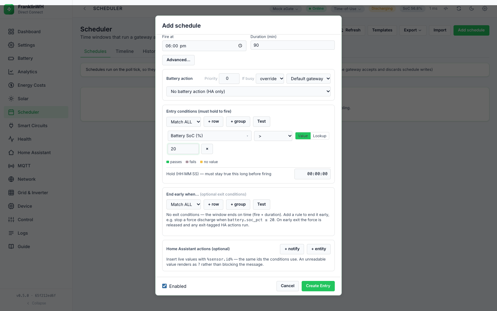
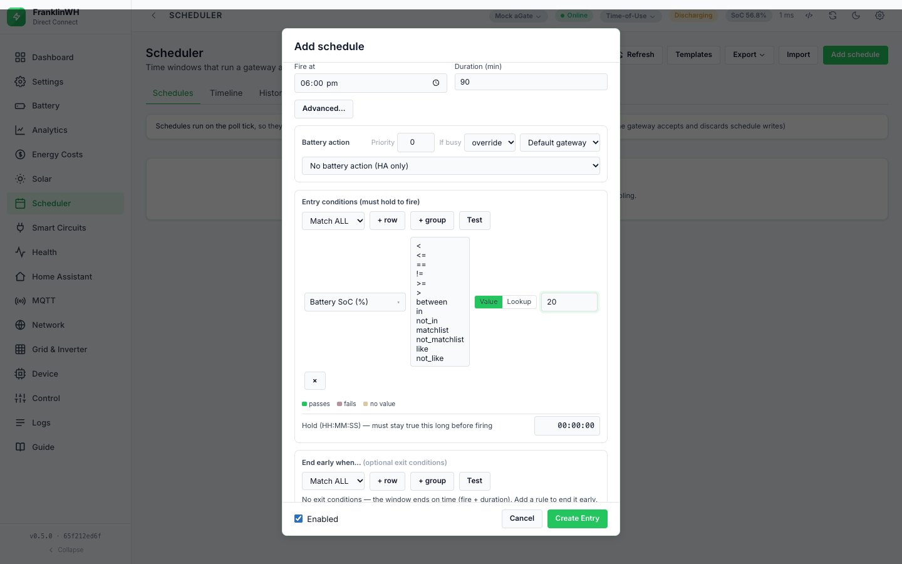
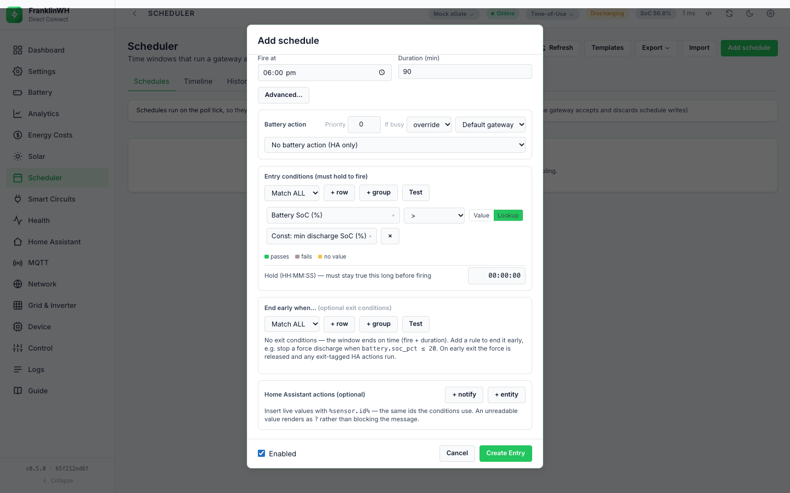
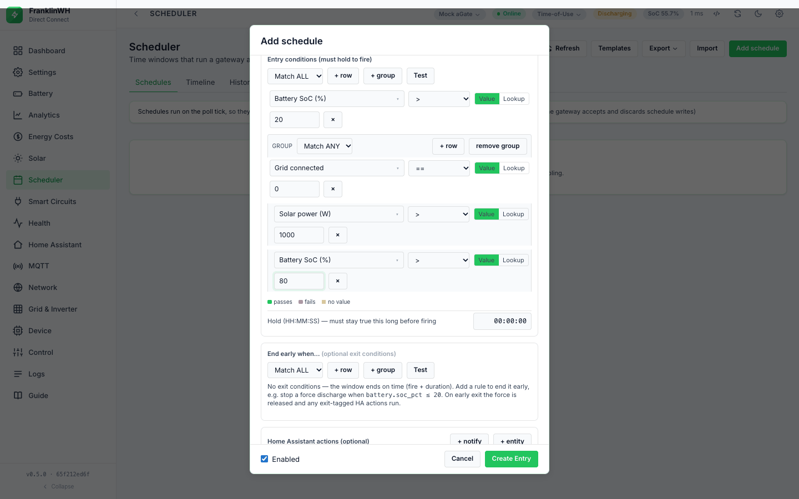
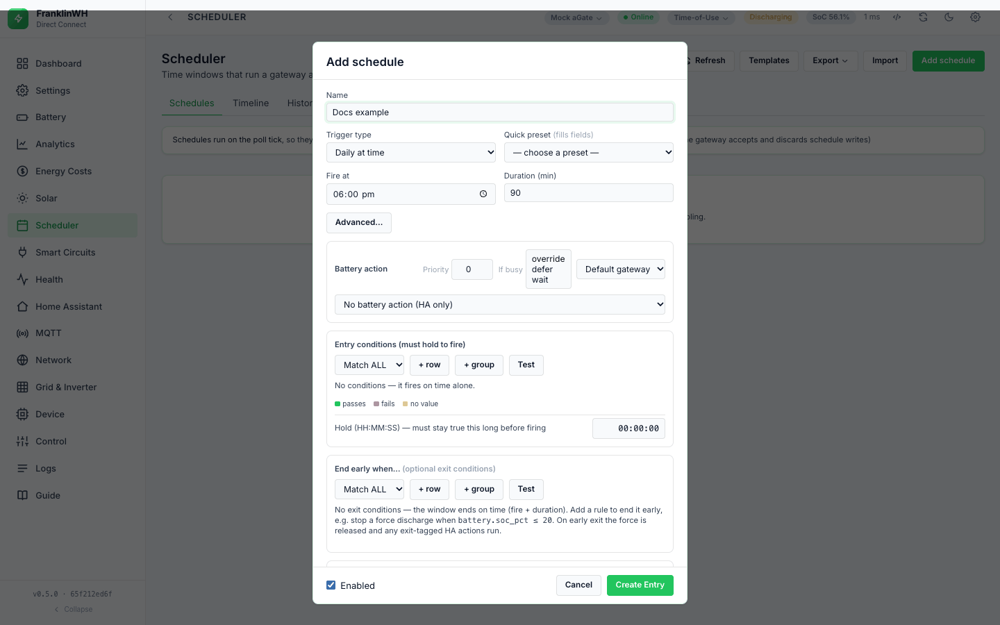
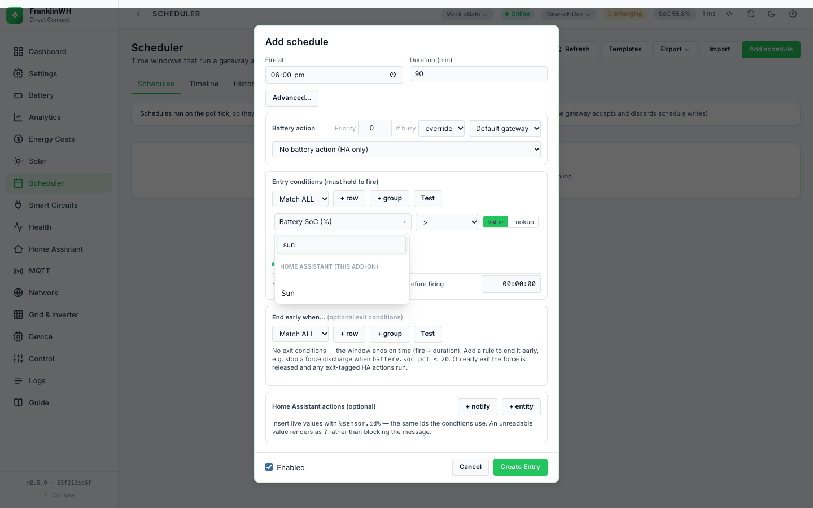
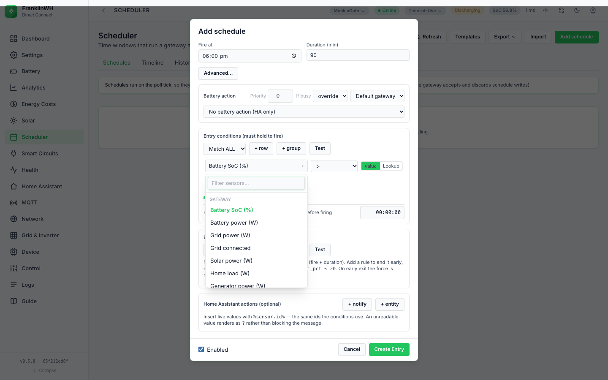

# Conditions

Direct Connect Bridge. Mirrors the Modbus Bridge page
[Conditions](https://david2069.github.io/franklinwh-modbus-bridge/user/scheduler/conditions/)
section for section.

Conditions let a schedule react to the battery, the grid, prices, the weather, Home Assistant
and more. This is how you schedule **by sensor** or **by event**: a trigger opens the window,
the conditions decide whether to act inside it.

Each schedule has two condition blocks in the form:

| Block | Checked | Effect |
|---|---|---|
| **Entry conditions (must hold to fire)** (the gate) | each tick while the window is open and the schedule has not yet fired this occurrence | The actions run only when they hold. |
| **End early when…** (exit conditions) | each tick while the window is open, **for every action kind**, whether or not the schedule fired | The first time they hold, the window counts as closed. See [Exit and release](exit-and-conflicts.md). |

<!-- @b CND-36 ;; src: scheduler.py:2006-2009 ;; untested ;; write: yes ;; b: exit conditions are evaluated every tick while the window is time-inside, for any action kind, not only while a force runs ;; test: unit: a set_mode entry with an exit condition; assert the exit edge is logged and exit HA actions run -->

A condition row has a **sensor**, an **operator** and a right-hand side: a **Value** you type
or a **Lookup** of another sensor.

## Rules for every condition

- **No value means false.** If a sensor has no value, every operator returns false,
  including `!=`, `not_in`, `not_matchlist` and `not_like`. A rule never acts on data it does
  not have.
  <!-- @b CND-01 ;; src: scheduler.py:159-163 ;; tested: tests/test_scheduler.py::test_missing_sensor_never_counts_as_true ;; write: yes ;; b: a None live value makes every operator false, including != and the negated list/pattern operators ;; test: — -->
- **An unknown sensor or operator is false too.** The API does not check sensor ids or
  operators when you save; such a row just never passes. A typo in a sensor id is a row with
  no value. Import does not warn about unknown sensors here.
  <!-- @b CND-02 ;; src: scheduler.py:189, scheduler.py:217-218, scheduler.py:824-861 ;; untested ;; write: no ;; b: an unknown sensor reads None and an unknown operator returns False; validate_import checks name, fire_at, dates, action, gateway and notify device but not sensors or operators ;; test: unit: op '~' is false; validate_import of an unknown sensor has no warning -->
- **Values come from one snapshot per gateway per tick**, built from that gateway's last
  poll plus the other sources listed below. Building it does not read the gateway. It does
  fetch every **exposed Home Assistant instance's whole state list** on every tick of every
  gateway, and the AEMO NEM price, the solar forecast and the Modbus client (this bridge)
  ratings from their caches.
  <!-- @b CND-03 ;; src: scheduler.py:1947-1970, scheduler.py:959-986 ;; untested ;; write: yes ;; b: tick builds one snapshot per gateway from last_state plus HA, solar, NEM, HA price, tariff, billing, fixed, system, const, ratings and derived sensors; ha_snapshot GETs /api/states per instance each tick ;; test: unit: tick with two gateways and different last_state; assert each entry is evaluated on its own gateway's values -->
- **On/off sensors: compare with 1 or 0.** `grid.connected`, `status.vpp`, `status.off_grid`,
  `status.debug`, the tariff window flags and the utility permissions are stored as `1`/`0`.
  A Home Assistant `on`/`off` becomes `1`/`0` too. A real boolean on the left compares exactly:
  `True == 1` is true, `True == "1"` is not.
  <!-- @b CND-04 ;; src: scheduler.py:108-116, scheduler.py:911-919 ;; untested ;; write: yes ;; b: on/off gateway sensors are int 1/0; _eq compares exactly when either side is a bool, so a bool equals 1 but not the text "1" ;; test: unit: evaluate status.vpp == 1 and == "1"; a True live value against "1" -->

## Operators

Thirteen operators, the same set and spelling as the Modbus Bridge (`ops` from
`GET /api/schedules`):

| Operator | Right-hand side | True when | Example |
|---|---|---|---|
| `<` `<=` `>=` `>` | a number (or a Lookup) | the numeric comparison holds; text that looks like a number counts | `battery.soc_pct < 80` |
| `==` | a number, text, or a Lookup | equal. Numbers compare as numbers (`25 == "25.0"`); booleans exactly; anything else as text **ignoring case** | `mode.name == self-consumption` |
| `!=` | as `==` | not equal (still false with no value) | `status.programme_id != 9` (but see below) |
| `between` | two numbers | inclusive; the order of the two numbers does not matter | `battery.soc_pct between 20 and 40` |
| `in` | list of numbers and ranges | the value is one of them or inside a range | `battery.soc_pct in 10, 20-30` |
| `not_in` | as above | not in the list (an empty list is true) | |
| `matchlist` | list of text values | equals one of them, ignoring case | `mode.name matchlist Self-Consumption, Time of Use` |
| `not_matchlist` | as above | equals none of them | |
| `like` | a pattern | matches, ignoring case | `weather.condition like *rain*` |
| `not_like` | a pattern | does not match | |

<!-- @b CND-05 ;; src: scheduler.py:168-172, scheduler.py:95-105 ;; tested: tests/test_scheduler.py::test_numeric_comparison_handles_string_values ;; write: yes ;; b: < <= >= > coerce both sides to float (bools are not numbers) and are false if either is not numeric ;; test: — -->
<!-- @b CND-06 ;; src: scheduler.py:108-116, scheduler.py:164-167 ;; untested ;; write: yes ;; b: == and != compare numerically when both sides are numbers, exactly for bools, otherwise case-insensitive text (differs from the Modbus Bridge, which compares text exactly) ;; test: unit: mode.name == "SELF-CONSUMPTION" true; 25 == "25.0" true; != of the same -->
<!-- @b CND-07 ;; src: scheduler.py:173-178 ;; untested ;; write: yes ;; b: between is inclusive and order-independent; false if any side is not numeric ;; test: unit: 25 between 30,20 true; 20 and 30 included; missing value2 false -->
<!-- @b CND-08 ;; src: scheduler.py:119-138, scheduler.py:179-182 ;; untested ;; write: yes ;; b: in / not_in take numbers and inclusive ranges a-b, a..b or en/em dash, split on comma, semicolon or newline; text members are dropped ;; test: unit: 25 in "10, 20-30" true; -5..-1; range order reversed -->
<!-- @b CND-09 ;; src: scheduler.py:179-182 ;; untested ;; write: yes ;; b: an empty member list matches nothing: in is false, not_in is true ;; test: unit: in "" false, not_in "" true -->
<!-- @b CND-10 ;; src: scheduler.py:141-146, scheduler.py:183-185 ;; untested ;; write: yes ;; b: matchlist compares whole case-folded text values with no range parsing ;; test: unit: Self-Consumption matchlist "self-consumption, Time of Use" true -->
<!-- @b CND-11 ;; src: scheduler.py:149-156, scheduler.py:186-188 ;; untested ;; write: yes ;; b: like uses * or % for many and ? or _ for one, case-insensitive; with no wildcard it is a substring test ;; test: unit: like "self%", "consum", "2?" -->

Details:

- **Ordering operators** (`<`, `<=`, `>=`, `>`, `between`) need numbers on both sides. A
  boolean is not a number for them.
- **`in` / `not_in`** take a comma-separated list; semicolons and new lines also work.
  `20-30`, `30-20`, `20..30` and `20–30` (en or em dash) are inclusive ranges. Write negative
  ranges with `..`: `-5000..-1000`. A text member is ignored. Brackets are **not** stripped:
  `(10, 20)` drops both members.
- **`matchlist`** compares whole text values, so `Self-Consumption` stays one name.
- **`like`** wildcards: `*` or `%` for any run of characters, `?` or `_` for one. A pattern
  with no wildcard means *contains*: `like consum` matches "Self-Consumption". Because `_` is
  a wildcard, a pattern cannot match a literal underscore.
- **`matchlist` and `like` on a number** compare its text form: `25` matches `like 2?`.
  <!-- @b CND-12 ;; src: scheduler.py:149-156, scheduler.py:183-188 ;; untested ;; write: yes ;; b: matchlist and like compare str(live), so a number or bool is matched as its text form ;; test: unit: 25 like "2?" true; 63.0 matchlist "63" false -->
- **`status.programme_id`**: `9` means VPP, but ordinary programmes use large arbitrary ids.
  Test `== 9`; never `!= 9` to mean "no programme".
- `in` tests membership, not crossing. A fast-moving value can step over a listed number
  between polls; use a range.

!!! note "No unit tests for most operators"
    `between`, `in`/`not_in`, `matchlist`, `like`, case-insensitive `==` and Lookup have no
    unit tests in this bridge. The behaviour above was checked by running the evaluator
    directly (2026-10-17) and is listed as *untested* in the
    [test plan](../../dev/scheduler-test-plan.md).

### Value and Lookup

The **Value / Lookup** switch sits after the operator.

- **Value** compares with what you type. The form sends anything that looks like a number as
  a number; the list and pattern operators send the raw text.
  <!-- @b CND-13 ;; src: static/js/scheduler_tab.js:871-899 ;; untested ;; write: no ;; b: _buildTree sends number-looking values as numbers, the RHS of in/not_in/matchlist/not_matchlist/like/not_like as raw text, and value2 only for between ;; test: browser: save a row with "50" and with "10,20"; inspect the PUT body -->
- **Lookup** compares with **another sensor's live value**, for example
  `battery.soc_pct <= const.min_discharge_soc`. If the Lookup sensor has no value the row is
  false.
  <!-- @b CND-14 ;; src: scheduler.py:219-223 ;; untested ;; write: yes ;; b: value_kind sensor compares with snapshot[value_sensor]; a None RHS makes the row false ;; test: unit: soc 25 > Lookup b=20 true; Lookup of a missing sensor false -->

The switch is hidden for the list and pattern operators. A Lookup with `between` compares
with one sensor only (`value2` is ignored), so use **Value** for `between`.

The card's **Explain** panel prints a Lookup row with the Lookup sensor's label in quotes
("… is at most "Const: min discharge SoC (%)""). **Test against live** prints the typed
`value` only, so a Lookup row shows an empty right-hand side there.
<!-- @b CND-15 ;; src: static/js/scheduler_tab.js:750-758, templates/tabs/scheduler.html:155-162 ;; untested ;; write: no ;; b: Explain renders a Lookup as the quoted sensor label; the Test against live row shows r.value, which a Lookup row does not have ;; test: browser: a Lookup row in Explain and in Test against live -->

## Groups and items: ALL / ANY

A block is a **group**: a match mode (**Match ALL** or **Match ANY**) and a list of items. An
item is a condition row or another group (**+ group**).

| Group setting | True when | Empty group |
|---|---|---|
| **Match ALL** | every item is true | true |
| **Match ANY** | at least one item is true | false |

<!-- @b CND-16 ;; src: scheduler.py:241-262 ;; tested: tests/test_scheduler.py::test_match_all_and_any ;; write: yes ;; b: ALL needs every item, ANY at least one; an empty nested ALL is true, an empty nested ANY false; an empty top-level block is true whatever its match ;; test: — -->
<!-- @b CND-17 ;; src: scheduler.py:207-216 ;; tested: tests/test_scheduler.py::test_exit_condition_nested_group_ends_window ;; write: yes ;; b: a node with conditions or match is a group and counts as one item of its parent ;; test: — -->

How the items relate:

- **Order does not matter.** Every item is evaluated every time (no short-circuit), so the
  **Test** buttons can show each row's live value.
  <!-- @b CND-18 ;; src: scheduler.py:241-248, scheduler.py:227-237 ;; untested ;; write: no ;; b: _eval_tree evaluates every node before combining and appends one trace row per leaf with sensor, op, value, live_value, result and cid ;; test: unit: trace length equals leaf count for an ALL whose first leaf fails -->
- **A group is one item of the block it sits in.**
- **The editor nests one level**: a block holds rows and groups, a group holds rows. A deeper
  tree sent through the API is evaluated, but the editor shows only one level.
- **Empty groups are dropped when you save**, and a block with no rows is saved as an empty
  list: no gate, or no exit conditions. *"No conditions — it fires on time alone."*
  <!-- @b CND-19 ;; src: static/js/scheduler_tab.js:878-899, scheduler.py:260-261, scheduler.py:2006-2007 ;; untested ;; write: yes ;; b: the form prunes empty groups and saves [] for an empty block; evaluate([]) is true (no gate) and an empty exit list never exits ;; test: browser: save a block with an empty group; assert the stored list -->
- **An empty group sent through the API is not the same as no conditions.** An exit block of
  `[{"match": "all", "conditions": []}]` is true, so the schedule never starts ("exit
  condition already holds"); an empty `any` group never ends one.
  <!-- @b CND-20 ;; src: scheduler.py:241-248, scheduler.py:2006-2009, scheduler.py:2046-2048 ;; untested ;; write: yes ;; b: an API exit list holding an empty ALL group is true, so due-ok entries are refused with exit condition already holds ;; test: unit: tick with exit_conditions [{match: all, conditions: []}]; assert nothing fires -->

## Scope: which gateway's values

Conditions are evaluated **per gateway**: each gateway's tick builds its own snapshot. A
schedule with gateway scope `all` is checked against each gateway's own values and can pass
on one while it fails on another (see [Targets](targets.md)).

| Sensors | Scope |
|---|---|
| `battery.*`, `grid.*`, `solar.power_w`, `solar.today_kwh`, `load.*`, `generator.*`, `mode.*`, `status.*`, `bridge.*` | the gateway being evaluated |
| `tariff.*` rates and windows, `service.*`, `demand.*`, `bonus.*`, `energy.*`, `tariff.export_charge_*`, `fixed.*` | **the meter that gateway connects to**, else the default meter. The running demand, energy and export figures are fed by that gateway's grid power. |
| `system.*` | that gateway (derived from it where possible, else your Setup values) |
| `ratings.*` (feeds the at-max-rate ETAs) | that gateway's host, through the Modbus client (this bridge); skipped for a mock |
| `const.*`, `weather.*`, `solar_forecast.*`, `tariff.spot_price`, `tariff.feed_in_price` (without a dynamic tariff), `ha:*` | the same for every gateway |

<!-- @b CND-21 ;; src: scheduler.py:1934-1970, scheduler_worker.py:107-116, scheduler_worker.py:156-163 ;; untested ;; write: yes ;; b: tick_once calls tick per eligible gateway with that gateway's last_state, host and id; gateway_scope all entries are evaluated on each ;; test: unit: two gateways, scope all, SoC 30 vs 80 and a > 50 gate; only one fires -->
<!-- @b CND-22 ;; src: scheduler.py:1466-1478, scheduler.py:1954-1960, billing.py:349-361 ;; tested: tests/test_utilities_tariffs.py::test_tariff_snapshot_from_gateway_meter ;; write: yes ;; b: tariff and service sensors come from the gateway's own meter, else the default meter (billing-window, demand, energy, bonus, export-charge and fixed use the same meter lookup); differs from the Modbus Bridge, which uses the gateway with id default ;; test: — -->

## Hold for (dwell)

**Hold (HH:MM:SS) — must stay true this long before firing** sits under the entry conditions
(`entry_hold_s` in the API):

- The schedule fires only after it has been *due* (window open, not yet fired, entry
  conditions true, exit conditions false) **continuously** for this long.
  <!-- @b CND-23 ;; src: scheduler.py:2062-2073 ;; untested ;; write: yes ;; b: with entry_hold_s > 0 the entry is held back until now minus the first due tick reaches the hold ;; test: unit: tick at t, t+60, t+300 with hold 300; fires only on the last -->
- If it stops being due even once (the gate fails, the window closes), the timer starts again.
  <!-- @b CND-24 ;; src: scheduler.py:2052-2053 ;; untested ;; write: yes ;; b: any not-due tick pops the dwell timer ;; test: unit: gate true, false, true; assert the hold restarts -->
  <!-- @b CND-25 ;; src: scheduler.py:2045, scheduler.py:2052-2053 ;; untested ;; write: yes ;; b: outside the window due() is false, so the dwell timer is reset at window exit ;; test: unit: hold spanning window end does not carry into the next window -->
- It is checked on each tick (15 s by default), so the real wait is rounded up to the next
  tick. 0 = fire on the first due tick. The API sets no maximum.
  <!-- @b CND-26 ;; src: scheduler.py:2063-2064 ;; untested ;; write: yes ;; b: entry_hold_s 0 skips the hold; no upper bound is enforced ;; test: unit: hold 0 fires on the first tick -->
- While waiting, **History** shows *waiting* — "conditions met — holding 300s before
  firing" — each time the timer starts.
- The timer lives in memory, per gateway and schedule. After a restart it starts again, so it
  never fires early.
- **A retry after a failed action waits for the whole hold again**, and logs *waiting* again:
  the timer is cleared when the schedule fires, and starts afresh on the retry.
  <!-- @b CND-27 ;; src: scheduler.py:2065-2073, scheduler.py:2459-2466 ;; untested ;; write: yes ;; b: the dwell timer is popped when the entry becomes ready; a failed run is not marked fired, so the next due tick starts a new hold (differs from the Modbus Bridge, which skips the hold on a retry) ;; test: unit: hold 60, failing action; assert the second attempt is at least 60 s after it is due again -->

Use it to ride through a brief price spike or a passing cloud. It applies to every action,
including notify-only schedules.

## When conditions are evaluated

| What | When |
|---|---|
| Entry conditions | each tick while the window is open and the schedule has not fired this occurrence; for **Always** they *are* the window |
| Hold timer | each tick |
| Exit conditions | each tick while the window is open, for every action kind |
| HA action guard | when that HA action is about to run (entry or exit) |
| After you save | at the next tick: saving does not trigger an immediate tick |
| **Run now** | not at all: Run now ignores the entry conditions (each HA action's guard still applies) |

- **The gate is a gate, not a leash.** Once the schedule has fired, the entry conditions are
  not checked again for that occurrence; a gate that turns false does not stop a running
  force. Use **End early when…**.
  <!-- @b CND-28 ;; src: scheduler.py:538-544 ;; untested ;; write: yes ;; b: due() returns already fired this occurrence before it evaluates the conditions ;; test: unit: force fired, then the gate turns false; assert no release until the window or exit ends it -->
- **A failing gate is logged once per day** as *gated*, per gateway and schedule, with the
  first **two** failing rows and their live values, for example
  `battery.soc_pct > 40 (live=27.0); grid.power_w > 1000 (live=350); +1 more`.
  <!-- @b CND-29 ;; src: scheduler.py:2054-2060, scheduler.py:1887-1903 ;; untested ;; write: no ;; b: a gated reason is logged once per calendar day per gateway:entry with up to two failing leaves and a +N more suffix ;; test: unit: three failing leaves; assert one gated row with two leaves and +1 more across two ticks -->

The values themselves change only as fast as their source: the gateway's poll, the
Open-Meteo cache (about 15 minutes), the AEMO NEM cache (about 4 minutes).

## Test Verification

This bridge has two ways to test conditions against live values. Neither fires anything.

| | **Test** (under each block in the form) | **Test against live** (card **⋮** menu) |
|---|---|---|
| Endpoint | `POST /api/schedules/evaluate` | `POST /api/schedules/{id}/test` |
| What it checks | the **unsaved** block as it is in the form | the **saved** schedule: window, calendar, fired-this-occurrence and entry conditions (`due()`) |
| Which gateway's values | the schedule's gateway in the form (the top bar's for **All gateways**) (#580) | the schedule's gateway (#580) |
| Clock | — | that gateway's site clock (#161) |
| Result | each row outlined: green *passes*, red *fails*, amber *no value*, with `live <value>`; summary *conditions currently PASS/FAIL* or, for the exit block, *exit WOULD end the window now* / *exit would NOT fire now* | *Would fire* / *Would not fire* with the reason and the window state, plus one line per **top-level** row with its live value |

<!-- @b CND-30 ;; src: app.py:3397-3422, static/js/scheduler_tab.js:901-939 ;; tested: tests/test_constants.py::test_api_constants_get_put_and_sensor_group ;; write: no ;; b: POST /api/schedules/evaluate evaluates an unsaved tree against live values and returns result plus a per-leaf trace (the editor maps rows by cid) ;; test: — -->
<!-- @b CND-31 ;; src: app.py:3360-3394 ;; unclear ;; write: no ;; b: Test against live uses get_state() (default gateway) and the container clock whatever the schedule's gateway, ignores exit conditions, hold and conflicts, and lists only top-level rows (a group row shows no sensor) ;; test: unit (API): a schedule bound to a second gateway; assert the snapshot is that gateway's -->
<!-- @b CND-32 ;; src: app.py:3397-3399, app.py:3360-3362 ;; untested ;; write: no ;; b: neither evaluate nor test calls _guard_writes; the bridge's HTTP API has no login ;; test: unit (API): evaluate answers 200 without any credential -->

!!! note "Test is close to, not the same as, the engine's view"
    - The engine adds the run variables (`%run.*%`, `%schedule.*%`) and feeds the billing
      trackers; the tests read them without feeding.
    - **Test against live** reads the schedule's gateway on its site clock, and does not
      check exit conditions, the hold, priority or **If busy**. A schedule can say *Would
      fire* and still not fire.
    - Both, and **Run now**, build their values as the tick does (#580): tariff, constants
      and derived values included.

## Home Assistant entities

Entities from a Home Assistant instance appear in the picker in a group named after the
instance, after the bridge's own groups.

- **Needs:** a Home Assistant instance, enabled, and the entity **exposed** on the **Home
  Assistant** tab. Only exposed entities are offered and kept.
- **Id:** `ha:<instance id>:<entity_id>`.
- **Value:** the entity state. Numbers become numbers. `on`, `true`, `open` and `home` become
  `1`; `off`, `false`, `closed` and `away` become `0`. **`unavailable`, `unknown`, `none` and
  an empty state are no value**: the entity is left out of the snapshot, so every condition
  on it is false. Anything else stays text, so compare it with `==` (case-insensitive) or
  `matchlist`.
  <!-- @b CND-33 ;; src: scheduler.py:937-956, scheduler.py:978-986 ;; tested: tests/test_scheduler.py::test_unavailable_or_unknown_ha_entity_never_satisfies_a_condition ;; write: yes ;; b: HA states coerce to float, 1 (on/true/open/home), 0 (off/false/closed/away) or text; unavailable/unknown/none/empty are no reading and are left out of the snapshot, so conditions on them are false ;; test: — -->
- **Refresh:** every tick of every gateway, by REST (`GET /api/states`, the whole list, then
  filtered to the exposed ids). There is no WebSocket. If the instance cannot be reached, its
  entities are absent, so they have no value.
  <!-- @b CND-34 ;; src: scheduler.py:959-986, ha_instances.py:64-67 ;; tested: tests/test_scheduler.py::test_only_exposed_entities_are_read_not_the_whole_instance ;; write: no ;; b: ha_snapshot reads each enabled instance's full /api/states and keeps only exposed ids; an unreachable instance contributes nothing ;; test: — -->
- If the instance is removed or disabled, the condition has no value. Import does not warn
  about `ha:` sensors.
  <!-- @b CND-35 ;; src: scheduler.py:974-985, scheduler.py:824-861 ;; untested ;; write: no ;; b: a disabled or removed instance contributes no values; validate_import does not check ha: sensors ;; test: unit: disabled instance; assert its ids are absent -->

!!! note "Before 0.5.4 an unavailable entity read 0 (#167, fixed in 0.5.4)"
    Before 0.5.4 an entity that was `unavailable` or `unknown` read **0**, not "no value", so
    a condition such as `price < 10` was **true** while the entity was down and could fire a
    force. Since 0.5.4 it has no value and the condition is false. If you had such a rule,
    check its History for runs while Home Assistant had lost the entity.

**Direct Connect only.** A Home Assistant price entity can feed `tariff.spot_price` and
`tariff.feed_in_price` (**Settings → Sites & Billing → Prices**). A `$/kWh` unit is scaled to c/kWh;
`c/kWh`, `¢/kWh` and a unitless value are taken as they are. A configured entity wins over
the AEMO NEM price for the same sensor.
<!-- @b CND-37 ;; src: scheduler.py:1203-1248, scheduler.py:1307-1327, scheduler.py:1952-1953 ;; tested: tests/test_aemo_nem.py::test_ha_price_snapshot_units_and_mapping ;; write: yes ;; b: tariff_price_entity and tariff_feedin_entity map to tariff.spot_price and feed_in_price in c/kWh with $ units scaled x100, applied after NEM so they win ;; test: — -->

## Every sensor in the picker

This bridge's picker groups its sensors differently from the Modbus Bridge. The groups, in
the order the picker shows them: **Gateway** first, then the others alphabetically, then one
group **per Home Assistant instance**:

| Group | Count | Where it comes from |
|---|---|---|
| Gateway | 15 | the gateway's last poll |
| Automation Constants | 4 | **Settings → Automation → Automation Constants** |
| Demand / Tariff | 5 | the gateway's meter tariff, fed each tick |
| Derived Battery | 10 | computed from the poll, the constants and a rate |
| Energy | 5 | the gateway's meter tariff, fed each tick |
| Fixed Charges | 5 | the meter tariff's fixed charges |
| System Setup | 8 | **Settings → Setup**, derived from the aGate where possible |
| Tariff & Utility | 23 | the meter's utility and tariff, AEMO NEM, a Home Assistant price entity |
| Weather & Solar | 7 | Open-Meteo, from the PV location |
| *one per HA instance* | your exposed entities | Home Assistant |

<!-- @b SEN-18 ;; src: app.py:3047-3073, static/js/scheduler_tab.js:998-1010 ;; tested: tests/test_billing_windows.py::test_billing_sensors_in_picker ;; write: no ;; b: GET /api/schedules lists every sensor with a group; the picker shows Gateway first and the rest alphabetically, with HA entities grouped by instance and relabelled with friendly names ;; test: — -->

Counts are from `GET /api/schedules` on a test bridge running 0.5.4 (2026-10-17), and match
the lists in the code at 0.5.5. A sensor reads **None** (no value, so every condition on it
is false) unless what it needs is set up.

!!! note "Some snapshot values are not in the picker"
    `weather.code`, `const.battery_capacity_kwh`, `const.battery_max_power_kw`,
    `ratings.max_charge_w` and `ratings.max_discharge_w` are in the snapshot, so a condition
    or placeholder typed through the API can use them, but the picker does not list them.

### Battery

**Gateway** group: `battery.soc_pct`, `battery.power_w` (+ discharging, − charging). **Derived
Battery** group: `battery.status`, `battery.capacity_kwh`, `battery.stored_kwh`,
`battery.remaining_kwh` and four ETAs. There is **no reserve sensor**: the local API reserve
is not in the snapshot (the Modbus Bridge's `battery.reserve_*` are **not in this bridge**).

### Solar / PV

`solar.power_w` (Gateway), `solar.today_kwh` (Weather & Solar, the gateway's own counter),
and the solar tracker percentages (Derived Battery). There is no `pv.is_generating`.

### Grid

`grid.power_w` and `grid.connected` (Gateway). `grid.connected` is **derived from grid power
being non-zero**: it reads `0` whenever the grid power is exactly 0 W, on grid or not. Use
`status.off_grid` to test for an outage.

`grid.offgrid_reason` (Gateway, text) says why the system is off-grid: `user requested` (the
aGate's simulated off-grid), `grid outage`, or `unknown` while off-grid with no reason read.
It has no value on grid. Same source as the top-bar chip. Compare with `==`, case-insensitive:
`grid.offgrid_reason == user requested`.

`grid.offgrid_min` (Gateway) is the minutes since this off-grid period began, with no value on
grid. If the bridge restarts while the system is off-grid, it counts from the first reading
after the restart; it does not guess an earlier start.
<!-- @b SEN-04 ;; src: scheduler.py:911-913 ;; tested: tests/test_scheduler.py::test_snapshot_marks_derived_values ;; write: yes ;; b: grid.connected is int(grid_w != 0), None without a grid reading (differs from the Modbus Bridge, which uses the connection state) ;; test: — -->

### Load

`load.power_w` and `generator.power_w` (Gateway).

### Mode

`mode.name` (Gateway): the operating mode name the gateway reports. Compare it as text
(`==` ignores case, or `matchlist`). The default operating mode constant is
`const.default_operating_mode`.

### Inverter

**Not in this bridge.** There are no `inverter.*` sensors. The run status is
`status.run_status` (number) and `status.run_status_desc` (text); documented values 0
Standby, 1 Charging, 2 Discharging, 5–7 off-grid, 8 Debug, 9 VPP.

### Gateway identity

**Not in this bridge** as `gateway.*` sensors. The **System Setup** group describes the
install (solar type and size, generator input, grid-forming, whole-home backup, load
shedding, non-backup loads, battery label). `status.vpp`, `status.debug` and
`status.programme_id` describe what the gateway is doing.

### Constants

Four in the picker: `const.min_discharge_soc` (default 20 %), `const.max_charge_soc`
(default 100 %), `const.demand_charge_min_soc` (default 30 %) and
`const.default_operating_mode` (default `self`). Set them at **Settings → Automation →
Automation Constants**. They always have a value.
<!-- @b SEN-07 ;; src: constants.py:19-29, constants.py:100-105, scheduler.py:1037-1051 ;; tested: tests/test_constants.py::test_constants_snapshot_keys ;; write: yes ;; b: const.* come from the constants store with defaults 20/100/30 %, capacity 0 and max power 5 kW, and the default mode self; they are never missing ;; test: — -->

### Tariff

**Tariff & Utility** group: rates (`tariff.buy_rate`, `tariff.sell_rate`, $/kWh), season,
time period, tier, `tariff.import_billable`, the four window flags, the export-charge
calculators, and `tariff.spot_price` / `tariff.feed_in_price` (c/kWh).

- The rates and windows come from the tariff of **the meter this gateway connects to** (else
  the default meter). Tiered pricing uses the first tier in the snapshot.
- A window that the tariff does **not define** reads **None**, so a gate on it fails closed.
  With no tariff at all, every tariff sensor is None. (The Modbus Bridge reads `False`/`0`
  here; this bridge does not.)
  <!-- @b SEN-08 ;; src: scheduler.py:1438-1463, scheduler.py:1481-1518 ;; tested: tests/test_billing_windows.py::test_billing_snapshot_windows_active ;; write: yes ;; b: window flags are 1/0 when the tariff defines that window and None otherwise; an unconfigured meter gives an empty snapshot ;; test: — -->
- `tariff.import_billable` is 1 or 0 from the rate model, and None when the rate model gives
  no answer.
  <!-- @b SEN-09 ;; src: scheduler.py:1507-1515 ;; untested ;; write: yes ;; b: tariff.import_billable is int(billable) from rate_model.resolve, None when billable is None ;; test: unit: a free window and a priced window -->
- `tariff.price_spike` is 1 during a price spike and 0 otherwise: the Home Assistant spike
  sensor when one is set, else the price at or above the spike threshold; no value with
  neither. `tariff.spike_threshold` is that threshold in c/kWh (**Sites & Billing →
  Prices**, #582). A Home Assistant demand-window entity there wins over the tariff's
  window for `tariff.demand_window_active`.
- `tariff.spot_price` is the AEMO NEM 5-minute price for your site's region, cached about
  4 minutes. On a fetch error the **last good price is kept, however old**; it is not dropped
  after 30 minutes as on the Modbus Bridge. A Home Assistant price entity wins over NEM. An
  active **dynamic** tariff overrides both, and also sets `tariff.buy_rate`/`sell_rate`.
  <!-- @b SEN-10 ;; src: scheduler.py:1171-1182, aemo_nem.py:19, aemo_nem.py:33-47, scheduler.py:1285-1304 ;; tested: tests/test_aemo_nem.py::test_nem_snapshot ;; write: yes ;; b: tariff.spot_price is the NEM c/kWh price for nem_region, empty without a region ;; test: — -->
  <!-- @b SEN-19 ;; src: aemo_nem.py:19, aemo_nem.py:29-47, scheduler.py:1950-1957 ;; untested ;; write: yes ;; b: the NEM price is cached 240 s and the last good value is kept on a fetch error with no age limit; an HA price entity then an active dynamic tariff override it ;; test: unit: spot_price after a failed fetch an hour later returns None (expected) -->

### Demand / Tariff

`demand.peak_kw`, `demand.interval_kw`, `demand.period_charge`, `bonus.export_kwh`,
`bonus.period_credit`. They are worked out by the bridge from **this gateway's** grid power on
each tick, against its meter's tariff. None without a tariff.

### Utility Plan

`service.*` (Tariff & Utility group): export, solar export, battery export, charging and
discharging permissions (1/0), export limit (kW) and plan type, from the meter's utility. A
permission that is not set reads **1** (allowed). There is no `service.tz_matches_clock`.
<!-- @b SEN-11 ;; src: scheduler.py:1492-1502 ;; tested: tests/test_utilities_tariffs.py::test_tariff_snapshot_from_gateway_meter ;; write: yes ;; b: service.* permissions default to 1 when the utility leaves them unset ;; test: — -->

### Other

**Not in this bridge.** There are no `dispatch.*` sensors saying what is driving the battery.
The nearest are `status.vpp` (programme id 9) and `battery.status`.

### Energy

`energy.period_import_kwh`, `energy.import_cost`, `energy.export_credit`,
`energy.unpriced_import_kwh`, `energy.unpriced_export_kwh`: this billing period, per gateway,
from its meter's tariff. There are no lifetime or today/week/month energy totals.

### Fixed Charges

`fixed.daily_charge`, `fixed.accrued_period`, `fixed.period_total`, `fixed.remaining`,
`fixed.days_remaining`, from the tariff's fixed charges.

### Weather

`weather.temp_c` and `weather.condition` (Weather & Solar group), the **current** weather from
Open-Meteo. They need a location under **Settings → Integrations → Location & Solar**
(**Sync from gateway** reads it from the aGate).
<!-- @b SEN-13 ;; src: scheduler.py:1185-1198, solar_forecast.py:111-140 ;; untested ;; write: yes ;; b: weather.* and solar_forecast.* come from the cached Open-Meteo forecast and are absent without a latitude and longitude ;; test: unit: solar_snapshot with no location returns {} -->

### Solar Forecast

`solar_forecast.today_kwh`, `today_peak_kw`, `remaining_kwh`, `tomorrow_kwh` (Weather &
Solar), and the tracker `solar_forecast.day_pct` / `vs_expected_pct` (Derived Battery). The
PV size, tilt and azimuth shape the forecast.

### Time

**Not in this bridge.** There are no `time.*` sensors. A trigger with calendar restrictions
(days, months, dates) does that job; see [Triggers](triggers.md).

### Notes on some sensors

**Battery, grid, solar, load, mode, status** come from the gateway's last poll: the poller's
cached state, no extra read.
<!-- @b SEN-03 ;; src: scheduler.py:888-925 ;; tested: tests/test_scheduler.py::test_snapshot_marks_derived_values ;; write: yes ;; b: snapshot_from_state maps soc, battery_w, grid_w, solar_w, load_w, generator_w, mode, run_status, programme_id, latency, vpp, off_grid, debug and kwh_sun to sensor ids ;; test: — -->

**ETA and headroom.** `battery.capacity_kwh` is the **battery capacity constant** (the local
API has no capacity register; 0 = unset, so the derived sensors read None).
`battery.time_to_charge_min` is the best-case minutes to the max-charge SoC constant at the
**Modbus client (this bridge)**'s Model 702 rating, cached for an hour, or the battery max
power constant (default 5 kW) when that cannot be read. The `_now` variants use the current
battery power, have no value when the battery is idle or moving the other way, and read 0
when already at or past the target.
<!-- @b SEN-06 ;; src: scheduler.py:1091-1168, scheduler.py:1054-1070 ;; tested: tests/test_derived_sensors.py::test_eta_at_max_rate_prefers_modbus_ratings ;; write: yes ;; b: derived battery sensors use the capacity constant; max-rate ETAs use ratings.* from Model 702 else battery_max_power_kw; now ETAs need movement toward the target ;; test: — -->

**`status.programme_id`** and **`status.vpp`**: VPP is the programme id 9, not the run status.

**Direct Connect only: run and schedule variables.** For messages, the engine adds
`%schedule.name%`, `%schedule.id%`, `%schedule.priority%`, `%schedule.action%`,
`%gateway.id%`, `%run.phase%`, `%run.occurrence%`, `%run.attempt%`, `%run.at%` and
`%run.resource%` to the snapshot of that one schedule. They are not condition sensors in
the picker. See [Actions](actions.md#placeholders-in-notifications).

#### This bridge's sensor list

Generated from `scheduler.py` (`SENSORS`, `DERIVED_SENSORS`, `SOLAR_SENSORS`,
`TARIFF_SENSORS`, `BILLING_WINDOW_SENSORS`, `EXPORT_CHARGE_SENSORS`, `DEMAND_SENSORS`,
`BONUS_SENSORS`, `ENERGY_SENSORS`, `FIXED_SENSORS`, `SYSTEM_SENSORS`, `CONST_SENSORS`,
`ASK_SENSORS`) as
grouped by `GET /api/schedules`. *Needs* and *without it* are per group.

| Picker group | Needs | Without it |
|---|---|---|
| Gateway | a fresh poll of that gateway | None |
| Derived Battery | the poll, the battery capacity constant, the SoC constants; at-max-rate ETAs also a rate (Model 702 or the max power constant); the tracker also the solar forecast | None |
| Weather & Solar | a location (**Settings → Integrations → Location & Solar**, synced from the aGate or typed in); `solar.today_kwh` the poll | None |
| Tariff & Utility | a meter with a utility and tariff; spot/feed-in a NEM region, an HA price entity or a dynamic tariff | None |
| Demand / Tariff, Energy, Fixed Charges | a tariff with those charges or windows | None |
| System Setup | nothing (defaults), better with Setup filled in | a default |
| Automation Constants | nothing | the default |
| Actionable notification (`ask.answer`) | the schedule's Actionable notification, answered in this run; read by exit conditions and HA action guards | None |
| an HA instance | the instance enabled and the entity exposed | None (also while the entity is `unavailable` or `unknown`, since 0.5.4, #167) |

??? example "All sensor ids (84 + your Home Assistant entities)"

    **Gateway**

    | Picker label | Sensor id |
    |---|---|
    | Battery SoC (%) | `battery.soc_pct` |
    | Battery power (W) | `battery.power_w` |
    | Grid power (W) | `grid.power_w` |
    | Grid connected | `grid.connected` |
    | Off-grid reason (text: "user requested", "grid outage", "unknown") | `grid.offgrid_reason` |
    | Off-grid for (minutes; counted from the first poll that saw it after a bridge restart) | `grid.offgrid_min` |
    | Solar power (W) | `solar.power_w` |
    | Home load (W) | `load.power_w` |
    | Generator power (W) | `generator.power_w` |
    | Operating mode | `mode.name` |
    | Run status (number: 0 Standby, 1 Charging, 2 Discharging, 5-7 off-grid, 8 Debug, 9 VPP) | `status.run_status` |
    | Run status (text: "Discharging", "Debug Mode", …) | `status.run_status_desc` |
    | Under external control / VPP mode | `status.vpp` |
    | Off-grid (islanded) | `status.off_grid` |
    | Debug Mode — FranklinWH remote support session | `status.debug` |
    | Programme id (9 = VPP; others are arbitrary ids) | `status.programme_id` |
    | Round-trip latency (ms) | `bridge.latency_ms` |

    **Derived Battery**

    | Picker label | Sensor id |
    |---|---|
    | Battery state (charging / discharging / standby) | `battery.status` |
    | Battery capacity (kWh) | `battery.capacity_kwh` |
    | Battery stored energy (kWh) | `battery.stored_kwh` |
    | Battery headroom to full (kWh) | `battery.remaining_kwh` |
    | ETA to max-charge SoC at current rate (min) | `battery.time_to_charge_now_min` |
    | ETA to min-discharge SoC at current rate (min) | `battery.time_to_discharge_now_min` |
    | ETA to max-charge SoC at max rate (min) | `battery.time_to_charge_min` |
    | ETA to min-discharge SoC at max rate (min) | `battery.time_to_discharge_min` |
    | Solar tracker: % of today's forecast reached | `solar_forecast.day_pct` |
    | Solar tracker: % vs forecast-to-now (>100 ahead, <100 behind) | `solar_forecast.vs_expected_pct` |

    **Weather & Solar**

    | Picker label | Sensor id |
    |---|---|
    | Weather: temperature (°C) | `weather.temp_c` |
    | Weather: condition | `weather.condition` |
    | Solar forecast: today (kWh) | `solar_forecast.today_kwh` |
    | Solar forecast: today peak (kW) | `solar_forecast.today_peak_kw` |
    | Solar forecast: remaining today (kWh) | `solar_forecast.remaining_kwh` |
    | Solar forecast: tomorrow (kWh) | `solar_forecast.tomorrow_kwh` |
    | Solar generated today, actual (kWh) | `solar.today_kwh` |

    **Tariff & Utility**

    | Picker label | Sensor id |
    |---|---|
    | Wholesale spot price (AEMO NEM or HA entity, c/kWh) | `tariff.spot_price` |
    | Dynamic feed-in price (HA entity, c/kWh) | `tariff.feed_in_price` |
    | Tariff: import rate ($/kWh) | `tariff.buy_rate` |
    | Tariff: feed-in rate ($/kWh) | `tariff.sell_rate` |
    | Tariff: season | `tariff.season` |
    | Tariff: time period | `tariff.time_period` |
    | Tariff: tier | `tariff.tier` |
    | Tariff: import billable | `tariff.import_billable` |
    | Utility: export allowed | `service.export_allowed` |
    | Utility: solar export allowed | `service.solar_export_allowed` |
    | Utility: battery export allowed | `service.battery_export_allowed` |
    | Utility: charging allowed | `service.charging_allowed` |
    | Utility: discharging allowed | `service.discharging_allowed` |
    | Utility: export limit (kW) | `service.export_limit_kw` |
    | Utility: plan type | `service.plan_type` |
    | Tariff: in peak-demand window | `tariff.demand_window_active` |
    | Tariff: in battery-export-bonus window | `tariff.bonus_window_active` |
    | Tariff: in export-charge window | `tariff.export_charge_window_active` |
    | Tariff: in a declared grid-import window | `tariff.import_window_active` |
    | Tariff: export-charge export this period (kWh) | `tariff.export_charge_kwh` |
    | Tariff: free export allowance remaining (kWh) | `tariff.export_charge_free_remaining` |
    | Tariff: chargeable export above free (kWh) | `tariff.export_charge_net_kwh` |
    | Tariff: export charge this period ($) | `tariff.export_charge_cost` |

    **Demand / Tariff**

    | Picker label | Sensor id |
    |---|---|
    | Demand: peak this period (kW) | `demand.peak_kw` |
    | Demand: current interval (kW, running) | `demand.interval_kw` |
    | Demand: charge this period ($) | `demand.period_charge` |
    | Bonus: export in the bonus window this period (kWh) | `bonus.export_kwh` |
    | Bonus: battery-export credit this period ($) | `bonus.period_credit` |

    **Energy**

    | Picker label | Sensor id |
    |---|---|
    | Energy: grid import this period (kWh) | `energy.period_import_kwh` |
    | Energy: grid import cost this period ($) | `energy.import_cost` |
    | Energy: grid export credit this period ($) | `energy.export_credit` |
    | Energy: import the plan priced no rate for (kWh) | `energy.unpriced_import_kwh` |
    | Energy: export the plan priced no rate for (kWh) | `energy.unpriced_export_kwh` |

    **Fixed Charges**

    | Picker label | Sensor id |
    |---|---|
    | Fixed: charges per day ($) | `fixed.daily_charge` |
    | Fixed: accrued this period ($) | `fixed.accrued_period` |
    | Fixed: projected this period ($) | `fixed.period_total` |
    | Fixed: left to cover this period ($) | `fixed.remaining` |
    | Fixed: days left in billing period | `fixed.days_remaining` |

    **System Setup**

    | Picker label | Sensor id |
    |---|---|
    | System: solar type (none/ac/dc/remote) | `system.solar_type` |
    | System: solar size (kWp) | `system.solar_kwp` |
    | System: generator input | `system.generator_input` |
    | System: grid-forming | `system.grid_forming` |
    | System: whole-home backup | `system.whole_home_backup` |
    | System: load shedding | `system.load_shedding` |
    | System: non-backup loads panel | `system.non_backup_loads` |
    | System: battery label | `system.battery_label` |

    **Automation Constants**

    | Picker label | Sensor id |
    |---|---|
    | Const: min discharge SoC (%) | `const.min_discharge_soc` |
    | Const: max charge SoC (%) | `const.max_charge_soc` |
    | Const: demand-charge min SoC (%) | `const.demand_charge_min_soc` |
    | Const: default operating mode | `const.default_operating_mode` |
