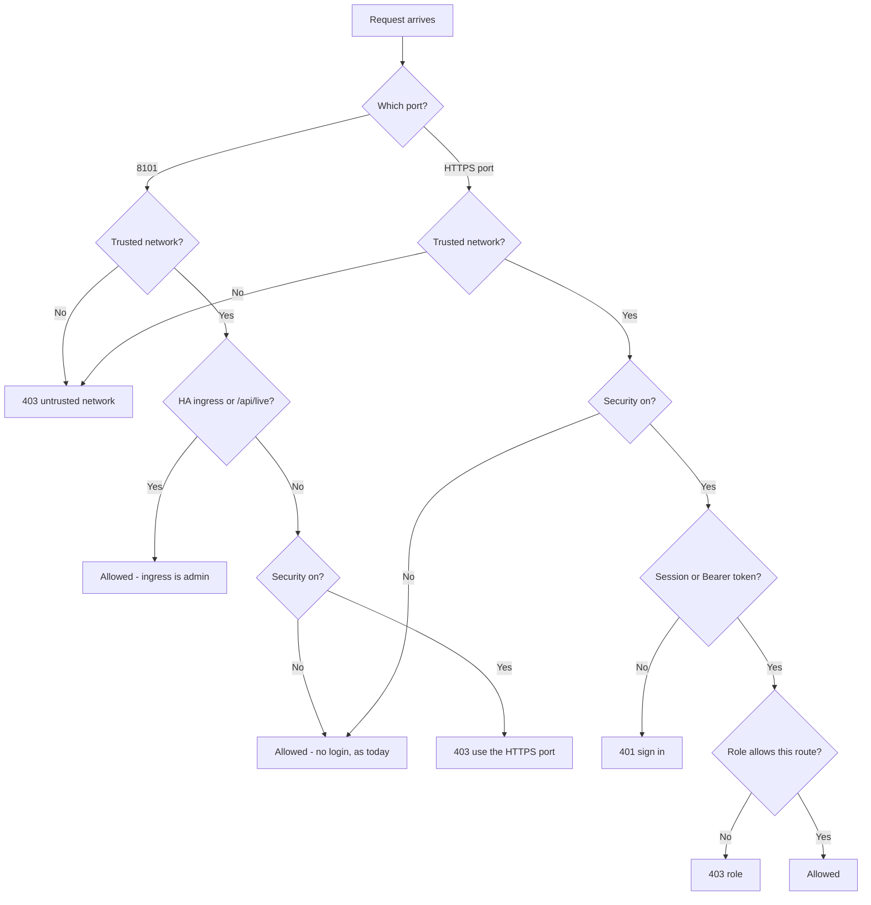
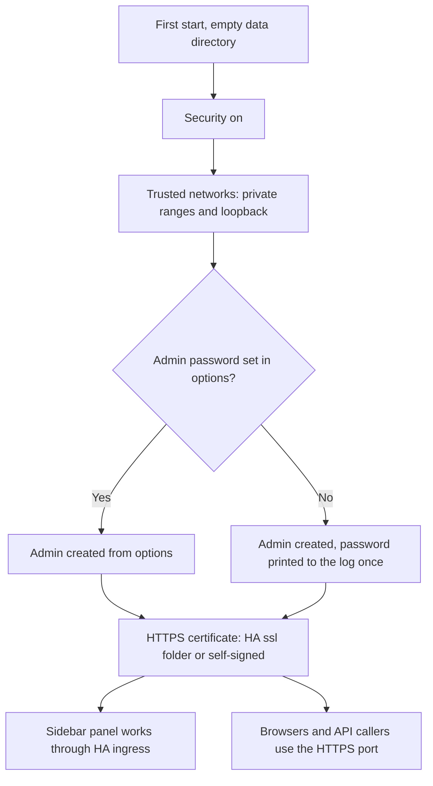
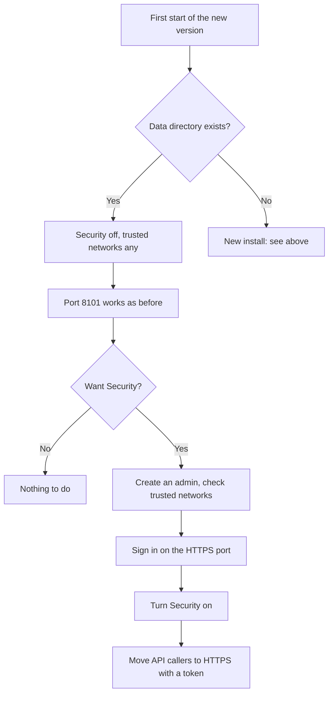

# Security: logins, trusted networks and API tokens

!!! warning "Planned — not in a release yet (#457)"
    Planned — not in a release yet ([#457](https://github.com/david2069/franklinwh-direct-connect-bridge/issues/457)).
    Today the bridge has no login: anything that can reach port 8101 can call every
    endpoint. See [There is no read-only mode today](control.md#there-is-no-read-only-mode-today)
    and the REST API's [Authentication](../developers/rest-api.md#authentication) section.

This page describes how the bridge's optional security will work once
[#457](https://github.com/david2069/franklinwh-direct-connect-bridge/issues/457) is built.
It follows the Modbus Bridge's users and roles, and adds an HTTPS-only port, trusted
networks and long-lived API tokens. Where #457 does not decide something yet, this page
says **to be decided**.

## In short

- **Upgrading?** Nothing changes. Security stays off, port 8101 works as it does today,
  and every network is trusted. You can turn Security on when you want it.
- **New install?** Security is on. Home Assistant's sidebar panel works without a bridge
  login. Everything else (a browser on your network, a phone, an API caller) uses the new
  HTTPS port and signs in.
- **Security can always be turned off.**

## Upgrading install vs new install

The bridge decides once, on its first start of the new version: an existing data
directory means an upgrade.

| | Upgrading install | New install |
|---|---|---|
| **Security** | Off | On |
| **Port 8101** | Unchanged: web UI and REST API, no login | HA ingress only, plus the Supervisor watchdog's `/api/live` |
| **HTTPS port** (number to be decided) | Available, but you don't have to use it | The only way in from outside Home Assistant: web UI with a login, REST API with a token |
| **Trusted networks** | Any | Private ranges (`10.0.0.0/8`, `172.16.0.0/12`, `192.168.0.0/16`) plus loopback |
| **HA ingress** (sidebar panel, **Open Web UI**) | Always allowed | Always allowed |
| **`/api/live`** (watchdog) | Always allowed | Always allowed |
| **Logins and tokens** | Not asked for | Required on the HTTPS port |

A request from a network that isn't trusted gets **403**, and the bridge writes a log line
(rate-limited, so a scan can't flood the log).

### Turning Security on (upgrading install)

To be decided: where the switch lives (for example **Settings → Admin → Security**). The
steps will be:

1. Create an admin account for the HTTPS port (see [The first admin](#the-first-admin)).
2. Check **Trusted networks**. Narrow *any* to the networks your browsers and API callers
   actually use.
3. Open the bridge on the HTTPS port and sign in, so you know the login works.
4. Turn **Security** on. From now on port 8101 answers HA ingress and `/api/live` only.
5. Move any API callers (scripts, Home Assistant REST sensors, other tools) to the HTTPS
   port with a [token](#api-access-tokens).

### Turning Security off (new install)

Turn the same switch off. Port 8101 then serves the web UI and REST API to every trusted
network without a login, as an upgraded install does. Accounts and tokens are kept, so
turning it back on restores them.

## Who gets in, and as what

### Home Assistant users (the sidebar panel)

Opening the bridge through Home Assistant's sidebar or **Open Web UI** goes through HA
ingress. Home Assistant has already signed you in, so the bridge doesn't ask again.

- The bridge trusts ingress only when three checks pass: it is running as an add-on, the
  request comes from the Supervisor's ingress address (`172.30.32.2`), and HA's ingress
  headers are present.
- An ingress request is treated as **admin**.
- It is named from HA's `X-Remote-User-*` headers, so logs and the audit trail show which
  HA user did what.
- **No bridge account is created or stored for HA users.** The name is read on each
  request and used only for display and logging.

Everyone who can open the add-on panel in Home Assistant is therefore an admin of the
bridge. Control who that is with Home Assistant's own users.

### The first admin

The HTTPS port needs a bridge account. On a new install the bridge creates one admin on
first start, as the Modbus Bridge does:

- from a username and password you set before the first start (add-on option or
  environment variable; names to be decided), or
- if you set none, with a generated password printed to the log **once**.

To be decided for the HA add-on: whether the first admin is created this way, or from the
sidebar panel (ingress is already admin) when you first open the HTTPS port.

The last enabled admin can't be deleted, disabled or demoted. If you lose the password,
a command-line reset sets a new one.

### Roles

| Role | Web UI | Reads | Writes (battery, mode, schedules, settings) | Manages users and tokens | Signs in with |
|---|---|---|---|---|---|
| **admin** | Full | Yes | Yes | Yes | Password (HTTPS port), or HA ingress |
| **user** | To be decided | Yes | Only routes marked for it | No | Password |
| **viewer** | Read-only | Yes | No | No | Password |
| **api** | None (REST only) | Yes | Only routes marked for it | No | Token |

Writes need **admin** unless a route says otherwise. In the Modbus Bridge, `user` and
`api` may also send battery commands; which of this bridge's routes allow them is to be
decided.

Accounts also have:

- an optional expiry date;
- password reset by an admin;
- a sign-in activity log;
- lockout: 5 failed sign-ins in 15 minutes locks the account for 60 seconds.

Passwords are stored as argon2id hashes, never in plain text.

### API access: tokens

**No API account is created automatically.** To let a script or another system call the
REST API:

1. An admin creates a user with the role **api**.
2. The admin creates a long-lived token for that user. The token is shown **once**; copy it
   then. The bridge keeps only a hash.
3. The caller sends it on every request, **on the HTTPS port only**:

```http
GET /api/summary HTTP/1.1
Authorization: Bearer <token>
```

A token carries its user's role. Each token has an expiry and a last-used time, and an
admin can revoke it at any time. A token sent to port 8101 is ignored.

## Docker and Python (pip) installs

There is no Home Assistant ingress outside the add-on, so:

- **Security off** (an upgrade, or turned off): nothing changes. Port 8101 serves the web
  UI and REST API to trusted networks without a login.
- **Security on:** port 8101 serves `/api/live` only (for a health check). The web UI
  and REST API are on the HTTPS port, with a login or a token. Publish that port in
  `docker-compose.yml` (or pass the option to the Python command; name to be decided).

The new-install default (Security on) applies here too; a data directory that already
exists keeps Security off.

## HTTPS certificate

The HTTPS port serves HTTPS only.

- **Home Assistant add-on:** it can use the `certfile` and `keyfile` from HA's `/ssl`
  folder, the same certificate HA uses.
- **Otherwise:** the bridge generates a self-signed certificate in its data directory.
  **Settings** shows its fingerprint, so you can check that the certificate your browser
  warns about is the bridge's own.

## How a request is decided



Not shown: ingress is honoured only when all three ingress checks pass, and a locked or
expired account counts as no login (401).

## First start of a new install



## Upgrading an existing install



## Later, not in #457

- Client certificates (mTLS) mapped to a user.
- Other ways to sign in.
