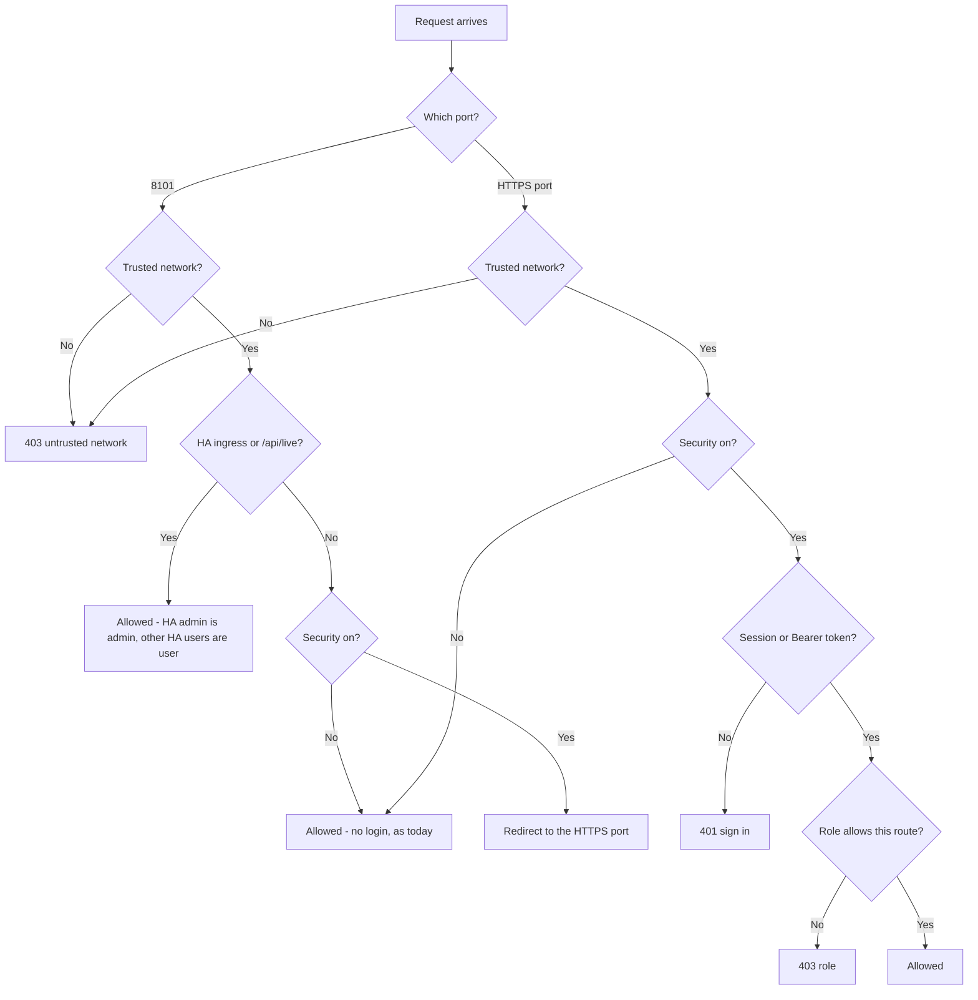
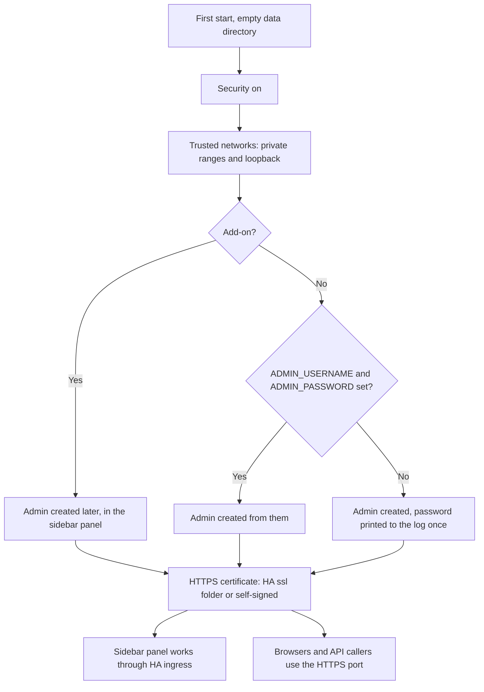
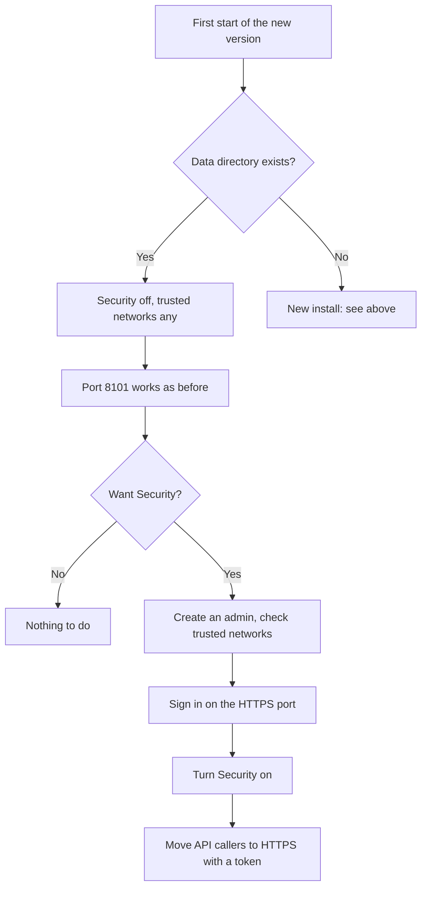

# Security: logins, trusted networks and API tokens

!!! warning "Mostly planned (#457)"
    **Trusted networks** are in the bridge from 0.5.31; see
    [Trusted networks: available now](#trusted-networks-available-now). The rest of this
    page (the Security switch, the HTTPS port, sign-in, roles and API tokens) is planned
    and not built yet ([#457](https://github.com/david2069/franklinwh-direct-connect-bridge/issues/457)).
    Until it is, anything on a trusted network can call every endpoint on port 8101. See
    [There is no read-only mode today](control.md#there-is-no-read-only-mode-today).

This page describes how the bridge's optional security will work once
[#457](https://github.com/david2069/franklinwh-direct-connect-bridge/issues/457) is built.
It follows the Modbus Bridge's users and roles, and adds an HTTPS-only port, trusted
networks and long-lived API tokens. The owner's decisions of 2026-11-04 are written in;
nothing on this page is built yet.

## In short

- **Upgrading?** Nothing changes. Security stays off, port 8101 works as it does today,
  and every network is trusted. You can turn Security on when you want it.
- **New install?** Security is on. Home Assistant's sidebar panel works without a bridge
  login. Everything else (a browser on your network, a phone, an API caller) uses the new
  HTTPS port and signs in.
- **Security can always be turned off.**

## Trusted networks: available now

**Settings → Admin → Security → Trusted networks** lists the networks that may reach the
bridge. A request from anywhere else gets **403** "Your network is not trusted by this
bridge", for pages and the API alike, and the bridge writes one log line per address
every 10 minutes.

- **An upgraded install** starts with **Any network** ticked: nothing changes.
- **A new install** starts with the private ranges and loopback: `10.0.0.0/8`,
  `172.16.0.0/12`, `192.168.0.0/16`, `127.0.0.0/8`, and for IPv6 `fc00::/7`, `fe80::/10`
  and `::1`. A phone on your home Wi-Fi gets in; an address on the internet, or a VPN
  range such as Tailscale's `100.64.0.0/10`, does not until you add it.
- **Always allowed:** Home Assistant's sidebar panel (on the add-on, requests from the
  ingress proxy with HA's ingress header) and `/api/live`, the health check.

To change the list, untick **Any network**, enter one network (`192.168.1.0/24`) or
address (`10.0.0.5`) per line, and **Save**. The section shows your address as the bridge
sees it. A list that doesn't include it is refused ("saving it would shut you out"),
unless you are in Home Assistant's sidebar panel, which always gets in.

If you shut a browser out anyway, open the bridge from Home Assistant's sidebar, or from
a machine on a trusted network, and add its network.

## Upgrading install vs new install

The bridge decides once, on its first start of the new version: an existing data
directory means an upgrade.

| | Upgrading install | New install |
|---|---|---|
| **Security** | Off | On |
| **Port 8101** | Unchanged: web UI and REST API, no login | HA ingress and the Supervisor watchdog's `/api/live`; everything else is redirected to the HTTPS port |
| **HTTPS port** (8102) | Available, but you don't have to use it | The only way in from outside Home Assistant: web UI with a login, REST API with a token |
| **Trusted networks** | Any | Private ranges (`10.0.0.0/8`, `172.16.0.0/12`, `192.168.0.0/16`) plus loopback |
| **HA ingress** (sidebar panel, **Open Web UI**) | Always allowed | Always allowed |
| **`/api/live`** (watchdog) | Always allowed | Always allowed |
| **Logins and tokens** | Not asked for | Required on the HTTPS port |

A request from a network that isn't trusted gets **403**, and the bridge writes a log line
(rate-limited, so a scan can't flood the log).

### Turning Security on (upgrading install)

The switch is under **Settings → Admin → Security**, with the users, roles, API tokens,
trusted networks and the certificate. Only an admin sees it. The steps:

1. Create an admin account for the HTTPS port (see [The first admin](#the-first-admin)).
2. Check **Trusted networks**. Narrow *any* to the networks your browsers and API callers
   actually use.
3. Open the bridge on the HTTPS port and sign in, so you know the login works.
4. Turn **Security** on. From now on port 8101 answers HA ingress and `/api/live`, and redirects everything
   else to the HTTPS port.
5. Move any API callers (scripts, Home Assistant REST sensors, other tools) to the HTTPS
   port with a [token](#api-access-tokens).

### Turning Security off (new install)

Turn the same switch off. Port 8101 then serves the web UI and REST API to every trusted
network without a login, as an upgraded install does. Accounts and tokens are kept, so
turning it back on restores them.

## Who gets in, and as what

### Home Assistant users (the sidebar panel)

Opening the bridge through Home Assistant's sidebar or **Open Web UI** goes through HA
ingress. Home Assistant has already signed you in, so the bridge doesn't ask again.

- The bridge trusts ingress only when three checks pass: it is running as an add-on, the
  request comes from the Supervisor's ingress address (`172.30.32.2`), and HA's ingress
  headers are present.
- An **HA administrator** is an **admin** in the bridge. Every other HA user is a
  **user**: they can view everything, send battery commands and manage schedules, but not
  change settings (see [Roles](#roles)). The bridge reads the user from HA's
  `X-Remote-User-Id` header and asks the Supervisor whether that user is in HA's
  administrators group (checked against the Supervisor API documentation, not yet
  tested).
- The user is named from HA's `X-Remote-User-*` headers, so logs and the audit trail
  show which HA user did what.
- **No bridge account is created or stored for HA users.** The name is read on each
  request and used only for display and logging.

Who is an admin of the bridge is therefore decided by Home Assistant's own users: make
someone an HA administrator, or not.

### The first admin

The HTTPS port needs a bridge account.

- **Home Assistant add-on:** you are already an admin in the sidebar panel. Create the
  admin's username and password there, under **Settings → Admin → Security**, before you
  use the HTTPS port. No password goes into the add-on options or the log.
- **Docker and pip:** set `ADMIN_USERNAME` and `ADMIN_PASSWORD` before the first start.
  They are read only while no admin exists; change the password in the bridge after
  that. If you set none, the bridge creates an admin named `admin` with a generated
  password, printed to the log **once**.

The last enabled admin can't be deleted, disabled or demoted. If you lose the password,
a command-line reset sets a new one.

### Roles

| Role | Web UI | Reads | Writes (battery, mode, schedules, settings) | Manages users and tokens | Signs in with |
|---|---|---|---|---|---|
| **admin** | Full | Yes | Yes | Yes | Password (HTTPS port), or HA ingress |
| **user** | Full, with Settings read-only | Yes | Battery commands, answering notifications, and schedules | No | Password, or HA ingress (non-admin HA users) |
| **viewer** | Read-only | Yes | No | No | Password |
| **api** | None (REST only) | Yes | Battery commands and answering notifications | No | Token |

Battery commands are force charge or discharge, release, mode, reserve and off-grid.
Everything else that changes something (settings, users, tokens, HA instances,
notification devices) needs **admin**.

Accounts also have:

- an optional expiry date;
- password reset by an admin;
- a sign-in activity log;
- lockout: 5 failed sign-ins in 15 minutes locks the account for 60 seconds.

Passwords are stored as argon2id hashes, never in plain text.

### API access: tokens

**No API account is created automatically.** To let a script or another system call the
REST API:

1. An admin creates a user with the role **api**.
2. The admin creates a long-lived token for that user. The token is shown **once**; copy it
   then. The bridge keeps only a hash.
3. The caller sends it on every request, **on the HTTPS port only**:

```http
GET /api/summary HTTP/1.1
Authorization: Bearer <token>
```

A token carries its user's role. Each token has an expiry and a last-used time, and an
admin can revoke it at any time. A token sent to port 8101 is ignored.

## Docker and Python (pip) installs

There is no Home Assistant ingress outside the add-on, so:

- **Security off** (an upgrade, or turned off): nothing changes. Port 8101 serves the web
  UI and REST API to trusted networks without a login.
- **Security on:** port 8101 serves `/api/live` (for a health check) and redirects
  every other request to the HTTPS port, so old bookmarks still land in the right place.
  The web UI and REST API are on the HTTPS port, 8102 by default, with a login or a
  token. Publish it in `docker-compose.yml`; set another number with `HTTPS_PORT`.

The new-install default (Security on) applies here too; a data directory that already
exists keeps Security off.

## HTTPS certificate

The HTTPS port serves HTTPS only.

- **Home Assistant add-on:** it can use the `certfile` and `keyfile` from HA's `/ssl`
  folder, the same certificate HA uses.
- **Your own certificate:** point the bridge at a certificate and key you already
  have, for example from Let's Encrypt.
- **Otherwise:** the bridge generates a self-signed certificate in its data directory.
  **Settings → Admin → Security** shows its fingerprint, so you can check that the
  certificate your browser warns about is the bridge's own.

### Trusting the self-signed certificate on a phone

So a phone stops warning, install the bridge's certificate and trust it. Download it
from **Settings → Admin → Security → Download certificate** on the phone, then:

- **iPhone and iPad:** open the downloaded profile in **Settings → General → VPN &
  Device Management** and install it. Then turn it on under **Settings → General → About
  → Certificate Trust Settings**.
- **Android:** **Settings → Security → Encryption & credentials → Install a certificate →
  CA certificate**, and pick the file. Menu names vary by maker.

Check the fingerprint shown on the phone against the one in Settings before you trust
it. Remove it the same way if you replace the certificate.

## How a request is decided



Not shown: ingress is honoured only when all three ingress checks pass, and a locked or
expired account counts as no login (401).

## First start of a new install



## Upgrading an existing install



## Later, not in #457

- Client certificates (mTLS) mapped to a user.
- Other ways to sign in.
