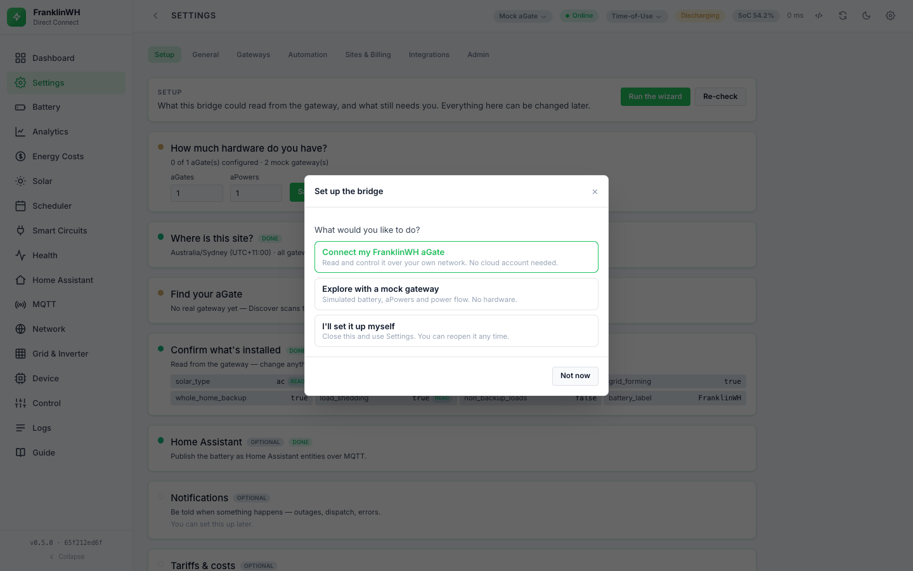
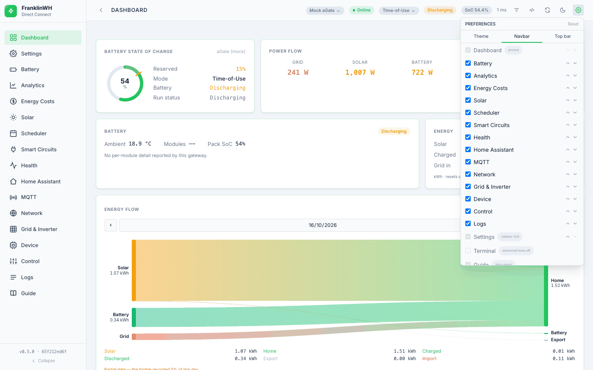
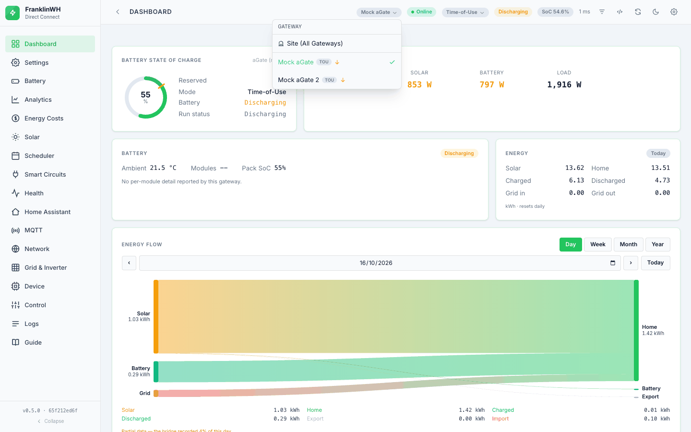
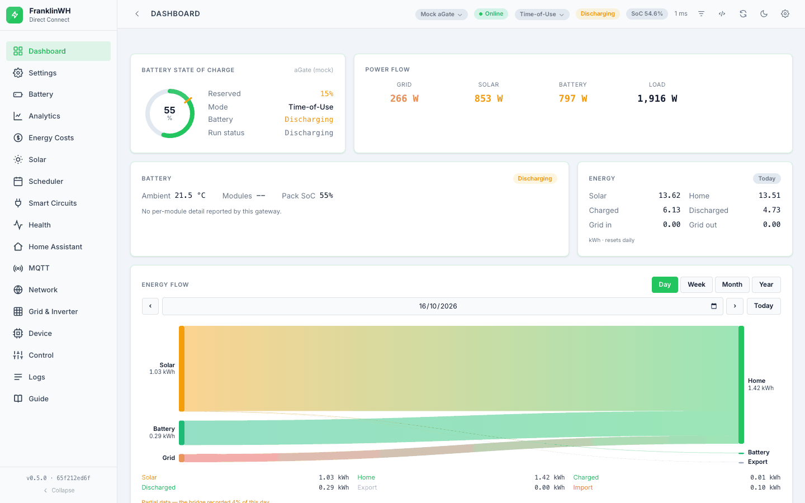
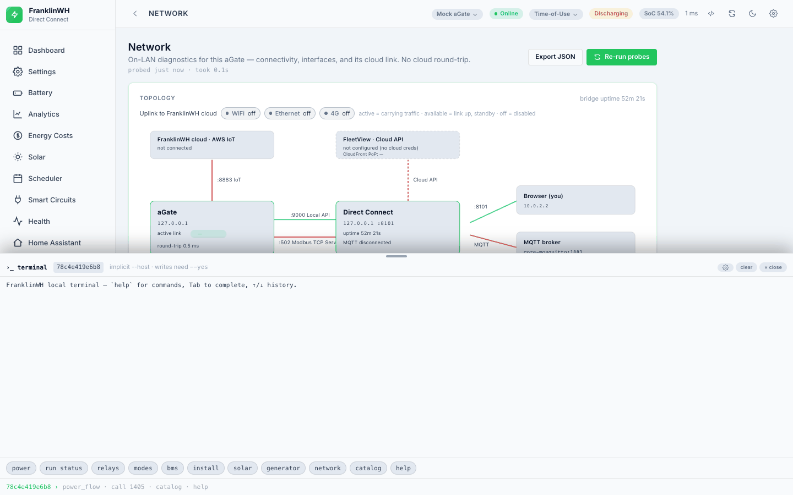
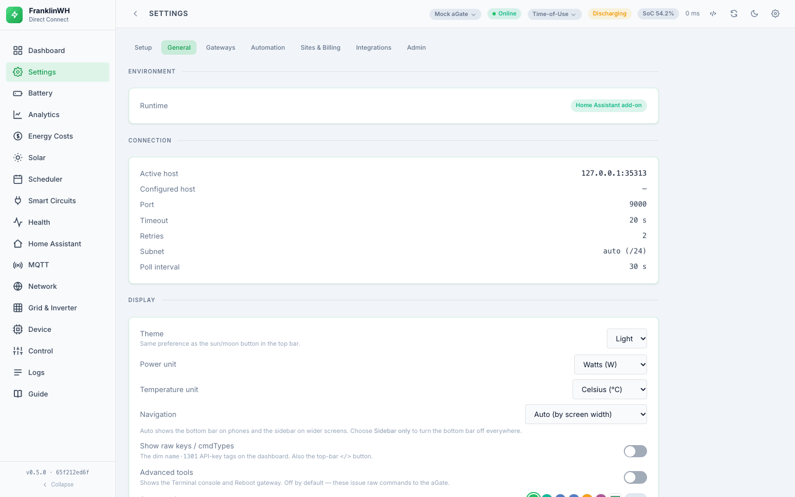
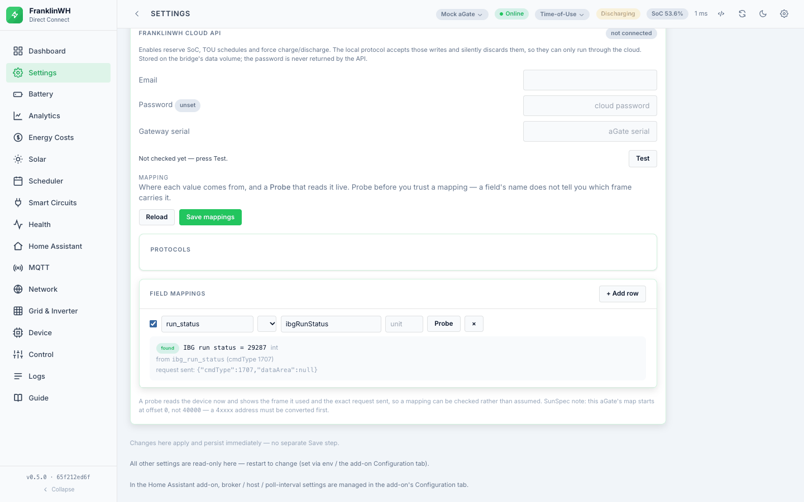

# Tour of the UI

[Back to the guide index](index.md)

---

## First run: the setup wizard

The first time you open a bridge with nothing configured, a modal walks you through the
essentials. It waits for the legal disclaimer, and you can close it at any point — closing
records "skipped", which stops the prompt and disables nothing.

1. **What do you want to do** — connect a real aGate, explore with a mock gateway, or set
   it up yourself.
2. **How much hardware** — how many aGates and aPowers you have. Both default to 1. This is
   what the bridge expects to find; it changes nothing on your system, and the Setup page
   later reports what was found against what you declared.
3. **Where the site is** — one timezone for the whole site, defaulting to your browser's.
   Schedules run on the site's clock, not the container's. Mock gateways are created on
   this clock; a real aGate's clock is set on the device, and Setup names any gateway whose
   offset differs rather than pretending to correct it.
4. **Find it** — Discover scans the LAN for aGates on TCP 9000, or you enter the address.
   The **Ports** box takes a port, list or range to find emulators; any port but 9000 is
   labelled **Emulator**.
   On the mock path, one mock per declared aGate is created, numbered, each with the aPower
   count you gave.
5. **Confirm** — what the gateway reports, one line per fact (gateway model, batteries,
   grid, modes, solar, generator, Smart Circuits, V2L) marked **Confirmed** or **To check**.
   Tap a line to see where it was read from and confirm it; one line is open at a time.
   Anything wrong is correctable in Settings.

Everything optional — Home Assistant, notifications, tariffs — is deferred and says so.

### The setup list

When those steps are done, the wizard opens on a **setup list**: everything else worth
setting up, each marked **Done** or **To do**. Reopening the wizard on a bridge that already
has a gateway (Settings → Setup → **Run the wizard**, or the dashboard banner) goes straight
to it, and closing it is not declining setup.

Three cards head the list (#741):

- **Automatic** runs the guided path for one aGate and its aPower. A step that is already
  done is passed over, and every question has a **Skip**:
  1. **Where the site is**, if the timezone is not set yet.
  2. **Find it**: Discover, or enter the address (passed over when an aGate is connected).
  3. **Confirm** what the aGate reports.
  4. **Link Home Assistant**: its address and a long-lived access token, with **Test** and
     **Save**. It is asked early so the bridge can check Home Assistant before publishing.
  5. **Existing Home Assistant entities**: see
     [below](#existing-home-assistant-entities). Always shown; it changes nothing by itself.
  6. **FranklinWH cloud** sign-in.
  7. **Modbus client** (this bridge): where it reaches the aGate's Modbus TCP Server. When
     the Modbus Bridge already publishes this aGate, it warns that two Modbus writers can
     work against each other; skip it unless the other one's writes are off.
  8. **Publish to Home Assistant** (MQTT). When another integration already publishes this
     aGate, **No** is suggested, so the same battery is not shown twice.
  9. **Summary**: each part marked **Done** or **Skipped**, and **Custom setup** for the
     rest. More aPowers than one are all read through the aGate; more than one aGate found
     is said, and the others are added from Custom.
- **Mock** runs the mock path: a simulated gateway to look around, never published to Home
  Assistant.
- **Custom** (advanced) is the list itself: set up each part yourself.

- **Essentials**: Connect to FranklinWH Cloud · Publish to Home Assistant (MQTT) · Connect
  to Home Assistant · Electricity utility, pricing & billing · Default operating mode ·
  Automatic scheduling.
- **Advanced**: HA notifications & devices · Security · User & API accounts · System View ·
  Connect to FranklinWH Gateway Emulator · Modbus TCP · Existing Home Assistant entities.

**Set up** answers it in the wizard (the cloud sign-in, publishing, the default mode, the
Gateway Emulator, Modbus TCP and the existing Home Assistant entities),
then **Done** brings you back to the list. **Open** takes you to the Settings card, tab or
overlay that already does it. **Start again from the first steps** re-runs the steps above.

**Connect to FranklinWH Gateway Emulator** adds an emulator as a gateway: its address and
Direct Connect port (the bridge's `fwh_port` to start with). **Modbus TCP** turns this
bridge's Modbus client on or off and sets where it connects: blank uses the active
gateway's address with the Modbus TCP Server port (`modbus_port`, or a port typed here). A
gateway added as `address:port` uses that port for Direct Connect only; its Modbus TCP
Server is still reached on the Modbus port. **Test** connects to it now.

Every change made here, and every Test, writes a line to **Logs** and a row to the
**Audit trail** (Logs → Audit trail), saying whether it worked. None of them needs a restart.

**Settings → Setup** is the same content, reachable for ever: every step reports whether it
is already satisfied, so a second pass shows current state rather than blank fields.
Below the install steps it lists everything worth setting up after install, as the wizard's
list does: **Essentials** (FranklinWH Cloud, MQTT, Home Assistant, utility and billing,
default mode, automatic scheduling) and **Advanced** (notifications, security, accounts,
System View, emulator, Modbus TCP). Each shows **Done** once set up; **Set up** / **Open** goes
straight to where it is set up, or opens that step of the wizard.

---

### Existing Home Assistant entities

Before anything is published, the bridge lists the FranklinWH entities Home Assistant
already has (#741), read from two places:

- **The MQTT broker**'s retained discovery messages: the broker publishing uses or, as a
  Home Assistant add-on, Home Assistant's own broker before publishing is on.
- **Home Assistant**, once it is linked: its FranklinWH MQTT devices on any broker, and
  entity ids ending in `_2` whose original still exists.

Each row says whose they are and what to do:

- **This bridge (removed gateways)**: entities left by a gateway that is gone. Home
  Assistant re-creates them on every restart. **Remove** clears exactly the count shown,
  after a second click to confirm. It needs publishing on; until then, use the MQTT tab later.
- **Another integration** (the Modbus Bridge, FWHAI, another Direct Connect bridge):
  reported only, never changed. When it publishes the same aGate, keep one, or turn off
  its publishing.
- **`_2` duplicates**: an older entity holds the name. Remove the old one in Home
  Assistant → Settings → Entities, then rename the `_2`.

Integrations that are not MQTT are not listed, except the one below.

### The FranklinWH integration (richo)

When Home Assistant has richo's FranklinWH integration (`franklin_wh`) loaded (set up and
running; a disabled integration is not loaded), the check says so, with how many entities
it has and when it last updated (for example "last updated 2 minutes ago"). The bridge
publishes its own entities, so while both run you have two sets. Turn it off when you're
ready: it is set up in YAML (version 2026.3.0 has no setup from the UI), so in
`configuration.yaml` remove, or comment out with `#`, its `platform: franklin_wh` entries
under `sensor:` and `switch:`, then restart Home Assistant. Its history stays; put the
entries back to turn it on again. The bridge never
takes over or changes that integration or its entities. **Keep both** hides the note for
good.

What the bridge adds over that integration (version 2026.3.0, which polls the FranklinWH
cloud and has whole-system power and energy sensors and Smart Circuit switches):

- Reads the aGate on your own network; the FranklinWH cloud is optional.
- Operating mode, reserve and battery dispatch controls in Home Assistant.
- The scheduler, with actionable notifications on your phone.
- Alerts when the aGate can't be reached, its data stops, or a command or schedule fails.
- Each aPower's charge, health and state in the bridge.

## Getting around

The bridge has one navigation registry and renders it two ways. On a wide screen you get
the **sidebar**; below roughly 768 px you get a **bottom bar** that fits as many tabs as
the width allows (about one per 64 px, minimum four) and puts the rest under **More**.
Both show the same tabs in the same order — they are generated from the same list, so
they cannot drift apart.

You can change all of this:

- **Settings → General → Navigation** — `Auto` (by width), `Sidebar only`, or
  `Bottom bar only`.
- **Topbar cog → Customise → Navbar** — show/hide tabs and reorder them (see
  [Customise](#customise) below). **Dashboard** is pinned
  first everywhere and cannot be hidden; **Settings** cannot be hidden either and is
  hoisted to second place in the sidebar (in the bottom bar it floats, because bar slots
  are scarce). A tab you hide is still reachable under **More**.
- Clicking the logo collapses the sidebar to an icon rail with hover labels.

Preferences are stored in your browser (`localStorage`), so they are per-device and not
shared between phone and desktop.

### Customise

**Topbar cog → Customise top bar, navbar and cards…** opens one dialog with three tabs:
**Top bar**, **Navbar** and **Dashboard cards** (#585). The Dashboard's **Cards** button
opens it on **Dashboard cards**. Each row has:

- a **drag handle** (≡): drag the row to its new place, with a mouse or a finger;
- **up / down arrows**, to move it one place (also from the keyboard);
- a **switch** to show or hide it.

Changes are saved as you make them. **Undo** steps back one change at a time, and
**Reset** puts the tab you're on back to its defaults. **Done** closes it. Theme and
accent stay in the cog.

## The top bar

Everything here except the connection chip and the cog can be turned on or off, and
reordered, from **Topbar cog → Customise → Top bar** (Centre indicators / Right buttons).

| Item | What it tells you |
|---|---|
| **Gateway selector** | Which aGate every tab is scoped to. Only appears when more than one gateway is registered. |
| **Connection** | Online / offline for the selected gateway. |
| **Operating mode** | The active mode. Tap to switch. |
| **OFF-GRID** | Islanded. Distinguishes `OFF-GRID · OUTAGE` (the grid went) from `OFF-GRID · SIMULATED` (someone asked for it). Tap it for the Off-grid dialog: why, how long, time left, and Reconnect. |
| **FORCE** | This bridge is holding a force (Battery force or a schedule). |
| **VPP** | Another remote controller has the aGate: its programme id (1707) is 9 and this bridge holds no force. With the Cloud API the tooltip also names the programme. |
| **DEBUG MODE** | Run status 8. |
| **Run status / SoC / latency** | Charging / discharging / standby, state of charge, round-trip time to the aGate. While the aGate is offline, the run status reads **Unknown (offline)** and the SoC is greyed; hover for when it was last read. |
| **Cards** | On the Dashboard only: opens Customise on **Dashboard cards**. |
| **`</>`** | Raw-key toggle — reveals the underlying `cmdType` behind each displayed value. |
| **Release** | Appears *only while a force dispatch is active*, on every tab, so you can stop it from anywhere. |
| **Signed-in user** | Who is signed in. Click it for the role and **Sign out**. Shown only when someone is signed in: Security on, or Home Assistant's sidebar (which shows the HA user, without Sign out). |
| **Refresh · theme · cog** | Re-poll, light/dark, and the cog: theme, accent and **Customise**. |

**System view** (its top-bar button, or System view in the sidebar) opens a picture of the
site over the page: grid, aGate,
home, solar, batteries and circuits, with the power flowing between them. **Options** is a
drop-down over the diagram (zoom, Customise diagram, the switches below and Start on System
view); a click outside it or Esc closes it. Five extras each have their own switch, off until
you turn them on and remembered in that browser: **Voltage & frequency** under the grid, **Today's energy** in kWh under each
picture (grid in and out, solar, home, battery charged and discharged), **Power on wires**
(the kW on each wire, with an arrow the way it goes), **Alarms** (a count on the device;
tap it to list them) and **Solar forecast & actual**. That last one is a box on the diagram's
left (above it on a phone) with today's solar forecast, the actual so far and what the
forecast says is still to come, with a bar of actual against forecast. The forecast is the
Solar tab's, for the gateway's site; without a site location and PV size there is no box.

**Zoom:** − / Fit / + under Options, pinch, or Ctrl+wheel. A site's diagram on a phone opens
as wide as the screen and scrolls down; **Fit** (or − from there) shows all of it, and +
goes back to full width.

**Smart circuits** is the other way round: shown until you switch it off, and the diagram is
laid out again without them.

Smart circuits show the names saved on the aGate (set in the FranklinWH app), as the Smart
Circuits tab does. **Options → Customise diagram** changes a name or picks a picture for
the diagram only; with several gateways, its **Gateway** picker shows one gateway at a time,
starting on the one shown.

**Several aPowers on one gateway** are one battery, labelled *Batteries ×4* (the count the
aGate reports), with the aGate's charge and power. Hover over it (or tap it) for each aPower
on its own line: aP1, aP2 … with its charge, current and BMS state, as on the Battery tab;
its details add each one's state of health. The bridge reads each aPower once a minute
(#703).

**A site with several gateways** is one diagram. Gateways whose meters belong to the same
site (Billing & Utilities → Plans & meters; see `docs/guide/multi-gateway.md`) are drawn
together: the grid and the site's service meter on the left, then one row per aGate with
its batteries, solar, smart circuits and home. The gateway chosen in the top-bar picker is
highlighted; tap another aGate to choose that gateway instead. A gateway alone on its site,
or with no meter, is drawn on its own as before.

**Alarms** come from four places, each shown only once it has been read:

- **The FranklinWH app's active alarms**, when the bridge is signed in to the FranklinWH
  cloud: read with the cloud status pass (every 5 minutes) and shown on the aGate as a
  count ("2 active alarms in the FranklinWH app"); open the app for what they are.
- **An aPower's alarm level**: each aPower reports one with its cell readings; anything but
  0 shows on that battery ("aPower 2: alarm level 3"). Read every 5 minutes.
- **The aGate's event log**: only how many events it holds can be read locally, so more
  than none shows on the aGate as a count. Read every 15 minutes.
- **The bridge's own alerts that matter now**, on the aGate: a condition still active
  ("aGate unreachable (since 15 Nov 14:34)") and an event not yet acknowledged ("Command
  refused (15 Nov 09:02)"). A condition that has cleared stays in the alert list until it is
  acknowledged, but isn't shown on the diagram, which is the system now.

## The tabs

Eighteen tabs, from the registry in `static/js/app.js`. Two entries in the nav are not
tabs at all: **Terminal** opens a console drawer, and **Guide** opens the bundled
protocol documentation.

| Tab | For |
|---|---|
| **Dashboard** | The at-a-glance view, built from ten cards you can individually hide and reorder: State of Charge, Power Flow (each source with what it is doing — Charging, Exporting — and a **Now / Today** toggle for today's kWh), Battery, Energy, Energy Flow (the Sankey), Operating Mode (the modes in the FranklinWH app's order, with the per-mode reserves and a **Set** button), Diagnostics, Solar Forecast, Power History and Live Points. While the aGate is offline, the State of Charge, Power Flow and Battery cards keep the last values read, greyed, with **Last reading HH:MM (N min ago)**, and the battery state reads **Unknown (offline)**. Cards fit their width: when a card is narrow (three across from a 1024 px window with the sidebar open), State of Charge puts its values under the ring and Energy goes to one column, so nothing is cut off; on a phone the cards stack one per row. |
| **Battery** | Per-aPower BMS detail — cell voltages, temperatures, pack SoC/SoH, electrical and state readings. **Record** on the live trend keeps it on the bridge from then on (at least every 5 s, up to a day, or until Stop). **Recording** starts a recording by hand, and **Scheduled recordings** start one at a time of day on the days you tick, on the site's clock. **Charts** lists the recordings and charts cells over time; the list folds away (on a phone, once you pick one) so the chart has the width, and on a phone what to chart (Voltage, Temperature, Comparison; All cells, Average, Median) is a drop-down. A read the aGate takes over a minute to answer says so, with **Try again**; it says it is showing the last good reading only when there is one. A failed read (the aGate dropped off) doesn't use up a planned sample, so a recording carries on once the aGate is back; it gives up after an hour with no good read. Each recording shows why it ended (completed, stopped by whom, or the aGate unreachable), and the Logs show who started and stopped it. |
| **Solar** | Solar production detail. The *forecast* is not here — it is the Solar Forecast card on the Dashboard (see [History and costs](energy-and-costs.md)). Hidden, with the Dashboard's Solar Forecast card, when there is no solar: the gateway reports no AC PV ports and no remote solar, or **System Setup** says none (DC solar is set there). Until the gateway has been read it stays. |
| **Smart Circuits** | The aGate's controllable circuits: state now, and on/off control. |
| **Generator** | Generator status, metrics and configuration. **Hidden entirely unless a genset is present** — the bridge would otherwise show a permanent 0 W. |
| **Analytics** | Longer-horizon charts from the bridge's own SQLite history. |
| **Billing & Utilities** | Billing: setup steps, this period so far, the bill's lines, closed periods, and your sites, meters, retailers and tariffs (Plans & meters). See [Billing & Utilities](energy-and-costs.md#billing-utilities). |
| **Smart Dispatch** | A 24-hour battery plan for your target and your utility's limits, with the action now and why. **Create schedules** adds the plan to the Scheduler as one-off tasks, and **Auto** can do it every hour (Shadow first); the tab itself never controls the battery. See [Smart Dispatch](hems/smart-dispatch.md). |
| **Scheduler** | Time-based automation. See [Scheduler](scheduler/index.md). |
| **Control** | Everything you can *do* to the selected gateway, in one place. Its audit trail is under Logs. See [Control](control.md). |
| **Grid & Inverter** | The grid power-plane limits (import/export enables, soft and hard limits). Advanced, and the write is **unverified** — see [Control](control.md). |
| **Home Assistant** | HA instances, which HA entities to expose to the scheduler, notification devices, and a dashboard-card YAML generator. |
| **MQTT** | What the bridge publishes, which entity groups are enabled, and a scan for other FranklinWH publishers on the same broker. |
| **Network** | The connection picture end to end: round-trip latency to `:9000`, the Modbus TCP Server (aGate `:502`) from the Modbus client's (this bridge) last real connection (green only if it succeeded since the aGate's link last came up; grey and dashed "unknown · last OK HH:MM" when older or while the link is down; the bridge never probes `:502`), MQTT, AWS IoT, the CloudFront edge the bridge's cloud calls reach (per period: Today, 7 days, 30 days or all kept; the PoP each request went to, how long it stayed on each, the cloud calls by HTTP verb, and errors and retries by type; **Map** shows each PoP at its city, with online map tiles), link history, missed polls, consecutive failures. **Latency test**: **Ping aGate** sends 5 round-trips to the Local API (`:9000`); **Watch** pings it once a second until **Stop** (it stops by itself after 15 minutes or when you leave the page; one run per gateway at a time), with running min / avg / max / loss and each drop-out's start and length. Below it, **Drop-outs in the last 24 h** lists the drop-outs the bridge's own polls recorded (after 3 failed polls in a row), with their length and error, so a drop nobody watched still shows; this sends nothing extra to the aGate. Neither touches the Modbus TCP Server (aGate `:502`). The first place to look when something feels slow. |
| **Device** | Device identity and raw readings — model, firmware, serial — and a browser for individual `cmdType` reads. |
| **Health** | A per-gateway connection panel: host, online/offline, round-trip latency, `Modbus :502` as Up / Down / **Not probed** (from the Modbus client's last real connection; nothing probes :502 to show it), ping, whether the host was rediscovered, MQTT, whether writes are enabled, firmware and serials, with a Refresh that forces a fresh probe. |
| **Logs** | The bridge's own log, stored in SQLite: searchable, paginated, filterable by level and source, with a **Live** follow mode and an export. Control actions, cloud calls and connection events all land here. |
| **Settings** | The configuration hub. Sub-tabs: **General**, **Gateways**, **Automation**, **Billing & Utilities**, **Location & Prices**, **Integrations**, **Admin**. |

### Terminal

A command console in the browser, for the bridge's CLI-style operations. It is behind the
**advanced tools** gate, which is **off by default** and remembered per browser; with the
gate off, the Terminal entry does not appear and the drawer cannot be opened. Commands
get an implicit `--host`, and anything that writes requires `--yes`.

### Logs

<!-- screenshot needed: the Logs tab, with the level tiles, filters and table -->

The **Logs** tab has two sub-tabs. **Bridge log** shows the bridge's own log lines, newest
first, in bridge-host time, and refreshes every 10 seconds. **Audit trail** lists every
consequential control (off-grid, reconnect, reboot, mode and Modbus changes, cloud sign-ins,
setup) with its source, detail and result; see [Control](control.md).

- **Level tiles** — DEBUG, INFO, WARNING, ERROR and CRITICAL, each with its count. Click a
  tile to show only that level; click it again to clear it.
- **Search messages…** — filters on the message, source and level.
- **All sources** and **All levels** — pick one source (logger) or one level.
- **Time range** — Last 1h, Last 6h, Last 24h (the default), Last 7 days or All time. The
  box shows the range that is loaded. It used to show "Last 1h" while it loaded the default
  24 hours, so lines from hours earlier appeared under "Last 1h" (#614).
- **Live** / **Paused** — click to stop the 10-second refresh, so the view holds still
  while you read. Click again to resume.
- **Export** — downloads the lines currently shown, with your filters, as a `.log` file.

The footer says how many lines are shown, and when the range holds more than were loaded.
To find a scheduler decision, the Scheduler's **History** view is usually quicker; see
[Scheduler → Outcomes and audit](scheduler/outcomes.md#activity-log-results).

### Sign-in and users

Accounts, roles and sign-in are under **Settings → Admin → Security** (from 0.5.32). New
installs have it on; an upgraded install keeps it off until you turn it on. See
[Security](security.md).

### Settings, by sub-tab

- **General** — runtime (add-on or standalone), connection (host, port, timeout, retries,
  subnet, poll interval), display and navigation preferences, log level, the Guide link,
  the **Support info** bundle, local history settings, and the legal disclaimer.
- **Gateways** — add, edit, enable, remove; **scan** a subnet to discover aGates; add an
  in-app **mock** gateway. See [Multi-gateway](multi-gateway.md).
- **Automation** — **Automation Constants** (min discharge SoC, max charge SoC,
  demand-charge min SoC, battery capacity, default operating mode). Under battery capacity,
  **Derive from aPower** starts on the aPower model and count read from the gateway on
  screen, and names it (*read from House*); **Fill** multiplies them. The constants themselves are *not* read
  from the aGate; you set them here and they become `const.*` sensors in the Scheduler.
  Also **System Setup**, the install profile.
- **Billing & Utilities** — sites, meters, retailers and tariffs: the same editors as the
  **Billing & Utilities** page's **Plans & meters**.
- **Location & Prices** — the site's **Location & Solar** (forecast location and array) and
  **Prices**: the price signal for automation and the price events (spike, demand window).
- **Integrations** — MQTT broker, notifications, battery dispatch, the Cloud API
  credentials, and **Integration → Mapping** (below).
- **Admin** — storage, vacuum, database backup / restore / download.

**Support info** is worth knowing about before you file a bug: it produces a deliberately
redacted snapshot — models, firmware, counts, settings, and explicitly no serials, host,
location or credentials — as text, JSON or CSV, to paste into an issue.
Its **install** line says which installation sent it: a random install id made on the
first start, how the bridge was installed (Home Assistant add-on on HAOS or Supervised,
Docker, Podman, pip, or a source checkout), the OS and CPU, the Python version, the Home
Assistant version on an add-on, the install date with the version first installed, and
the version now. The id never leaves the bridge unless you paste the support info.

### Integration → Mapping, and the Probe

Under **Settings → Integrations**. A *mapping* is a name this bridge uses paired with
**where the value comes from**. Three things live here:

**Protocols** — the transports a mapping can name, each with an honest `implemented`
flag. Implemented today: Direct Connect (TCP 9000), SunSpec / Modbus TCP, Modbus Bridge
REST, and the FranklinWH Cloud API. Listed as visible placeholders marked "To be
implemented": MQTT, Home Assistant WebSocket and generic REST. A placeholder shows the
intended shape, and the API **refuses to save** one — so it can never become a stored
configuration that fails at runtime.

The SunSpec entry carries a caveat worth repeating: **this aGate's register map starts at
offset 0, not 40000**, so a `4xxxx` address from a document has to be converted first.

**Field mappings** — rows of name, protocol, raw field and unit, enabled or not.

**Probe** — the useful part, and read-only by construction. Type a raw field name
(`ibgRunStatus`, say), and the bridge finds the frame itself and returns:

- the live value, and its **decoded meaning** where an enum exists, so a bare `9` is not
  left for you to interpret;
- the `cmdType` it came from, with that command's description;
- the field's label, unit and group where the schema knows them;
- **the exact request that was sent** — the frame itself, not a reconstruction.

Only read methods are reachable, so a probe cannot write. If the field is in no read
frame you get a 404 that lists which frames were tried and suggests why (another channel,
a different name on the wire, or a field that only appears in some states).

This exists because "which frame carries this field" kept being inferred from field names
and neighbouring code, and the inferences were wrong: VPP was declared absent from the
local API when it is `1707 ibgRunStatus` rather than `1301 run_status`; `gridLineVol` was
cited from 1708 when it is 1707; `isThreePhaseInstall` was read as grid topology when it
is a solar field. Each would have been a two-second probe. If you are about to write down
what a field means, probe it first.
